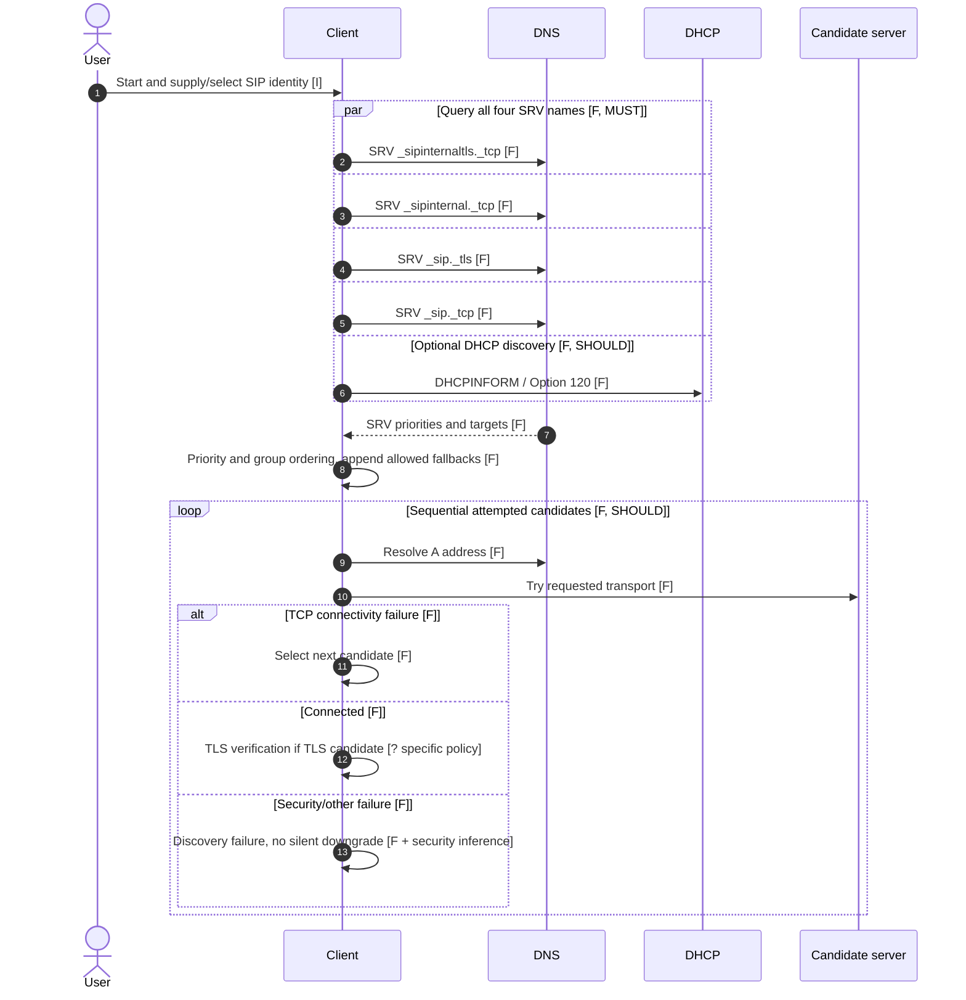
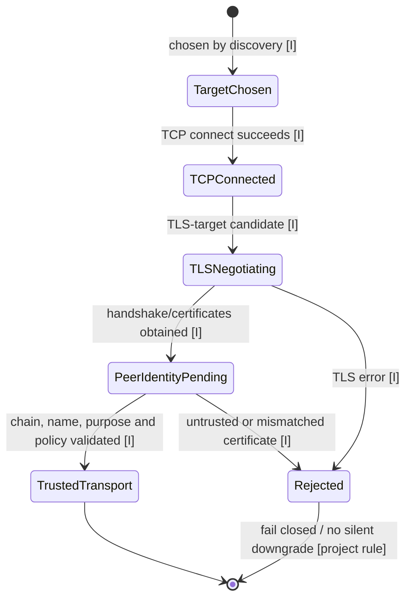
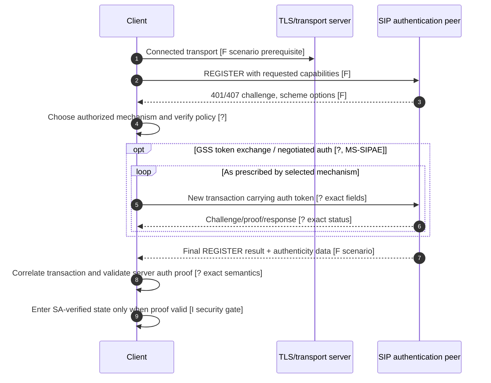
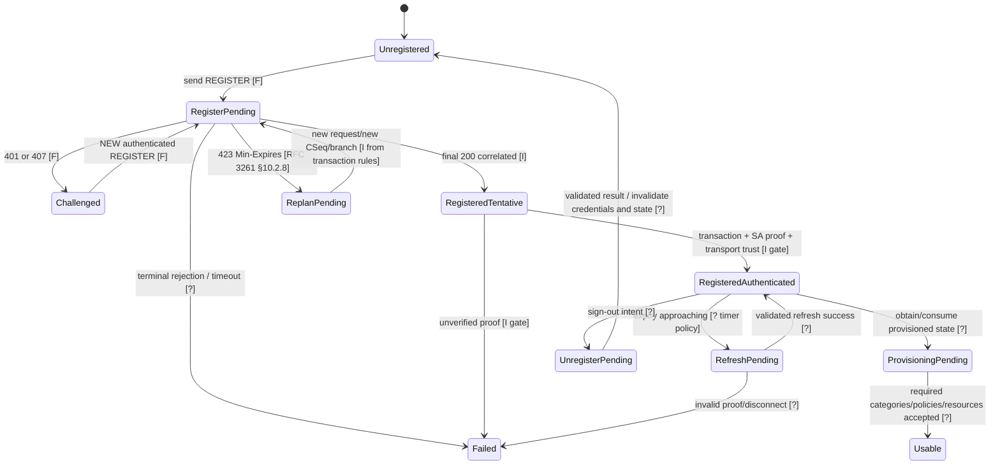
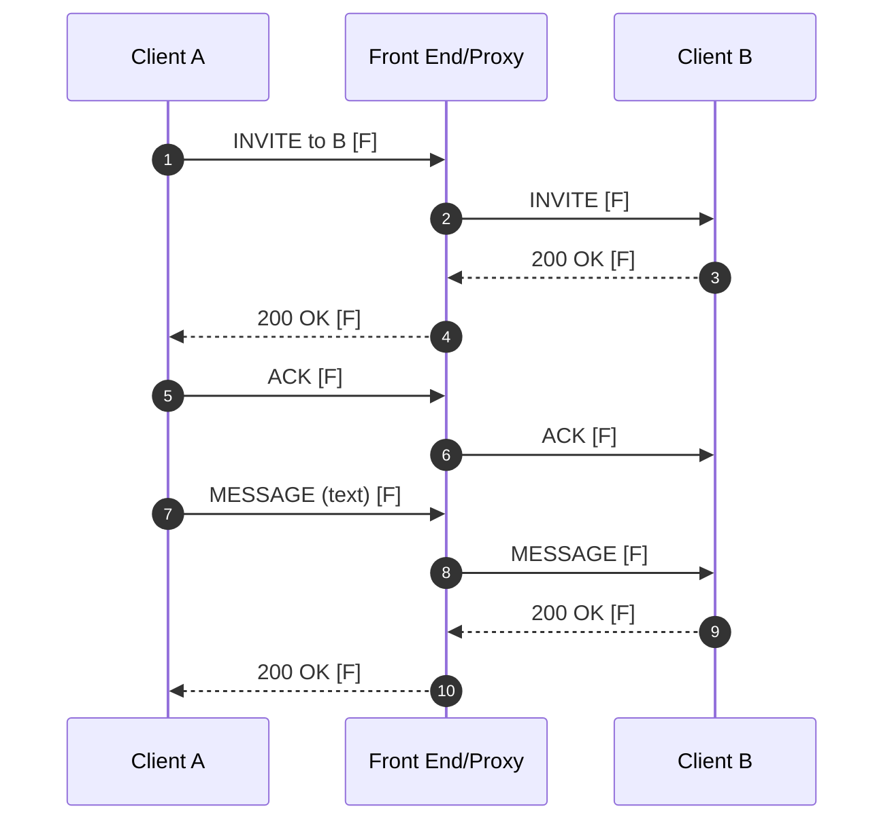

# Windows Full Client message flows and state models (DRAFT v0.1)

**Status: scenario-level / partial.** These are architecture reconstruction aids, **not** complete Microsoft client state machines. Each step is marked `F` = directly documented scenario/clause, `I` = engineering inference, `?` = not yet verified. No sequence diagram licenses transmitting requests or skipping trust checks.

## 1. Startup, discovery, connection

**Sources:** [MS-CONMGMT §3.1.5](https://learn.microsoft.com/en-us/openspecs/office_protocols/ms-conmgmt/40d79c10-2275-4e52-bb4b-67c703d092c3) (live text; landing revision 10.0 from 2025-05-20); [RFC 2782 §3](https://www.rfc-editor.org/rfc/rfc2782#section-3); relevant MS-OCSPROT protocol overview [§2.2.2.1](https://learn.microsoft.com/en-us/openspecs/office_protocols/ms-ocsprot/bdcd1606-11c6-4457-a708-3d1c296259a0), overview revision 9.0.



The discovery client may finish queries early by specified precedence rules; the above parallel diagram does not specify result aggregation timing. **OPEN**: DHCP message exact wire, DNS negative caching, SRV weight order reconciliation, target certificate name/port handling, proxy / redirects and transport-level timers.

## 2. TLS handshake, certificate identity and trust

**Sources to review before elevating any transition:** [MS-CONMGMT](https://learn.microsoft.com/en-us/openspecs/office_protocols/ms-conmgmt/9f6ebbf0-9000-4dc8-86cd-ebfe22467cbf) rev 10.0 (certificate and connection sections **not yet fully reviewed**), [RFC 5280](https://www.rfc-editor.org/info/rfc5280), [RFC 5246](https://www.rfc-editor.org/info/rfc5246), [RFC 8446](https://www.rfc-editor.org/info/rfc8446), [RFC 6125](https://www.rfc-editor.org/info/rfc6125), [RFC 9525](https://www.rfc-editor.org/info/rfc9525).



**No asserted normative details:** TLS ClientHello fields, acceptable algorithms/TLS versions, peer name source and DNS-ID vs service-ID decision, clock skew, certificate revocation and pinning policy are all **OPEN**. `TrustedTransport` alone does **not** authenticate the Skype/SIP user, Kerberos service principal or application session.

## 3. Sign-in: Kerberos, NTLM, TLS-DSK and certificate-related flows

**Sources:** [MS-OCSPROT §2.5.2](https://learn.microsoft.com/en-us/openspecs/office_protocols/ms-ocsprot/45e475a0-b534-469a-892e-6bd6ae42fc6e), [MS-SIPAE](https://learn.microsoft.com/en-us/openspecs/office_protocols/ms-sipae/ba3e9821-fa85-4e0f-a80c-5a4c720a00bd) published rev 11.0. `401/407` and an ensuing authenticated request below are directly described in an **illustrative registration scenario**, not a complete exchange. All GSS/SSPI token loops and TLS-DSK key schedule **OPEN**.



Authentication variants requiring separate per-message truth tables: **Kerberos** (MS-SIPAE and MS-KILE/RFC 4120/RFC 2743; SPN and mutual authentication), **NTLM** (MS-SIPAE and MS-NLMP; challenge and signing), **TLS-DSK** (MS-SIPAE, key/certificate enrollment and channel binding), **certificate/auth web services** (MS-OCAUTHWS and policy), **Digest** only if relevant in the exact client/server deployment. Do not invent mechanism order, mandatory availability, token format, MIC bytes, credential cache use or fallback. Never treat an SSPI handle, 200 OK or offline MIC as signed-in proof.

## 4. REGISTER, refresh, provisioning, sign-out

**Sources:** [MS-OCSPROT §2.5.2](https://learn.microsoft.com/en-us/openspecs/office_protocols/ms-ocsprot/45e475a0-b534-469a-892e-6bd6ae42fc6e), [MS-SIPREGE §3.1.2.5.1](https://learn.microsoft.com/en-us/openspecs/office_protocols/ms-siprege/8b6cbbb4-b398-4b55-847d-950b9a8d3010), [RFC 3261 §§10.2–10.3 and 17](https://www.rfc-editor.org/info/rfc3261).



**Important:** This is a proposed *local validation state model*; the Microsoft standards do not explicitly assert these English labels. **OPEN**: all client-visible flags, provisioning protocol message bodies, register association duration, negotiated keep-alive, supported headers / response errors, unregistration and race cases, multiple endpoints / replication.

## 5. Contacts, presence, 1:1 instant messaging

MS-OCSPROT [§2.5.9 One-to-One IM Session](https://learn.microsoft.com/en-us/openspecs/office_protocols/ms-ocsprot/f27a1335-dfb8-43b3-80d3-5354757c7c0c) documents this scenario (overview revision 9.0); SIP processing remains subject to RFC 3261 and applicable MS-SIPRE/MS-SIPAPP.



**Inference:** SIP 200 acknowledging MESSAGE is **not** an end-user read receipt, even if application displays message sent. OPEN: MS-SIPAPP INVITE negotiation, message MIME/body formats, MS-PRES category publication, BENOTIFY vs NOTIFY, privacy rules, category synchronization, contact list/directory search, transfer of IM history, delivery semantics and offline delivery. Relevant MS-PRES revision 13.0; RFC 3265 vs 6665 revision caveat.

## 6. Audio/video/conferences, media and collaboration

MS-OCSPROT [§2.5.17](https://learn.microsoft.com/en-us/openspecs/office_protocols/ms-ocsprot/aa2e218d-9e1a-40d1-9ff4-58c2b7cd7aad) documents an illustrative multiparty audio call. **The spec warns that asynchronous subflows need not occur in the displayed order.** Some first phase messages are `addConference` (MS-CONFPRO), then `addUser`, `SUBSCRIBE`, conference `BENOTIFY`, focus `INFO`/getConference and conference SDP/ICE/AV media. Diagram below compresses those steps **without** claiming order is universal.

```mermaid
sequenceDiagram
  autonumber
  participant A as Client
  participant Focus as Conference focus
  participant MCU as AV MCU
  participant Media as Media endpoint
  A->>Focus: addConference (MS-CONFPRO) [F]
  Focus-->>A: Response with conference URI [F]
  A->>Focus: INVITE / addUser [F]
  Focus-->>A: 200 OK [F]
  A->>Focus: SUBSCRIBE conference state [F]
  Focus-->>A: 200 OK + MCU identification [F]
  Focus-->>A: BENOTIFY conference state/roster [F]
  A->>Focus: INFO getConference [F]
  Focus-->>A: 202 then INFO response [F]
  A-->>Focus: 200 OK to INFO [F]
  A->>MCU: INVITE + SDP offer [F]
  MCU-->>A: 200 + SDP answer [F]
  A->>Media: ICE connectivity tests [F]
  Media-->>A: ICE replies [F]
  A<<-->>Media: RTP / RTCP media [F]
  Note over A,MCU: SDP re-negotiation may follow; ICE/TURN/Edge details omitted [F/?]
```

**Related documents requiring full separate review**: MS-CONFBAS 15.0, MS-CONFPRO, MS-CONFIM, MS-CONFAV, MS-CONFAS, MS-XMLMC; MS-SDPEXT 16.0; SDP RFC 3264/8866; MS-ICE/ICE2/AVEDGEA/TURN, RTP RFC 3550/3551, SRTP RFC 3711/MS-SRTP/MS-SSRTP, MS-DTMF, MS-H264PF, MS-RTVPF and sharing MS-RTASPF + MS-RDPBCGR. **OPEN:** codec availability and negotiation, device capture, all SDP attribute semantics, AES/key transport, dynamic ports, conference permissions/lobby, video upgrade, REFER/transfer, Enterprise Voice, PSTN, E911, recording and app/desktop sharing security. A SIP/SDP model or roster does not prove any media processing.

## 7. Disconnect, relogin, sign-out, retry and defensive termination

No fully verified Microsoft client recovery state machine is available yet. This graph is entirely an **engineering investigation plan**, not a transcript of a shipped Windows client's behavior.

```mermaid
stateDiagram-v2
  [*] --> Active
  Active --> LinkLost: socket/TLS closed [I]
  Active --> SessionExpired: registration/auth expiry [I]
  Active --> UserSigningOut: user sign-out [I]
  LinkLost --> Quarantine: clear untrusted session state [I]
  SessionExpired --> Quarantine: invalidate stale authorization [I]
  Quarantine --> DiscoveryPending: policy permits reconnect [?]
  DiscoveryPending --> AuthPending: new TLS identity established [?]
  AuthPending --> Active: new SA plus REGISTER and required provisioning validated [?]
  Quarantine --> Failed: terminal policy, certificate or authentication error [?]
  UserSigningOut --> SignedOut: invalidate locally; deregistration behavior [?]
  SignedOut --> [*]
  Failed --> [*]
```



**Do not automatically replay unsafe pending SIP requests after reconnect**. To be normative, review: RFC 3261 §§8–12,17 timers/transactions/dialogs, MS-CONMGMT keep-alives and reconnection, MS-SIPAE SA lifecycle and replay rules, MS-SIPREGE refresh/unregistration, and ICE/SRTP rekey on media connection changes. **OPEN**: which transactions can be retried, provisional responses, overlapping dialogs, transport affinity, server redirect or fallback, retry-after/backoff, server-side policy and error taxonomy. Tests prohibited here per owner; only document requirements.

## Source-level gaps at the research frontier

- Full MS-OCSPROT v9.0 published release PDF/DOCX could not be acquired; exact whole-document comparison not completed.
- Selected live Learn sections may not exactly match the release edition pinned by published-version page; section-level revision matching pending.
- This file contains **scenario diagrams** and investigation states, not an exhaustively verified transition table with every timer / action / guard.
- No invented auth binary message formats, SDP payloads, MS proprietary XML structures or protocol headers.
