# Selected RFC clause-level review (edition-pinned): RFC 3261 and RFC 2782

**Date:** 2026-10-23. **Source identity**: RFC 3261, *SIP: Session Initiation Protocol*, Rosenberg et al., **June 2002** (Obsoletes RFC 2543, many subsequent Updates); RFC 2782, *A DNS RR for specifying the location of services (DNS SRV)*, Gulbrandsen/Vixie/Esibov, **February 2000** (Obsoletes RFC 2052; Updated by RFC 6335 and RFC 8553). Official original texts: [RFC 3261](https://www.rfc-editor.org/info/rfc3261) and [RFC 2782](https://www.rfc-editor.org/info/rfc2782).

**Interpretation:** Detailed study of **selected clauses only**, not whole RFCs. `MUST/SHOULD/MAY` reflect cited editions, not a blanket claim of client applicability. Version reconciliation with MS-OCSPROT 9.0, MS-CONMGMT 10.0 and MS-SIPREGE 17.1 remains OPEN.

## RFC2782 §3 — DNS SRV record encoding and target selection

| Requirement ID | Fact (RFC 2782 original edition) | Consequence / negative case |
| --- | --- | --- |
| RFC2782-03-01 | SRV RR: `_Service._Proto.Name TTL Class SRV Priority Weight Port Target`; type **33**; fields Priority, Weight and Port are unsigned 16-bit network-order integers | DNS reply parser must validate wire lengths, type/class, range, target, no integer overflow; buffer/resource limits are local security controls, not RFC numeric limits |
| RFC2782-03-02 | Lower numeric Priority should be contacted before higher values; clients **MUST** attempt lowest reachable priority target; equal priority weights influence selection, with larger weights more likely | Stable alphabetic sorting is not equivalent to weighted ordering |
| RFC2782-03-03 | For equal priority, described **SHOULD** algorithm: zero weights first in unordered list; take cumulative weights; random selection uniformly from **0..sum inclusive**; select first cumulative total >= random; remove and repeat | Check corner cases: all zero weights; mixed zero/nonzero; RNG upper bound inclusive; no unsafe modulo bias; fallback retry preserves original priority group |
| RFC2782-03-04 | A Target value of **`.`** indicates the service is unavailable | Do not attempt A/AAAA for dot target or promote it to fallback endpoint |
| RFC2782-03-05 | Port specifies service TCP/UDP port; A/AAAA resolution of Target supplies addresses; do not treat SRV records as server identity or TLS trust | Certificate/identity checks governed separately by Microsoft and TLS/PKIX specs |

The equal-priority algorithm is distinct from how **MS-CONMGMT §3.1.5** groups internal/external TLS and TCP queries. Both procedures need a joint result-ordering proof; the Microsoft early-completion rules have not been exhaustively reconciled. Security §5 (DNS spoofing and trust) remains to be audited at depth.

## RFC3261 §§10.2.1–10.2.4 — binding creation, deletion, refresh

| Requirement ID | Fact | Explicit limitation / state implication |
| --- | --- | --- |
| RFC3261-10-01 | REGISTER To header carries address-of-record; Contact lists candidate bindings. `expires` Contact parameter is per-binding; global Expires applies where absent (RFC3261 §§10.2.1, 10.2.1.1). Registrar chooses actual duration per §10.3 local policy | Do not schedule refresh from the client's requested interval alone; parse accepted response; evaluate MS-specific endpoint instance identity |
| RFC3261-10-02 | Removal: for a specific Contact, requested duration **0**; all-binding wildcard `Contact: *` MUST NOT be used unless `Expires: 0` (RFC3261 §10.2.2) | In a multi-device client, wildcard removal would affect other endpoints; constrain own binding and analyze Microsoft GRUU + SIP.INSTANCE behavior |
| RFC3261-10-03 | A successful REGISTER response includes complete current binding list; REGISTER with no Contact leaves the list unchanged (§10.2.3) | 200 response is not equivalent to endpoint being newly inserted; correlate own binding and expiration |
| RFC3261-10-04 | UA **SHOULD NOT** refresh bindings made by other UAs, must refresh own before expiration, and **SHOULD** preserve Call-ID across registration within a boot cycle and target original network address unless redirected (§10.2.4) | Multi-endpoint and restart semantics cannot rely on synthetic local state; preserve explicit ID ownership |
| RFC3261-10-05 | After REGISTER transaction timeout, UAC **SHOULD NOT** immediately retry same registrar; no specific backoff interval imposed by RFC3261 §10.2.7 | Do not invent standardized 5s/10s retry. Implementer may later choose policy, but only after documentation phase |
| RFC3261-10-06 | 423 Interval Too Brief: UA **MAY** retry with all requested Contact expirations >= **Min-Expires** from response (§10.2.8) | `MAY`, not `MUST`: reject absent/malformed Min-Expires; subsequent sending is a new transaction with associated CSeq/branch discipline |

**R-3261-10-X conflict/profiling question:** A generic RFC3261 registration Contact can use URI schemes beyond `sip:`; a Microsoft-specific client may impose narrower security/instance/URI requirements. These constraints must be linked to an explicit MS-SIPREGE/MS-SIPRE clause rather than misattributed to generic RFC3261.

## RFC3261 §§17.1.2.1–17.1.2.2 — non-INVITE client transaction

`REGISTER` and `MESSAGE` use non-INVITE transaction semantics; ACK is **not** part of a non-INVITE transaction. The transaction's state machine must not be equated with application-authentication, provisioning or sign-in.

**Timer defaults in RFC 3261 §17.1.2.2 and §17.1.4:**
- `T1` default **500 ms**, estimate of RTT, network/deployment variation permitted.
- `T2` default **4 s**.
- `T4` default **5 s**.
- `Timer F` **64 × T1**, transaction timeout (default 32 seconds if T1=500ms), across reliable and unreliable transport.
- `Timer E` request retransmissions **for unreliable transport**: start T1 and double up to T2. On a 1xx response, continue at T2 until final.
- `Timer K` linger after final response: **T4** on unreliable transport, **zero** on reliable transport. Do **not** model periodic UDP retransmits on TLS.

```mermaid
stateDiagram-v2
    [*] --> Trying: transmit new non-INVITE; F=64*T1
    Trying --> Trying: E expires on unreliable => retransmit; double capped T2
    Trying --> Proceeding: 1xx => forward provisional
    Trying --> Completed: 200..699 => forward final
    Trying --> Terminated: F timeout
    Proceeding --> Proceeding: E expires on unreliable => retransmit; interval T2
    Proceeding --> Completed: 200..699 => forward final
    Proceeding --> Terminated: F timeout
    Completed --> Terminated: K expires (reliable=0; unreliable=T4)
    Terminated --> [*]
```

**Important protocol separations:**
- **Transaction layer:** handles matching via branch/sent-by/CSeq method and response class (§17.1.3), dispatch and timers; **not** server trust.
- **Registrar binding / authentication layer:** decides whether transaction 200 satisfies registration, and whether the server, token and MIC are verified (MS-SIPAE, MS-SIPREGE).
- **Application/UI state:** signed in only after **all** relevant server auth, registration and provisioning preconditions, never merely after 200.
- **INVITE transaction** is a **different** machine (§17.1.1) with its own ACK/Timer A/B/D semantics; media sessions add SDP offer/answer and dialog state (§§12–13); not analyzed in full here.

**Failure classes yet to detail:** late 1xx after 200, responses for unrelated branch, transport change, target failover mid-transaction, 401/407 re-challenge identity, 408/503/Retry-After semantics, redirects, timer races, conflicting CSeq, dialogs restored after reconnect and malicious duplicate floods. Also examine RFC 4320, 6026 and 6665 update effects before treating legacy 3261 state behavior as universal.

## RFC3261 §10.3 versus MS-SIPREGE registrar extensions

- RFC3261 §10.3 requires registrar processing in arrival order and atomically. It allows Registrar redirect behavior and does not prescribe Microsoft's **Epid/SIP.INSTANCE/GRUU** scheme.
- [MS-SIPREGE §3.1.2.5.1](https://learn.microsoft.com/en-us/openspecs/office_protocols/ms-siprege/8b6cbbb4-b398-4b55-847d-950b9a8d3010) adds specific registration Event/Supported checks, endpoint identity, Presence-State responses and explicit diagnostic error mappings.
- A release-specific **complete** conflict resolution must verify the published MS-SIPREGE 17.1 PDF and the related MS-SIPRE version. Do not assume RFC GRUU final version replaces the draft-ietf-sip-gruu-10 reference.

## Review status

**Complete in this document:** explicitly described paragraphs in RFC2782 §3, RFC3261 §§10.2.1–10.2.8, 17.1.2.1–17.1.2.2, selected §10.3; sources are fixed RFC editions. **Incomplete:** RFC2782 §5, RFC3261 full §§2–27/security plus update graph, every normative reference, errata, interop requirements, Microsoft-edition reconciliation. This is **NOT an RFC3261/RFC2782 complete technical analysis**.
