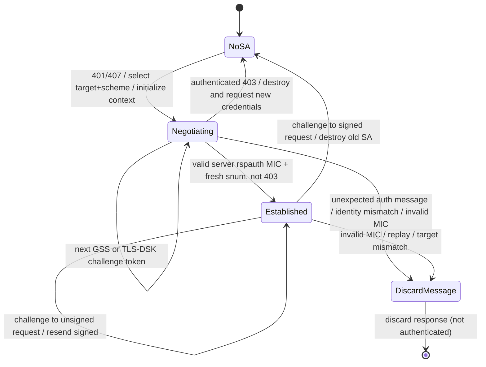

# MS-SIPAE SIP client authentication, signing and replay — selected primary clauses

**Reviewed:** Official live Microsoft Open Specifications pages **[MS-SIPAE] §§3.2.5.1 and 3.2.5.2**; official published landing shows **revision 11.0 (2025-05-20)**, prior revision 10.0 (2024-08-20). **CRITICAL REVISION CAVEAT:** The specific live subsection pages show individual last-updated dates **2021-08-17** (§3.2.5.1) and **2021-11-16** (§3.2.5.2), and the 2025 released PDF was **not obtained or line-by-line reconciled**. The following are accurate **LIVE-CLAUSE / EDITION-UNCONFIRMED** observations, **not claims that published rev 11.0 uses identical normative text**.

Source links: [landing/version history](https://learn.microsoft.com/en-us/openspecs/office_protocols/ms-sipae/ba3e9821-fa85-4e0f-a80c-5a4c720a00bd), [§3.2.5.1](https://learn.microsoft.com/en-us/openspecs/office_protocols/ms-sipae/71b7e07d-505f-4ca6-9577-0a27bd12b0e9), [§3.2.5.2](https://learn.microsoft.com/en-us/openspecs/office_protocols/ms-sipae/26fd795e-5567-4d33-a09b-9c501f7ff01c).

## A-101 Challenge processing (§3.2.5.1): syntax, target identity and SA lifecycle

| ID | Live clause requirement / message shape | State or security consequence | Open review |
| --- | --- | --- | --- |
| SIPAE-CH-01 | On **401** or **407**, inspect `WWW-Authenticate` or `Proxy-Authenticate` respectively (**MUST**). If Digest, the separate §3.2.5.5 flow is **SHOULD** rather than blindly applying the remaining steps. | Scheme dispatch and credential policy before token emission | Digest product applicability, RFC auth updates |
| SIPAE-CH-02 | Find existing **SA** by same `realm` and target identity (**MUST**). NTLM/TLS-DSK target = `targetname` unquoted; Kerberos identity includes `sip/` service descriptor plus unquoted `targetname`. | Prevent cross-realm/target SA confusion, and never reuse an SA solely by IP/username | Exact SPN canonicalization, service trust source |
| SIPAE-CH-03 | Examine `Date` header for clock skew; if authentication fails with excessive skew, prompt for clock correction. For **Kerberos**, reference MS-KILE default acceptable skew **5 minutes**. No specified maximum for NTLM/TLS-DSK. | Clock/time trust affects GSS error handling; 5-minute Kerberos default is **not a blanket SIP timer** | Domain policy behavior; UI, timezone and tamper handling |
| SIPAE-CH-04 | Existing established SA challenged on previously **unsigned** request → resend with signature and stop challenge handling. If it was already signed → **destroy SA** and initialize new SA. | Authentication recovery and stale-SA invalidation | Fresh CSeq/transaction, retry caps and anti-downgrade |
| SIPAE-CH-05 | Existing not-yet-established NTLM or TLS-DSK with `gssapi-data` handles token in current context; decode using **RFC 3548 §3** base64. | Bounded decode, reject malformed token and no context reuse across identities | Exact maximum sizes and auth error treatment |
| SIPAE-CH-06 | **NTLM** intermediate token may generate `AUTHENTICATE_MESSAGE` through MS-NLMP `GSS_Init_sec_context` as described. Initial datagram-mode NTLM `NEGOTIATE_MESSAGE` token may be empty. | Distinguish **present empty** `gssapi-data=""` from absent parameter | NTLM mechanism hardening and fallback policy |
| SIPAE-CH-07 | **Kerberos** obtains a ticket to named service and initializes GSS context requesting `Integrity`, `Identify`. NTLM requests `Datagram`, `Identify`, `Integrity`. | Token acquisition or SSPI handle is **not established authentication** | Mutual-auth proof/check flags and modern OS constraints |
| SIPAE-CH-08 | **TLS-DSK** uses a TLS handshake carried by `gssapi-data` as described; client validates server certificate, locates/generates client certificate, processes handshake tokens. Historic RFC 2246/4346/5246 cited. | Not automatically the same as outer SIP/TLS transport; distinct negotiated context and credentials must be analyzed | Certificate enrollment, TLS version support and legacy crypto policy |
| SIPAE-CH-09 | Challenge `WWW-Authenticate` produces `Authorization`; `Proxy-Authenticate` produces `Proxy-Authorization`. Parameters: mechanism, copied `realm`, `targetname`, optional `opaque`, `qop="auth"`, conditional `gssapi-data`. | Challenge-bound headers; avoid incorrectly sending proxy credentials to registrar and vice versa | Full §2.2.3 ABNF, header multiplicity and folding |
| SIPAE-CH-10 | Version negotiation: version **3** when compatible challenge indicates 3; version **4** if client implements it and challenge indicates >=4. Version 4 includes `cnum`, `crand`, `response` per §3.2.4.1. | Signing and token construction depends on **agreed** version, not hard-coded default | §3.2.4.1 full algorithms + client implementation support |
| SIPAE-CH-11 | Resend original challenged request with produced auth header. | New SIP transaction / correlation rules must be layered with RFC 3261 | Exact Via/CSeq semantics for full client |

## A-102 TLS-DSK key derivation substep (§3.2.5.1)

**As documented in the live clause, not as recommendation to enable historical TLS algorithms:**

1. After successful TLS-DSK handshake and selected TLS-version PRF, form random seed `client_hello.random || server_hello.random`.
2. Compute **128 bytes** of `PRF(master_secret, "client EAP encryption", seed)`.
3. **Client-to-server** auth key: truncated third 32-byte segment; **server-to-client** auth key: truncated fourth 32-byte segment. Hash/output width depends on negotiated suite/PRF and downstream §3.2.4.1.
4. The section cites **RFC 2716 §3.5** as similar construction and explicitly mentions legacy TLS RFC 2246, 4346 and 5246. This is a documented legacy protocol profile, **not authorization** to accept TLS 1.0, MD5, SHA-1 or insecure downgrade. Supported suites for SfB 2019/SE and up-to-date security policy require version-specific review.

Trust boundaries: outer SIP transport peer identity, inner TLS-DSK handshake peer, client cert enrollment and authentication key separation. **OPEN**: how transport session/server certificate is bound to SIP realm and targetname and how rotation invalidates all SAs. This document does not provide executable cryptographic test vectors.

## A-103 Incoming authenticated-message processing (§3.2.5.2)

A message carrying `Authentication-Info` or `Proxy-Authentication-Info` must be matched to an existing SA by **auth mechanism + realm + target**. If no match: **discard**. If matched: construct the signing buffer in **exact order**, each active field value enclosed in angle brackets and using the original header case/syntax even where semantically case-insensitive.

| Buffer position | Source field | Conditional details |
| ---: | --- | --- |
| 1 | Authentication scheme: `NTLM`, `Kerberos`, `TLS-DSK` | Always |
| 2 | `srand` | Always |
| 3 | `snum` | Always |
| 4 | `realm`, unquoted | Always |
| 5 | `targetname`, unquoted | Always |
| 6 | SIP `Call-ID` | Always |
| 7 | SIP `CSeq` sequence number | Always |
| 8 | SIP `CSeq` method | Always |
| 9 | `From` URI | Always |
| 10 | `From` tag | Always |
| 11 | `To` URI | **Only if server auth protocol version >=3** |
| 12 | `To` tag | Always |
| 13 | `P-Asserted-Identity` SIP URI | **Only if version >=3** |
| 14 | `P-Asserted-Identity` tel URI | **Only if version >=3** |
| 15 | `Expires` header value | Always |
| 16 | Decimal SIP response code | **Only for response** |

**Missing-field semantics:** For required/active buffer positions lacking a header, include `<>`; do **not** include an empty position if its version/message-type condition is **not met**. Header case preservation matters for cryptographic canonicalization; semantically equivalent SIP values are not necessarily byte-equivalent for MIC. Do not normalize before constructing this signature input without exact normative review.

1. Decode `rspauth` hex according to **RFC3548 §6**. For **Kerberos** use `GSS_VerifyMic` per RFC2743 §2.3.2; for **NTLM**, as MS-NLMP §3.1.4, the live clause notes a fixed SSPI message sequence number **100**.
2. **TLS-DSK** checks `rspauth` via HMAC per **RFC2104** using the independently derived **server** authentication key and negotiated hash (not client key). Signature mismatch/failure → discard message.
3. Only after valid MIC, check `snum` replay within an SA-specific window: if highest seen exceeds incoming by **more than 256**, or `snum` was already received, discard. A newer maximum advances the window. The window is described as 257 values including highest; exact wrap/integer and initial state must still be reconciled against definitions in §3.
4. If SA is not yet established and a MIC-authenticated **403 Forbidden** response arrives, destroy SA and request different credentials. Otherwise transition SA to `established` and destroy other SAs sharing realm+target; **the authentication state transition alone does not mean provisioning, contact sync and media readiness**.

### Selected failure and threat case register

| Case | Explicit treatment / risk | Source |
| --- | --- | --- |
| 401/407 without matching SA | New SA initiation per challenge rules, not trusting arbitrary realm | §3.2.5.1 |
| 401/407 against signed established SA | Destroy old SA and reinitialize | §3.2.5.1 |
| Unknown target or realm in auth response | Discard | §3.2.5.2 |
| Wrong MIC / corrupted authenticated field | Discard | §3.2.5.2 |
| Duplicate snum or outside replay window | Discard | §3.2.5.2 |
| Valid authenticated 403 while not established | Destroy SA and request other credentials | §3.2.5.2 |
| Missing conditional To/PAI canonicalization bytes | Different signature buffer, rejects proof; exact byte construction mandatory | §3.2.5.2 |
| TLS-DSK hash/key confusion | Potential false authentication if client/server keys mixed; compare §3.2.4.1 | §§3.2.5.1–3.2.5.2 |
| Credential phishing via untrusted challenge targetname | **INFERENCE security question**, not resolved by the two clauses; require trusted target/SPN binding | §3.2.5.1 + MS-CONMGMT pending |

### Partial SA state machine (engineering visualization of these two live clauses)

**Unresolved detail:** Handling of invalid MIC must not be conflated with *destroy SA*, because live §3.2.5.2 says **discard message and stop**; any later SA disposal/recovery is a separately researched policy/section. In a product state machine, `DiscardMessage` is an event disposition rather than necessarily a permanent terminal SA state.

## Precise normative-dependency expansion identified by these clauses

- [MS-SIPAE] §§2.2.3, 3.2.4.1, 3.2.5.1–3.2.5.5, product behavior appendix — more document needed.
- [MS-KILE] section on Kerberos clock skew, SSPI context/tickets; [MS-NLMP] §3.1.4; GSS [RFC2743] §2.3.2.
- **Legacy explicitly cited:** [RFC3548] §§3,6 (base64/base16), [RFC2104] (HMAC), [RFC2716] §3.5 (TLS-DSK-like key derivation), [RFC2246]/[RFC4346]/[RFC5246] (TLS-version handshakes).
- Modern update/obsolescence analysis is **OPEN**: RFC3548 → RFC4648, legacy TLS → RFC8446 in modern deployments; no silent substitution of crypto rules.

**End-state:** These clauses substantially improve auth coverage, but the full MS-SIPAE 11.0 specification, wire grammar, all signing algorithms, version history, security considerations, timers, product behaviors and normative cross-reference closure are **NOT YET VERIFIED**. No code, test or live server action performed.
