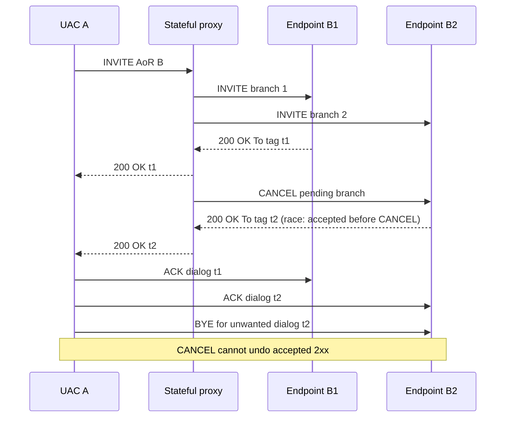

# RFC 3261 and Microsoft multi-endpoint IM: forked INVITE, ACK, CANCEL, BYE race ledger

Research 2026-10-22. First-party normative base: [RFC 3261](https://www.rfc-editor.org/rfc/rfc3261), June 2002 §§9, 12, 13.2.2.1, 13.2.2.4, 15, 16.7, and [RFC 6026](https://www.rfc-editor.org/rfc/rfc6026), September 2010 (updates RFC3261 INVITE 2xx transaction handling). Microsoft original owner-supplied editions previously examined: **MS-OCSPROT 9.0 (2025-05-20) §2.5.11, pp.37–38** and **MS-SIPRE 13.0 (2025-05-20) §§3.2.4–3.2.5, 3.3–3.4**. Source evidence for the latter remains in prior original-PDF research records. No endpoint contact, protocol code or live tests.

## Proven normative RFC3261 race behavior

| Rule | Source | Evidence / condition |
|---|---|---|
| FORK-R01 | §13.2.2.1 | A provisional 1xx with a To tag can create an **early dialog**, each using unique dialog ID. An early dialog is not equivalent to an accepted conversation. |
| FORK-R02 | §§13.1, 13.2.2.4 | A single forked INVITE can yield **more than one 2xx**, distinguished by To-tag. Each distinct 2xx produces a **different confirmed dialog**; proxy selection of one does not make another impossible. |
| FORK-R03 | §13.2.2.4 | **UAC core MUST generate ACK for every received 2xx**. Its CSeq number equals that of INVITE, method ACK, and credentials match INVITE; if 2xx includes an offer, ACK carries the answer. ACK to 2xx is handled by UAC core, sent directly to transport and retransmitted when 2xx is retransmitted. |
| FORK-R04 | §13.2.2.4 | If acknowledged 2xx dialog is unwanted, UAC **MUST send BYE**. To terminate extra accepted fork after race, use distinct ACK then BYE, **not CANCEL**. |
| FORK-R05 | §§9, 9.1–9.2 | CANCEL is **hop-by-hop** and applies only while corresponding INVITE has no final response; final response makes matched CANCEL a no-op on session. Matched CANCEL receives separate **200**; original pending INVITE **SHOULD** receive **487**. |
| FORK-R06 | §9.1 | UAC-constructed CANCEL copies Request-URI, Call-ID, To, From, CSeq numeric value, Via top value and Route (if present); CSeq method becomes CANCEL; **MUST NOT** contain Require or Proxy-Require. Do not confuse CANCEL 200 with INVITE 200. |
| FORK-R07 | §16.7 step 10 | Stateful proxy, on forwarding final response, **MUST** generate CANCEL for other still-pending appropriate branches; however RFC explicitly warns 200 can race on multiple branches before cancellation takes effect. |
| FORK-R08 | §13.2.2.3 | A non-2xx final response ends early dialogs and is ACKed by the INVITE transaction layer; this differs from 2xx UAC-core ACK, and later non-2xx responses are ignored. |
| FORK-R09 | §13.2.2.4 | UAC core accounts for possible late 2xx within **64*T1** after first 2xx, retiring unconfirmed early dialogs thereafter. Do not use the shorter conference-IM sendMessageTimer (10s) as SIP fork timer. |
| FORK-R10 | §13.2.2.4 | If 2xx carries an unacceptable SDP offer, UAC **MUST** still create a valid SDP answer in ACK then immediately send BYE; cannot simply ignore accepted dialog. |
| FORK-R11 | RFC6026 | Updates the handling of successful INVITE transactions and 2xx retransmission/absorption; exact client-vs-server transaction applicability needs individual updating-rules analysis, not blind RFC3261-only state copying. |

## Microsoft-specific applicability

**MS-OCSPROT §2.5.11** depicts B1/B2 receiving forked INVITE, B1 selecting/responding 200 and proxy canceling B2. This is **one successful example**. It does not cancel the RFC3261 possibility of two accepted forks. **MS-SIPRE §§3.2.4–3.2.5** binds endpoint routing to the SIP To epid (and From epid for sending); a SIP dialog also needs Call-ID, local-tag and remote-tag keys, and the remote epid is a separate additional state item. Confirmed dialogs formed by distinct To tags therefore cannot be collapsed merely because they share AoR. GRUU Contact usage further constrains dialog target identity (§3.4.4.1), distinct from REGISTER Contact.

## Conditional multi-2xx sequence (RFC-valid scenario, NOT claim of observed Skype for Business wire)

**Diagram restrictions:** direct ACK/BYE routes are conceptual; RFC3261 route-set/Contact and Microsoft proxy routing determine actual transport hops. The specific order of ACK to B1 vs B2 can vary; no exact total packet ordering guaranteed. Distinguish 200 to CANCEL from 200 to INVITE through method/CSeq and transaction identities.

## Failure/ambiguity gates

- **FORK-01:** 481 CANCEL with no matched transaction vs 200 matching CANCEL; need exact proxy transaction state.
- **FORK-02:** 487 INVITE branch cancellation after 200 CANCEL must not be mistaken for full call rejected if another confirmed dialog survives.
- **FORK-03:** Out-of-order or repeated 2xx must map to unique/reused To-tag dialogs and trigger appropriate ACK retransmission; never create duplicate conversation just because 200 repeated.
- **FORK-04:** MS-SIPAE security association selection and verification still apply to authenticated message traffic. Source does not establish bypass of SIPAE for CANCEL/ACK; scheme-specific exception must be read where applicable.
- **FORK-05:** SIP To epid mismatch silent-discard behavior MS-SIPRE is independent from dialog tags; analyze interactions with proxy rewrite and stale endpoint registrations.
- **FORK-06:** RFC6026 updates transaction server behavior; RFC3261 §13.2.2.4 UAC-core 2xx ACK contract remains the anchor, but edition-appropriate server client transaction updates must be documented independently.
- **FORK-07:** Full product-specific client behavior with two 2xx (display selection, privacy, response authentication, contact routing and timing) not established by high-level MS-OCSPROT example.

**Evidence status:** normative base RFC3261 checked from original RFC Editor and reconciled with previously verified Microsoft 2025 endpoint behavior; no claim of full Microsoft branch implementation or live outcomes. Entire document/reference corpus and complete Windows-client functional state matrix **NOT COMPLETE**. No protocol implementation, real servers, test traffic, merge or release.
