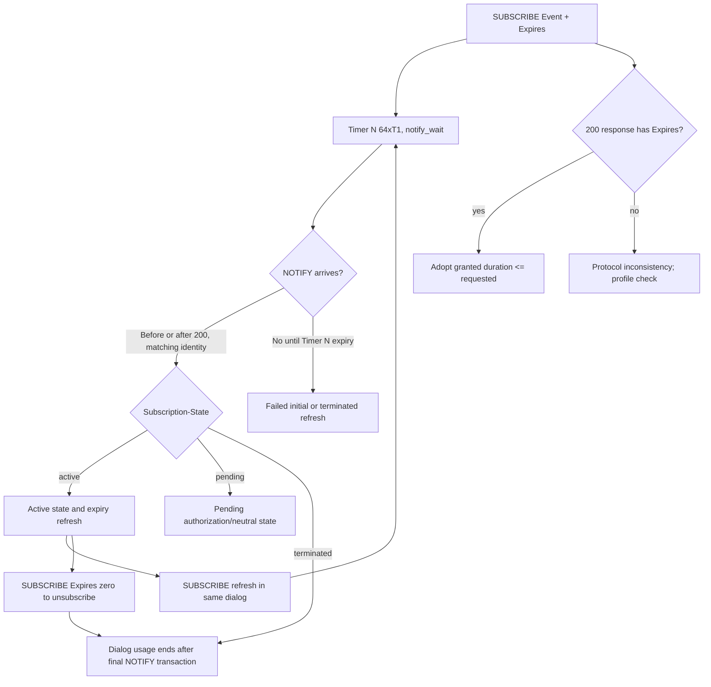

# RFC 3265 → RFC 6665 → RFC 7621: event-subscription lifetime and MS-PRES edition conflict ledger

**Research date 2026-10-22.** Original RFC Editor primary texts individually read for sections below: **[RFC 3265](https://www.rfc-editor.org/rfc/rfc3265)** (June 2002, obsolete); **[RFC 6665](https://www.rfc-editor.org/rfc/rfc6665)** (July 2012, **obsoletes 3265**, **updates 3261 and 4660**); **[RFC 7621](https://www.rfc-editor.org/rfc/rfc7621)** (August 2015, **updates RFC 6665 §4.5.1**). RFC Editor officially lists RFC 3265 updates by RFC5367, RFC5727, RFC6446 before obsolescence; each requires separate applicability audit. Owner-supplied Microsoft source: **MS-PRES v20250520 rev13.0 §§2.2.2.4.1–3, 3.4.5.1–2**, **MS-SIP v20170601 rev8.0 §3.5**, **MS-SIPRE v20250520 rev13.0 §§3.4 and 3.7**, **MS-SIPREGE v20250819 rev17.1**. Normativity of latest IETF update does **not** prove legacy product implementation.

## Precise RFC evidence / client consequence

| ID | RFC and normative section | Proven rule |
|---|---|---|
| EVT-01 | RFC6665 front matter | RFC3265 is **obsoleted**, RFC3261 and RFC4660 updated. Microsoft's later revision still explicitly cites RFC3265. Keep separate `historical Microsoft reference` and `current IETF normative series` fields, not one synthesized 'RFC3265 = current standard' record. |
| EVT-02 | RFC6665 §3.1.1 | Initial SUBSCRIBE duration set by `Expires`; SUBSCRIBE 200-class result **MUST** include Expires, **MAY** shorten but **MUST NOT** lengthen requested duration. Contact-header expires is **not** same as subscription Expires. |
| EVT-03 | RFC6665 §§4.1.2.3–4 | Successful `SUBSCRIBE Expires:0` triggers **final NOTIFY**, possibly with or without resource state. Termination becomes effective at the concluded `Subscription-State: terminated` NOTIFY transaction (§4.4.1), not solely 200 to SUBSCRIBE. |
| EVT-04 | RFC6665 §4.1.2.4 | Subscriber Timer **N = 64*T1** starts on SUBSCRIBE and refresh; absence of NOTIFY by expiry fails initial subscription, or terminates refresh. Before first NOTIFY, resource state is neutral; NOTIFY **may arrive before** 200 to SUBSCRIBE. |
| EVT-05 | RFC6665 §4.1.3 | Incoming NOTIFY must correlate to known outstanding subscription and matching Event/dialog; otherwise **481** unless other suitable 4xx/5xx; unsupported Event → **489 Bad Event**. NOTIFY carries mandatory `Subscription-State` (active, pending, terminated), with relevant `expires`/reason semantics. |
| EVT-06 | RFC6665 §4.4.1 | A new event-dialog usage is established by NOTIFY transaction (unless terminated), route set at subscriber based on **NOTIFY** and **not** merely 200 SUBSCRIBE. Match Call-ID, tags and Event. This differs from naïve INVITE-dialog handling and needs Microsoft special route-set reconciliation. |
| EVT-07 | RFC6665 §8.3.1 | For SUBSCRIBE or NOTIFY, updated framework **MUST NOT send 202**, **MUST treat received 202 same as 200**. Contrast: `202` used by MS-CONFIM **MESSAGE** response has its own conference IMDN delivery handling; this prohibition concerns **SUBSCRIBE/NOTIFY**, not arbitrary MESSAGE responses. |
| EVT-08 | RFC6665 §4.1.3/§4.2.2 | A notifier may send immediate or later NOTIFY; subscriber must authenticate NOTIFY as applicable. A normal NOTIFY is a regular SIP request needing response; **MS-SIP BENOTIFY** specifically says no SIP response, so distinguish its negotiated extension. |
| EVT-09 | RFC6665 §4.1.3 | `Subscription-State: terminated;reason=deactivated` suggests immediate new subscription / migration; `reason=probation` means retry later, `retry-after` conditional. Distinct from MS-PRES RLMI `instance.state=resubscribe` per resource; do not conflate those XML and SIP header status namespaces. |
| EVT-10 | RFC6665 §4.1.3 & §6.5 | Secure request correlation and integrity guard against injected NOTIFY, subscription hijack and spoofed expiration; RFC discusses integrity of Contact, Route, Expires, Event, To. MS-SIPAE MIC/SA and TLS route protections must be validated separately. |
| EVT-11 | RFC7621 §2 revising RFC6665 §4.5.1 | Notifiers **MUST** implement GRUU RFC5627 and **MUST use GRUU local target** for dialog-forming/target-refresh methods **except** dialogs for which all subscription requests would be rejected. If using exception with non-GRUU Contact, notifier **MUST reject** subscription to such dialog (SHOULD 403). Applies also to INVITE-created dialogs. |
| EVT-12 | RFC6665 §§4.4.3 and §4.1.2 | One-shot polling **SUBSCRIBE Expires:0** and persistent subscription have different lifetime semantics. Contrast Microsoft **MS-PRES §3.4.5.1.2** specifically identifies polling when Expires=0 **and no To tag**. |

## Focused cross-spec state diagram (current RFC profile only)

**Diagram does not encode all RFC-proxy forked subscriptions, NOTIFY retransmission/state code combinations, or Microsoft BENOTIFY/piggyback extension.** `J→G` abbreviates final NOTIFY requirement, *not instant teardown upon Expires:0*. The timer values depend on RFC3261 T1; do not substitute conference IMDN 10s timer or SIPCOMP negotiation-specific timer.

## Material Microsoft edition/extension compatibility questions

- **RFC-EDITION-01 (blocking):** MS-PRES §2.2.2.4.1 says RFC3265 §§3.1–3.2; since 2012 IETF recommends RFC6665 with follow-on RFC7621. A 2025 Microsoft document explicitly citing RFC3265 does **not** establish 2012 semantics on every legacy Skype for Business Full Client. Build a per-client-version capability profile and do not silently replace all 3265 rules.
- **RFC-EDITION-02:** MS-PRES category SUBSCRIBE can return `200 OK` multipart/related with RLMI and category data and optionally `ms-piggyback-first-notify`. How it interacts with RFC6665 §4.1.2.4's expected NOTIFY and Timer N must be established using **MS-SIP §3.5 and MS-SIPREGE §2.2.2.2**, including Microsoft's specific special-case first-notify support. Don't claim an incompatibility/protocol violation before full text and product behavior check.
- **RFC-EDITION-03:** Microsoft `BENOTIFY` has unusual no-response rule; ordinary RFC6665 NOTIFY must not be treated as BENOTIFY without a negotiated `Supported/Proxy-Require: ms-benotify` extension and server enablement.
- **RFC-EDITION-04:** MS-PRES §3.4.5.2 permits server to route NOTIFY via fresh **registration** route set rather than subscription route set; reconcile with RFC6665 §4.4.1 route set and MS-SIPRE §3.7 recovery for valid transaction/dialog processing.
- **RFC-EDITION-05:** MS-PRES RLMI `instance.state=terminated/resubscribe` is **resource-level** rejection, not automatically whole-dialog `Subscription-State:terminated`.
- **RFC-EDITION-06:** RFC7621 GRUU requirement and Microsoft registration/contact GRUU (§MS-SIPRE) must be analyzed by **notifier role** and subscription permissions, not assuming any endpoint using a GRUU is always authorized to publish or receive presence.

## Research remaining

1. Read RFC6665 §§4.1.4,4.2.1–4.2.3 full for forking, authentication, probation, notifier failover and state machine details; inspect original 2002 RFC3265 clauses side-by-side for behavioral discrepancies.
2. Audit RFC5367,5727,6446,4660,5839,5627 and their update chains and actual Microsoft normative citation contexts.
3. Read MS-SIP rev8 §3.5 and MS-SIPREGE rev17 product notes in full for event notifications, piggyback and no-NOTIFY exceptional paths. Mark each as current RFC compatibility, historical Microsoft behavior or unknown, not generalize.
4. Verify full contact/group and conference event package capabilities, MSRP/SIP/GRUU privacy and message integrity.

**Overall RFC and Microsoft full-client evidence NOT COMPLETE.** No new protocol implementation, genuine server tests, merge or release.
