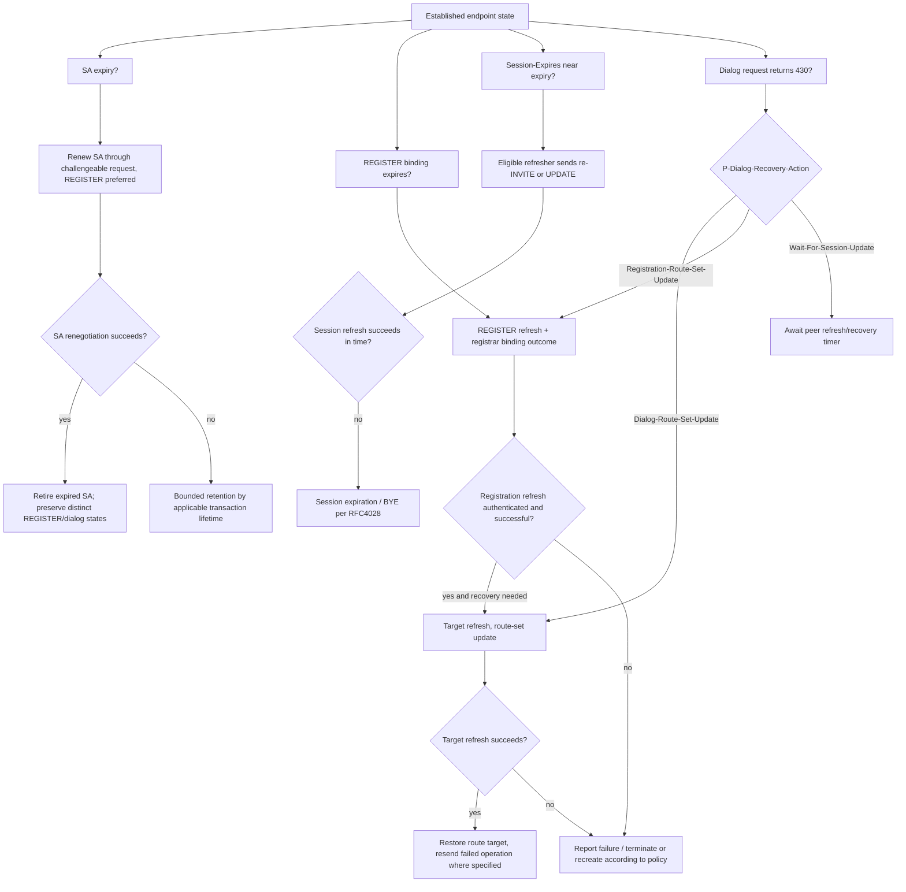

# RFC 4028 / MS-SIPRE / MS-SIPREGE / MS-SIPAE: independent recovery lifecycles

Research date 2026-10-22. **Documentation only; not an implementation plan or a complete protocol audit.** Primary references: [RFC 4028 (April 2005)](https://www.rfc-editor.org/rfc/rfc4028) §§3–10, [RFC 3261 (June 2002)](https://www.rfc-editor.org/rfc/rfc3261) §§10,12,17; supplied original `catalog/MS-SIPRE.txt` **rev13.0, v20250520** §§3.7.2–3.7.6; `catalog/MS-SIPREGE.txt` **rev17.1 v20250819** §§3.1.2.1, 3.1.2.5.1; `catalog/MS-SIPAE.txt` **rev11.0 v20250520** §§3.2.5.2, 3.2.6. Their full PDFs were supplied in catalog.zip. The specified sections were independently inspected; not all normative transitive references or product notes have yet been audited.

## Four state lifetimes are separate

| Requirement | Evidence | Direct constraint and state consequence |
|---|---|---|
| LIFE-01 | RFC4028 §§3–6 | INVITE session lifetime is negotiated using `Session-Expires`, optional `refresher` assignment, and `Min-SE`. Too-small interval has **422 Session Interval Too Small** response, distinct from identity/auth challenge. |
| LIFE-02 | RFC4028 §§7,9–10 | Eligible UAC/UAS session refresher sends periodic **re-INVITE or UPDATE**. Loss of refresh within negotiated interval can terminate session; this is not REGISTER expiry. |
| LIFE-03 | MS-SIPRE rev13 §3.7.2.1 | UA with recovery enabled and negotiated RFC4028 session timer **SHOULD** start recovery refresh timer when dialog created, interval **at least negotiated session timer**. This timer is *not necessarily* equal to session timer interval. |
| LIFE-04 | MS-SIPRE rev13 §§3.7.3.1,3.7.4.1 | Recovery extension **SHOULD** be enabled for valuable call/media dialogs; **SHOULD NOT** be enabled for replaceable presence SUBSCRIBE dialogs. Advertise `Ms-Dialog-Route-Set-Update` on all recovery-enabled in-dialog requests and use target refreshes. |
| LIFE-05 | MS-SIPRE rev13 §§3.7.5.1,3.7.5.3.1 | On stale route, extension-aware proxy responds **430 Flow Failed** with `P-Dialog-Recovery-Action` and chooses one of route repair, REGISTER-then-repair, or wait-for-peer paths; no extension tends to **481**. |
| LIFE-06 | MS-SIPRE rev13 §3.7.5.3.4 | Recoverable dialog **MUST** perform target refresh, e.g. UPDATE for INVITE or SUBSCRIBE for subscription. On successful response **MUST** update Contact/Record-Route based remote target and route set. |
| LIFE-07 | MS-SIPREGE rev17.1 §3.1.2.1 | Registrar conceptual per-endpoint fields include `Routable` flag (true while valid registration exists), `Presence-Service-Available`, endpoint identity (EPID/SIP.INSTANCE/GRUU), cluster metadata. Model is conceptual; wire-compatible behavior matters rather than mandatory internal data structure. |
| LIFE-08 | MS-SIPREGE rev17.1 §3.1.2.5.1 | Registrar **MUST** establish/maintain client SA with NTLM or Kerberos per MS-SIPAE before validating the REGISTER (note: full TLS-DSK profile and product-specific support warrant separate analysis). Registration validity/route availability is not proof all presence services available. |
| LIFE-09 | MS-SIPAE rev11 §3.2.6 | When SA expiry fires, client **MUST** start new SA establishment; **SHOULD** send a REGISTER without authorization, **MAY** send other challengeable requests, **SHOULD NOT** use ACK/CANCEL. If renewal succeeds destroy expired SA, else **SHOULD** keep it for original SIP transaction max duration (Timer B/F default 32 sec in cited profile). |
| LIFE-10 | MS-SIPAE rev11 §3.2.5.2 | Protected response verified against scheme/realm/target-matched SA plus MIC/replay state before it can advance authenticated security state. **A matching SIP 2xx without MIC success is insufficient where this header applies.** |
| LIFE-11 | RFC3261 §10.2.4 and MS-SIPREGE rev17 | REGISTER contact binding refresh has a different lifetime/transaction than dialog re-INVITE, SA refresh and MS-SIPRE route-set repair. Never use one shared `connected` flag as a substitute. |

## Condition-based recovery model (synthesis, not a mandated single wire trace)

**Interpretation boundary:** independent timers can fire concurrently; this graph depicts possibilities, not an ordering guarantee. `Registration-Route-Set-Update` is abbreviated label for the registry-first action described by full Microsoft header. Do not claim RFC4028 refresh repairs the route without MS-SIPRE §3.7 target refresh or that authenticated SA alone keeps a SIP dialog alive.

## Contradictions and version profile gates

- **ERR-01:** A 422 + Min-SE retry is an RFC4028 interval negotiation issue, not an authentication challenge; retry details §§7.3–7.4 require precise UAC behavior extraction.
- **ERR-02:** A proxy 430 with recovery action cannot be reduced to generic transport disconnection, nor equated to 481/487.
- **ERR-03:** Microsoft §3.7 recommends recovery for media-rich dialogs, not ordinary replaceable presence subscriptions; profile selection requires explicit source evidence.
- **ERR-04:** Microsoft MS-SIPREGE server-side `Routable` and `Presence-Service-Available` are independent, including survivable scenarios. A registered client may have unavailable presence service.
- **ERR-05:** Registrar's NTLM/Kerberos SA requirement in MS-SIPREGE §3.1.2.5.1 does not by itself settle full TLS-DSK availability for other roles or deployments. Resolve product notes and topology branches.
- **ERR-06:** RFC4028 modern updates and RFC3265 vs RFC6665 Microsoft event subscription applicability remain to be checked per Windows Full Client release.
- **ERR-07:** SIP method target refresh semantics, route changes across TLS peers, reauthentication and replay context consistency under simultaneous SA/registration/dialog expiry need multi-document clause-level proof.

## Completion ledger

**Verified in this tranche:** MS-SIPRE rev13 §§3.7.2–6, MS-SIPREGE rev17.1 §§3.1.2.1/3.1.2.5.1, MS-SIPAE rev11 §§3.2.5.2/3.2.6, and RFC4028's session-refresher/422 basics. **Still not verified:** all RFC4028 UAC/UAS timer branches, exact historic-client negotiation values, simultaneous failure races, product note/version matrix, all transitive norms, complete Windows Full Client functional protocol coverage, all 112 assessments.

**Research is NOT COMPLETE.** Do not implement protocol code or run network/server interoperability checks; these are reserved to owner. No merge into main and no release.
