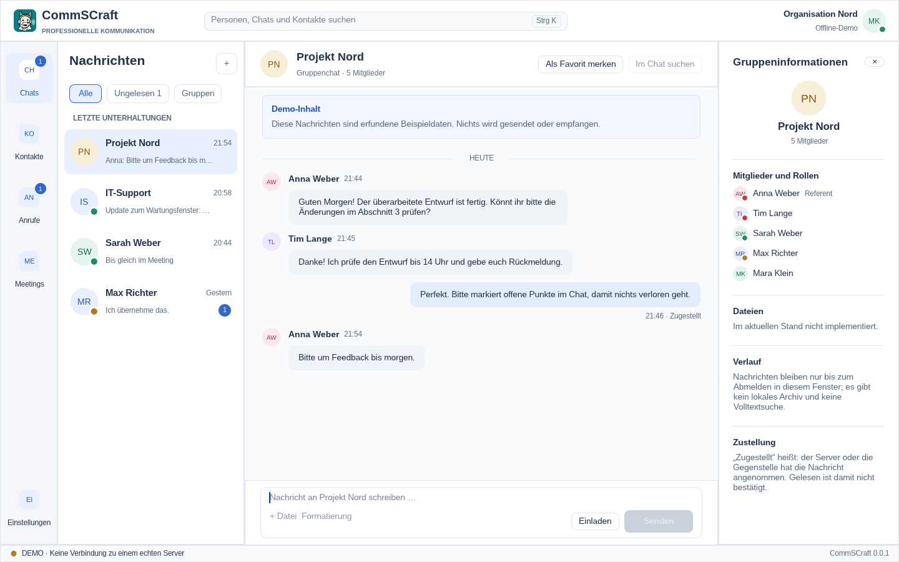
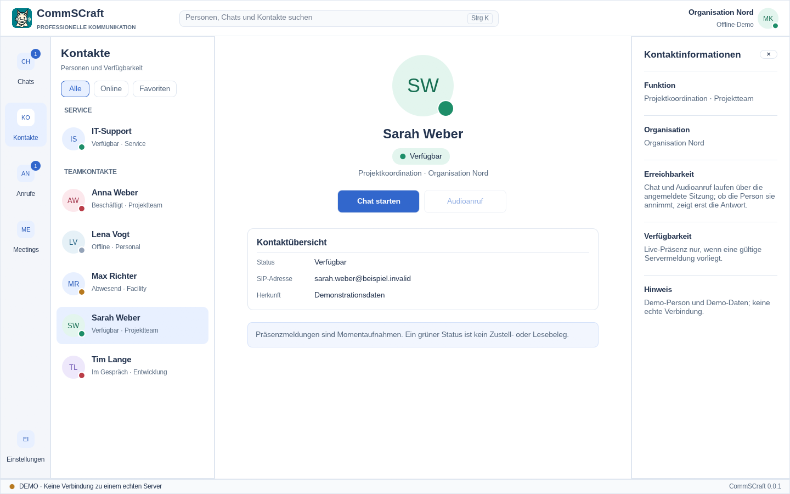
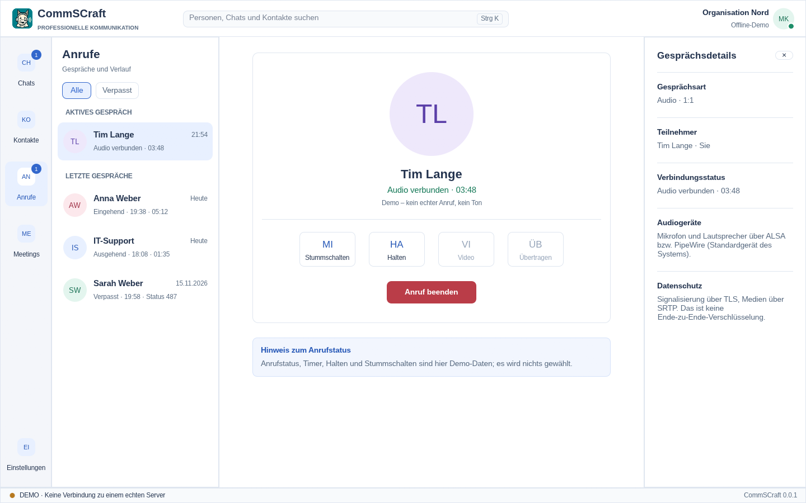
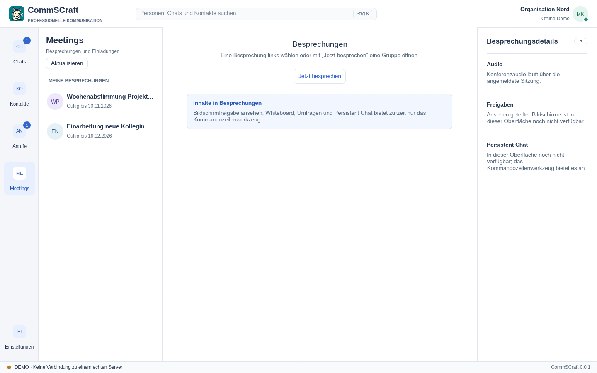
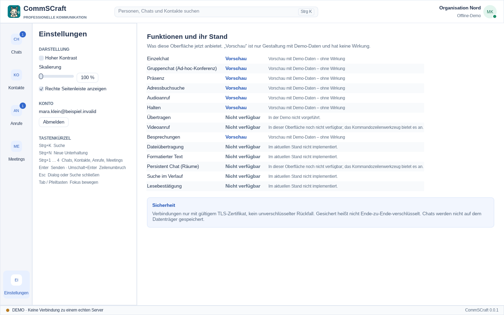
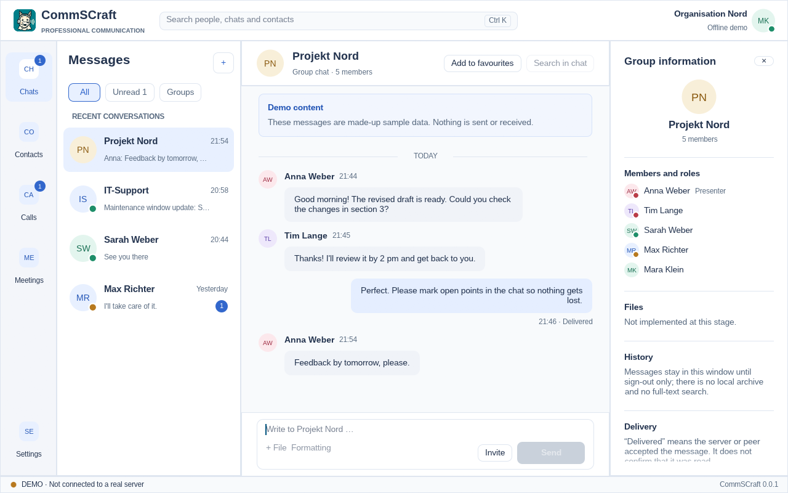

# Desktop interface

> **Last reviewed:** 2026-11-16 · **Last updated:** 2026-11-16 · **Change:** new (phase 1: offline demo)

The Linux desktop client `commscraft` (`apps/commscraft`) puts an egui interface on top of the
session engine. The interface lives in its own crate, `commscraft-ui` (`crates/ui`): theme, view
model, views and demo fixtures, with no protocol, network or file code. The protocol core never
depends on it.

```text
apps/commscraft        window (eframe, OpenGL, Wayland/X11), system fonts, brand icon, adapters
  └── crates/ui        CommsUi: views + theme + AppState (reducer) + UiIntent; demo fixtures
        ⇅ AppEvent / UiIntent (typed; never raw SIP)
      crates/session   the sans-I/O engine (unchanged)
```

## Phases

| Phase | Content | State |
|---|---|---|
| 1 | Shell and the three screens with demo data: chats (list, conversation, composer, group details), contacts and presence, calls (active call, controls, history), meetings, settings with the capability overview; keyboard, focus, scaling, high contrast, German and English | done (tested-offline) |
| 2 | The session adapter: sign-in, contacts and presence, 1:1 and group chat, delivery, typing, audio calls, meetings, invitations | next |
| 3 | UX additions on existing data: favourites kept locally, filters, address book search, keyboard navigation | – |
| 4 | QA against the specification and the reference images | – |

`commscraft --demo` shows the interface with made-up people at `beispiel.invalid` and never opens a
network connection; every demo conversation, call and meeting carries a visible demo mark, and the
status bar says "DEMO · not connected to a real server". Without `--demo` the sign-in screen
appears; this build has no session adapter yet and says so.

## Honest capability gates

Every function the interface shows has a gate: **available** (supported and enabled), **preview**
(design with demo data only, no effect) or **unavailable** (disabled, the reason in the tooltip and
in Settings → "Functions and their state").

| Function | Gate today | Why |
|---|---|---|
| 1:1 chat, group chat, presence, address book search, audio call, hold, meetings | preview (demo) | the session has them; the adapter is phase 2 |
| transfer | unavailable in the demo | the session has it; not shown in the demo |
| video call, persistent chat rooms, viewing shared screens, meeting content | unavailable | the command-line tool offers them; not in this interface yet |
| file transfer, formatted text, history search, read receipts | unavailable | not implemented (no public specification for file transfer; `text/plain` only; no archive or index; delivery is not reading) |

Delivery is shown as what it is: *sending*, *delivered* (the server or peer accepted the MESSAGE),
*not delivered (status)*, *not delivered to …* (IMDN in groups) or *delivery unknown*. There is no
"read" state. A call shows *connected* only after the session reported the answer; dialling and
ringing are separate states.

## Layout and theme

Top bar 66 px, rail 92 px, list panel 300 px, flexible main area, context panel 290 px (can be hidden,
closes by itself below 1100 px window width), status bar 28 px. Colours are tokens in
`crates/ui/src/theme.rs` (blue and slate: primary `#3267CC`, hover `#2456B6`, selection `#E8F0FF`,
outgoing `#E5EEFF`, ink `#24344F`, …). Status colours are semantic only and always come with a word.

Deviations from the reference images, on purpose:

- Secondary text is `#586A80` instead of `#64748B`: the latter reaches only 4.2:1 on the selection
  and message colours, the rule asks for 4.5:1 for normal text (tested in `theme.rs`). Success as
  text is `#177A59`; `#1E8E69` stays for dots.
- The rail shows two-letter monograms instead of drawn icons (no third-party icon sets).
- egui does not embolden fonts: bold text uses the system's bold face found through fontconfig.
- The brand icon in the top bar is the unchanged `assets/branding/CommSCraft-icon-128.png`.

## Fonts, accessibility, keyboard

- No font files are shipped: `fc-match` names the system's sans, bold and monospace faces (Inter,
  Noto Sans, DejaVu Sans, …); without any usable font the program says so and stops.
- Every interactive element has an accessible label (rows, rail buttons, call tiles, fields); the
  tests drive the interface through that accessibility tree. The Linux screen reader bridge
  (AccessKit over AT-SPI) is not built in yet: its adapter still uses zbus 5, whose `zvariant` and
  `zbus_names` crates RustSec lists as unmaintained (RUSTSEC-2026-0370 … 0372), and CI denies such
  warnings.
- Shortcuts: Ctrl+K search, Ctrl+N new conversation, Ctrl+1 … 4 views, Enter sends, Shift+Enter new
  line, Esc closes a dialog or the search, Tab and arrow keys move the focus. Drafts are kept per
  conversation; each conversation keeps its scroll position and only follows new messages while it
  is at the bottom.

## Data and security

- The interface keeps conversations in memory only, bounded (500 messages per conversation, 200
  conversations, 8 KiB per message shown, 10 000 contacts); nothing is written to disk.
- Text from the network is cleaned again before it is shown: control characters, bidirectional
  overrides and invisible format characters are removed, lengths are cut. Nothing is rendered as
  HTML, Markdown or rich text.
- The password leaves the sign-in form once, with the sign-in intent; the field and its undo memory
  are cleared, and the debug form of the intent hides it.
- Screenshots and tests use synthetic data only.

## Screenshots of the build

Made with `commscraft --demo --lang de --view VIEW --screenshot FILE` at 1440 × 900 (the program
saves its own first settled frame):

| Chats | Contacts | Calls |
|---|---|---|
|  |  |  |

| Meetings | Settings | Sign-in | 1280 × 800, English |
|---|---|---|---|
|  |  |  |  |

## Checks

```
cargo fmt --all -- --check
cargo clippy -p commscraft-ui -p commscraft --all-targets -- -D warnings
cargo test -p commscraft-ui -p commscraft
cargo run -p commscraft -- --demo
```
