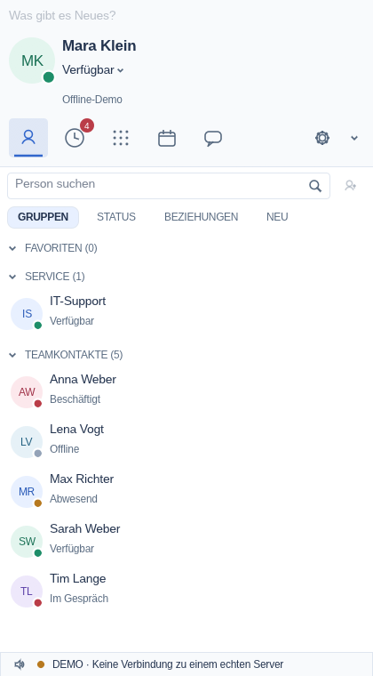
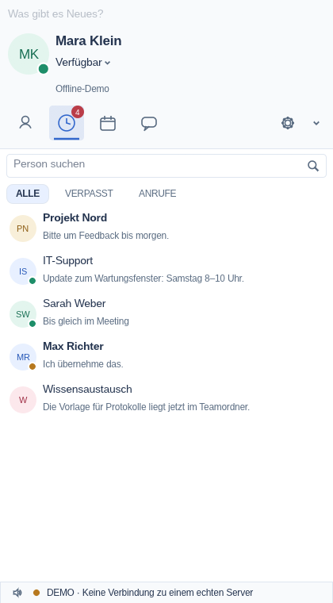
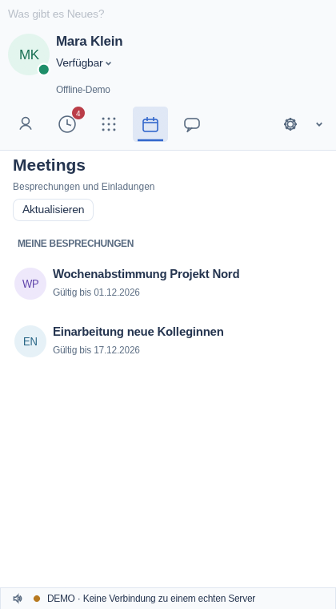
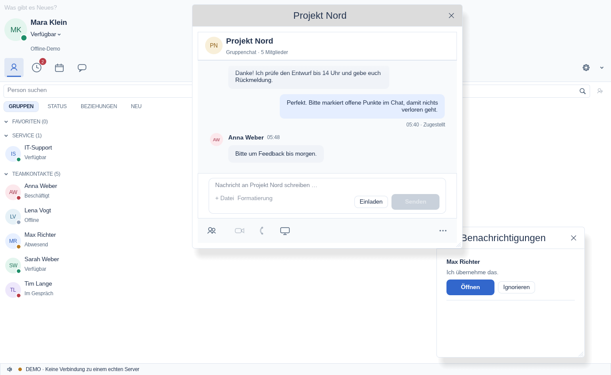
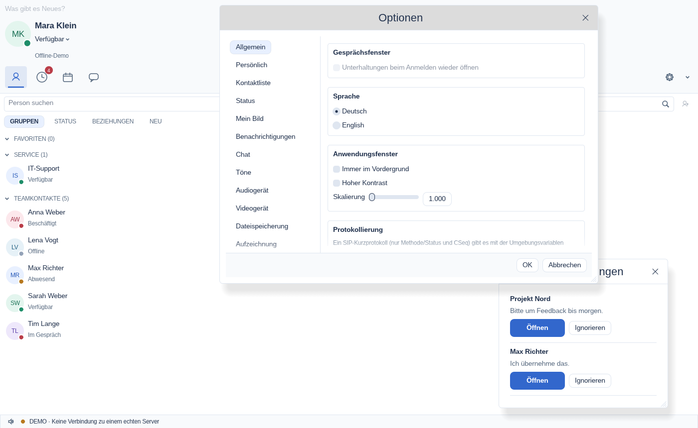
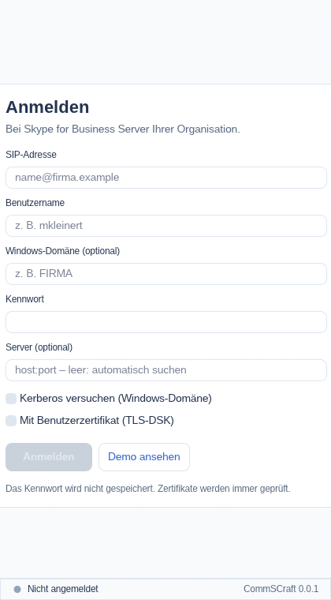

# Desktop interface

> **Last reviewed:** 2026-11-17 · **Last updated:** 2026-11-17 · **Change:** minor (conversations as tabs of one window)

The Linux desktop client `commscraft` (`apps/commscraft`) puts an egui interface on top of the
session engine. The interface lives in its own crate, `commscraft-ui` (`crates/ui`): theme, view
model, views and demo fixtures, with no protocol, network or file code. The protocol core never
depends on it.

```text
apps/commscraft        window (eframe, OpenGL, Wayland/X11), system fonts, brand icon, adapters
  └── crates/ui        CommsUi: views + theme + AppState (reducer) + UiIntent; demo fixtures
        ⇅ AppEvent / UiIntent (typed; never raw SIP)
      crates/session   the sans-I/O engine (unchanged)
```

## Phases

| Phase | Content | State |
|---|---|---|
| 1 | Shell and the three screens with demo data: chats (list, conversation, composer, group details), contacts and presence, calls (active call, controls, history), meetings, settings with the capability overview; keyboard, focus, scaling, high contrast, German and English | done (tested-offline) |
| 2 | The session adapter: sign-in, contacts and presence, 1:1 and group chat, delivery, typing, audio calls, meetings, invitations | done (tested-offline; `tested-in-lab`: sign-in, contacts and presence, 1:1 and group chat both ways, outgoing calls with ringing, connected, hold, resume, hang-up; incoming calls answered and hung up) |
| 3 | UX additions on existing data: favourites and display preferences kept locally, filters, the address book search on the server (settled text only), keyboard navigation | done (tested-offline; the address book search `tested-in-lab`) |
| 4 | QA against the specification and the reference images | done (see QA below; it checked the earlier three-pane layout) |
| 5 | The window structure of the Windows client with an own look (main window with tabs, windows of their own for conversations and calls, notifications, menus, options) | done (tested-offline; `tested-in-lab`: sign-in, a conversation window with a delivered message, a call window for a call to the Windows client) |

`commscraft --demo` shows the interface with made-up people at `beispiel.invalid` and never opens a
network connection; every demo conversation, call and meeting carries a visible demo mark, and the
footer says "DEMO · not connected to a real server". Without `--demo` the sign-in screen
appears and the client signs in through the session engine.

## The session adapter (phase 2)

`apps/commscraft/src/session.rs` runs one worker thread per sign-in. It owns the TLS connection,
the session engine and the media threads of calls; the interface talks to it through two bounded
queues (commands 256, events 4096) and never waits for the network in a frame.

- **Sign-in:** the sign-in address and the password are enough, as with the Windows client: the
  user name is optional and defaults to the address (the user principal name, with an empty NTLM
  domain; `tested-in-lab`); Autodiscover and DNS SRV like the
  command-line tool (shared crate `commscraft-client`), NTLM with the password typed in the form, TLS always verified against the
  system trust store plus an optional `--ca-file`. A server outside the SIP domain is used only
  when its domain is listed in `~/.config/commscraft/trusted-domains` or – for a server named by
  Autodiscover over verified HTTPS – when the user trusts it in a dialog (an explicit yes; it is
  then remembered there; no answer within two minutes or closing the dialog means no). Kerberos can be tried first (a checkbox: the
  system's ticket, else the password; NTLM stays the fallback, and the reason is shown); TLS-DSK
  (a checkbox) gets the user certificate once from the server's certificate service with the
  password (shared `commscraft-client::tlsdsk`) and signs in with it afterwards.
  With TLS-DSK (a stored, valid certificate) or Kerberos (the system's ticket) the password may
  stay empty; when the stored certificate is missing or has expired, the sign-in says that the
  password is needed. A password is stored only when the user ticks *remember the password in
  the keyring*, and only after a successful sign-in: in the system's keyring (Secret Service over
  D-Bus, or the keyring portal in a sandbox) through `oo7` on zbus 6, one item per sign-in
  address; the next start offers the last address and may sign in with the field empty;
  *Options → personal → remove the stored password* deletes it (`tested-in-lab`).
- **Mapping:** engine events become typed `AppEvent`s (contacts, presence with the published
  display name, conversations, delivery, typing, roster, invitations, calls, meetings, notices);
  interface intents become engine commands. The interface's own conversation key is tied to the
  session's ID with `Engine::next_conversation_id`, so a failed opening reaches the right
  conversation. Groups (ours, joined meetings, an MCU that dials us) are shown as groups.
- **Calls:** the media thread of `commscraft-client::calls` (ICE, SRTP, G.722/G.711, ALSA); a call
  shows *connected* only after `CallAnswered`. Calls go only to SIP addresses picked in the
  interface – never to phone numbers – so the engine's emergency call path is not reached from
  here. The call tile *Transfer* sends a blind transfer (REFER) to an address picked in the address
  dialog; the result is reported, and the call ends only when the transfer succeeded. A
  transfer request of the other side is declined, with a notice (the command-line tool offers it).
- **Video calls and shared screens:** *Video call* (contact and chat header) sends audio and
  video at once; an incoming call that offers video can be answered *with video*. Someone sharing
  a screen or a window with us appears as *shares a screen* with *View* and *Decline*; viewing is
  receive-only (video-based screen sharing, or RDP for a shared window). The received picture is
  shown in the sandboxed video window process of `commscraft-client::video_window` (the
  desktop binary starts it as `commscraft video-window …`; Landlock and a system call filter, as
  in the CLI), never in the interface process; the window scales the picture to its size, can be
  maximized (square in its bar or a double click) and resized at its bottom right corner. The
  camera (`COMMSCRAFT_CAMERA`, else `/dev/video0`) is opened only once a video stream is
  negotiated. A viewed share shows *sharing connected* once its stream is negotiated (it has no
  audio answer). `tested-in-lab`: video call out (the peer sees our camera), viewing a shared
  desktop (video) and a shared window (RDP), the window's maximize.
- **Address book search:** MS-DLX through the shared `commscraft-client::directory` with the
  registrar's NTLM; asked once the search text has rested for 600 ms; results are shown with
  their source and are not kept as contacts.
- **Contact photos:** a thread of its own fetches the photos of the user, the contacts, search
  hits and conversation partners with the shared `commscraft-client::photos` (the address book's
  photo; with the photo policy *all photos* first Exchange's), so SIP never waits for HTTP; the
  NTLM step comes from the session worker over a channel. The photo is decoded there in pure Rust
  (JPEG with zune-jpeg, PNG; at most 1024 pixels a side) into a 96 × 96 thumbnail. *Options →
  personal → show pictures of contacts* switches them off. `tested-in-lab`.
- **Meeting audio:** the phone button of a meeting conversation joins its audio (a call to the
  A/V MCU through the signed-in session); the call window carries the meeting's name and offers
  no hold or transfer; the camera button joins with audio and video: the client asks the A/V MCU
  for a sending participant's video (CA-13) and moves on to the next sender when no picture
  comes; the picture is shown in its own window. `tested-in-lab` (picture from another
  participant's camera received).
- **Desktop integration:** *Options › Personal* starts CommSCraft with the desktop session (an
  XDG autostart entry, written only on request); *Options › Audio* chooses the sound device for
  calls – the system's default (PipeWire) or a device ALSA lists (`/proc/asound/pcm`).
  `tested-offline`.
- **Calls:** *Transfer* offers a person (unattended) or, with a second connected call, its party
  (attended: the consultation call is replaced); after a connected call a bar asks for a rating
  of one to five stars when the server names a quality service (sent as the rating report).
  `tested-in-lab` (rating), attended transfer `tested-offline` in the interface.
- **Tabbed conversations:** as in the Windows client, the open conversations are tabs of one
  window (option *Enable tabbed conversations*, on by default): from two on, a list on the left
  with picture, name, the last message, the unread count and a close button; closing the window
  with several tabs asks "close all tabs or the current tab?" (with *always close all tabs*).
  `tested-offline`.
- **Calls on the stage of the conversation window:** as in the Windows client, a call is shown
  above the IM of its conversation (a 1:1 call without one gets a conversation): the received
  video embedded (the sandboxed decoder process hands back pictures of at most 640×360 at 15 per
  second instead of opening a window of its own), name, state and duration, round buttons for
  the IM area, the microphone, hang up and the call controls (hold, transfer, dial pad); with the
  IM area hidden the stage fills the window. A shared window over RDP comes the same way.
  `tested-in-lab`.
- **Chats as in the Windows client:** a 1:1 conversation is set up with its first message, which
  the invitation carries (`Ms-Text-Format`, so the other side's notification shows the text); an
  invitation to a chat without audio is joined at once and its conversation appears unread; an
  invitation with audio is still asked. Own invitations announce audio only while the
  conference's audio is in use. `tested-in-lab`.
- **Conversation history in Exchange:** a finished IM conversation is saved in the user's
  Conversation History folder (EWS CreateItem, in the background thread) – as the server's
  archiving policy says, else as chosen in *Options › IM* (on by default). The conversations
  tab lists the folder's newest entries (FindItem) and shows one entry's text read-only (GetItem
  with a text body). `tested-in-lab`.
- **Shared screens in meetings:** when someone shares in a meeting, the conversation says so
  and offers *View*: a screen shared as video comes as receive-only video from the application
  sharing MCU (the sharer's source asked for), a shared window over RDP; both in the isolated
  window. `tested-offline` (the lab check needs a sharing participant).
- **Planned meetings:** the meetings tab plans a meeting (subject, how long it stays usable, who
  does not wait in the lobby), and for a chosen meeting offers join, copy its link, change and
  cancel; the list reads each meeting's details (subject, expiry, link) and counts conferences
  without a subject (from group conversations) instead of listing them. `tested-in-lab`.
- **Meeting control:** a presenter sees the lobby in the participant list (admit, deny, admit
  all) and has a menu per participant (make presenter or attendee, mute or unmute, remove) and
  meeting commands in *More* (mute or unmute the audience, lock or unlock); the meetings tab
  joins a meeting by its https link (the join manager names the focus, in the background
  thread). `tested-in-lab` (roles, lock, remove; the lobby and muting only offline).
- **Own presence:** the status menu offers available, busy, do not disturb, be right back
  (12500), off work (away with the activity `off-work`) and appear away, and *Reset status*
  (the manual state removed, the server works it out again); the personal note is published when
  its field is left (`note` category, containers 200/300/400) and a note set elsewhere comes into
  the field. Contacts show *be right back*, *off work* and *inactive* too. `tested-in-lab`.
- **Status automation:** after the idle minutes set in *Options › Status* (default 5) the
  endpoint's machine state becomes idle (5000, shown as *inactive*), after further minutes
  (default 5) away (15500); keyboard or mouse make it active again (3500). The idle time comes
  from the desktop session over D-Bus (GNOME's Mutter idle monitor, else
  `org.freedesktop.ScreenSaver`); without it nothing changes. The own state shown is the one the
  server works out (the own address in the batch presence subscription). `tested-in-lab`.
- **Editing the contact list:** add a person (the add button, the contact menu, search results,
  the *New* view), move a contact into another group, remove it; add, rename and delete groups
  (only empty ones). A list kept in Exchange is read and changed there (EWS UCS operations,
  shared `client::exchange`, in the background thread; Exchange's group kinds map to the default
  group, favourites and hidden groups); otherwise through the session's contact list changes.
  *New* lists people who added the user (acknowledged when added or ignored); the contact menu
  sets the privacy relationship, blocking included. `tested-in-lab`.
- **Distribution groups and favourites of the contact list:** a group the user added from the
  address book is shown as a distribution list (its `externalURI` names the list's mail address,
  `presence::group_extension`); opened, its members come from the address book (MS-DLX
  ExpandDistributionList, in the background thread) with their presence (a `WatchPresence` batch
  subscription) and photos; the server's favourites group fills *Favourites*. `tested-in-lab`.
- **Appointments from Exchange:** the same thread asks for the user's appointments of four days
  (GetUserAvailability) and the automatic reply (GetUserOofSettings) through the shared
  `commscraft-client::exchange`, after sign-in and then every 15 minutes, as the server's calendar
  settings allow; the meetings tab shows them by day (subject and location only for appointments
  that are not private) and says when automatic replies are on. `tested-in-lab`.
- **Persistent chat rooms:** offered only when provisioning names a persistent chat pool
  (otherwise *unavailable: disabled by the server*). *Rooms* in the chat list → *Load chat
  rooms* connects to the pool, lists the rooms the user is a member of, joins them and asks for
  each room's history once. A room is a conversation of its own kind – not an ad-hoc group: no
  typing notifications, no invitations, no "end". Our message is *sending* until the chat server
  sends it back (*delivered*); a refused or unsent one is *not delivered*. Messages that come
  again with the history are shown once (by the server's message number). `tested-offline`:
  Skype for Business Server 2019 has no persistent chat.
- **Meeting content:** in a meeting's group conversation, details → *Meeting content* → *Show
  content* joins the web conferencing server (PSOM over TLS, the shared
  `commscraft-client::meeting_content`): who presents and what, whiteboards with their number of
  annotations, slides with count and position, notes, files, and polls with question, choices,
  results, open or closed, and voting (*your vote* only once the server confirms it). Slides and
  whiteboard ink are not drawn yet (said in the panel). `tested-in-lab`: joining, a whiteboard and
  a poll created on the Windows client, voting from the desktop client (the Windows client counted
  the vote).
- **Invitations** to meetings wait under *Meetings*; the rail shows how many, the status bar names
  who invites; the same invitation sent twice is listed once.
- **Not in the desktop client yet** (gated with a reason): video and screen viewing inside
  meetings, drawing slides and whiteboard ink.

`--sign-in sip:ADDRESS [--user USER] [--domain D] [--server H:P]` signs in at start with the
password from standard input; `--commands FILE` follows a file of test commands (`view`, `chat`,
`select`, `search`, `send`, `group`, `accept`, `call`, `videocall`, `transfer`, `answer`, `answervideo`, `viewscreen`, `hangup`, `hold`, `resume`, `mute`,
`unmute`, `status`, `shot`, `quit`) that trigger exactly the actions of the interface – for the
owner's lab runs and screenshots. `COMMSCRAFT_VERBOSE=1` prints one line per SIP message (method
or status and CSeq, never headers).

## Honest capability gates

Every function the interface shows has a gate: **available** (supported and enabled), **preview**
(design with demo data only, no effect) or **unavailable** (disabled, the reason in the tooltip and
in Settings → "Functions and their state").

| Function | Gate today | Why |
|---|---|---|
| 1:1 chat, group chat, presence, address book search, audio call, hold, transfer (blind), meetings | available when signed in; preview in the demo (transfer: not shown in the demo) | through the session adapter |
| persistent chat rooms | available when signed in and provisioning names a chat pool, else unavailable (disabled by the server); preview in the demo | through the session adapter |
| video call (1:1), viewing a screen shared 1:1 | available when signed in; preview in the demo | through the session adapter and the video window process |
| meeting content (whiteboards, slides, polls with voting) | available when signed in; preview in the demo | through the session adapter (PSOM) |
| video and screen viewing in meetings | not offered | the command-line tool offers them; not in this interface yet |
| file transfer, formatted text, history search, read receipts | unavailable | not implemented (no public specification for file transfer; `text/plain` only; no archive or index; delivery is not reading) |

Delivery is shown as what it is: *sending*, *delivered* (the server or peer accepted the MESSAGE),
*not delivered (status)*, *not delivered to …* (IMDN in groups) or *delivery unknown*. There is no
"read" state. A call shows *connected* only after the session reported the answer; dialling and
ringing are separate states.

## Window structure

The interface takes the operating structure of the Windows desktop client of Skype for Business –
a narrow main window, conversations and calls in windows of their own, menus and an options
window with the same areas – with its own look: own line icons drawn in code, the blue and slate
colours, own wording. No Microsoft image, icon, sound or font is used, and the appearance is not
copied (clean-room rule).

- **Main window** (420 × 760 by default, at least 340 × 480): the personal note line (shown;
  publishing it is not built), picture, name, the status menu (available, busy, do not disturb,
  away; sign out, quit), then the tabs *Contacts*, *Conversations*, *Meetings* and – where
  the server offers persistent chat – *Rooms*; on the right the options button and the main menu
  (*File*, *Meet now*, *Tools*, *Help*). A yellow bar shows the newest warning until it is closed;
  the footer has the audio device button and the state of the connection in words.
- **Contacts:** search (contacts, conversations, the address book on the server), views by
  *groups* (favourites, the groups of the contact list) and *status*; *relationships* and *new* are
  not built. A contact opens with a double click; its menu offers a message, a call, a video call,
  the favourite mark and the contact card.
- **Conversations:** all, missed (unread), calls (the call history).
- **No telephony:** the interface shows no phone tab, no keypad for numbers and no phones area in
  the options (owner's choice); calls and video calls go to contacts, the keypad of a running call
  sends tones. The emergency call code of the session stays out of reach of the interface.
- **Conversation window:** head (picture, title, status or members), history, composer, and the
  bar at the bottom: participants, video call, call, *Present* (sharing one's own screen or window,
  slides, whiteboard and polls are not built and say so; the meeting content can be shown), and
  *More options* (invite, favourite, end).
- **Call window:** state in words, the video state, mute, hold, transfer, keypad, hang up; a
  viewed screen share has only *stop viewing*.
- **Notifications:** incoming calls (answer, with video, decline; *view* for a shared screen),
  meeting invitations (join, decline) and new messages in conversations that are not open (open,
  ignore), in one small window that stays on top.
- **Options:** 13 areas (general, personal, contact list, status, my picture, alerts, IM,
  sounds, audio device, video device, file saving, recording, meetings). What works changes the
  local preferences (language, always on top, high contrast, scale, contact list display and
  order, away group, favourites group, message alerts, quiet while do not disturb, chat text
  size, sounds, the camera device, the participant list when joining); what is not built is
  disabled with the reason. OK keeps the changes, Cancel drops them.

`--embed-windows` draws the windows of their own inside the main window (screenshots of
everything, and systems without separate windows).

Colours are tokens in `crates/ui/src/theme.rs` (primary `#3267CC`, ink `#24344F`, …); secondary
text `#586A80` and success text `#177A59` reach 4.5:1 (tested). Status colours always come with a
word.

## Fonts, accessibility, keyboard

- No font files are shipped: `fc-match` names the system's sans, bold and monospace faces (Inter,
  Noto Sans, DejaVu Sans, …); without any usable font the program says so and stops.
- Every interactive element has an accessible label (rows, rail buttons, call tiles, fields); the
  tests drive the interface through that accessibility tree. The Linux screen reader bridge
  (AccessKit over AT-SPI) is not built in yet: its adapter still uses zbus 5, whose `zvariant` and
  `zbus_names` crates RustSec lists as unmaintained (RUSTSEC-2026-0370 … 0372), and CI denies such
  warnings.
- Shortcuts: Ctrl+K search, Ctrl+N new conversation, Ctrl+1 … 4 tabs, Enter sends, Shift+Enter new
  line, Esc closes a dialog or the search, Tab and arrow keys move the focus. Drafts are kept per
  conversation; each conversation keeps its scroll position and only follows new messages while it
  is at the bottom.

## Local preferences

`~/.config/commscraft/desktop.conf` (mode 0600, written atomically) keeps favourites (SIP
addresses, group titles, chat rooms) and the settings of the options window (language, display,
contact list, alerts, sounds, the camera device file, meetings). No chat content, presence or
password is ever written there; the file is read bounded (64 KiB, 500 favourites) and malformed
lines are skipped. The demo and screenshot runs never read or write it.

## QA (phase 4, of the earlier three-pane layout)

Checked against the owner's UI specification and acceptance checklist and against the three
reference designs (1440 × 900), with screenshots of the real build (above).

| Area | Result |
|---|---|
| Project integrity | `AGENTS.md`/`CLAUDE.md` unchanged; egui as decided; the protocol core has no interface dependency (`crates/ui` depends only on egui; the session engine gained one accessor, `next_conversation_id`); Linux desktop only; no alarm, situation, escalation or acknowledgement function (a test checks the screens for such words); the emergency call code is unchanged and not reachable from the desktop client (it calls SIP addresses only) |
| Layout | top bar 66, rail 92, list 300, context 290 (can be hidden, closes below 1100 px), status bar 28; screens for chats, contacts, calls, meetings, settings; usable at 1440 × 900, 1280 × 800 and at 200 % scale (test) |
| Colours | the blue and slate tokens in `theme.rs`; deviation: secondary text `#586A80` and success text `#177A59` for 4.5:1 (tested); status always with a word |
| Typography | system sans, bold and monospace faces through fontconfig (none bundled); sizes 22/19/14.5/13.5/11.5 pt; deviation from the references: the system face instead of Inter when Inter is not installed |
| Raster and icons | 8 px spacing, radius 8–10; deviation: two-letter monograms instead of drawn icons in the rail and call tiles |
| Interaction, keyboard, focus | Ctrl+K, Ctrl+N, Ctrl+1…4, Esc, Enter/Shift+Enter, Tab and arrow keys in the lists; visible focus rings on rows, rail buttons and tiles; drafts kept per conversation; scroll position kept per conversation |
| Data states | demo marked everywhere; delivery is never shown as read; a call is connected only after the answer (test); empty lists, offline, failed sign-in, a lost connection (with "sign in again"), a missing microphone (notice, the call goes on) all have words (tests and lab) |
| Security | no secrets in logs (the trace prints method or status and CSeq only), the password leaves the form once and is cleared, no TLS bypass, no end-to-end claim (the privacy text says TLS and SRTP are not end-to-end encryption), no chat content on disk |
| Accessibility | labels on all interactive elements (the tests use them); contrast tested; the Linux screen reader bridge is still missing (AccessKit's adapter on zbus 5 is listed as unmaintained) |

Open after phase 4 (in [`gaps.md`](../gaps.md) row 9): the screen reader bridge, video and screen viewing inside meetings, and drawing
slides and whiteboard ink. Added after the QA: meeting content with polls and voting (`tested-in-lab`), video calls and viewing screens shared 1:1 (`tested-in-lab`), persistent chat rooms (tested offline), blind transfer and TLS-DSK sign-in (both
`tested-in-lab`), Kerberos as an option of the sign-in (`tested-in-lab` only its fallback to NTLM:
the test host has no Kerberos configuration) and the trust dialog for a foreign server domain
(tested offline: the lab's servers are in its domain).

## Data and security

- The interface keeps conversations in memory only, bounded (500 messages per conversation, 200
  conversations, 8 KiB per message shown, 10 000 contacts); nothing is written to disk.
- Text from the network is cleaned again before it is shown: control characters, bidirectional
  overrides and invisible format characters are removed, lengths are cut. Nothing is rendered as
  HTML, Markdown or rich text.
- The password leaves the sign-in form once, with the sign-in intent; the field and its undo memory
  are cleared, and the debug form of the intent hides it.
- Screenshots and tests use synthetic data only.

## Screenshots of the build

Made with `commscraft --demo --lang de --view VIEW --screenshot FILE` (the program saves its own
first settled frame); the windows of their own with `--embed-windows --size 1400x860`:

| Contacts | Conversations | Meetings |
|---|---|---|
|  |  |  |

| Conversation window and notifications | Options | Sign-in |
|---|---|---|
|  |  |  |

## Checks

```
cargo fmt --all -- --check
cargo clippy -p commscraft-ui -p commscraft --all-targets -- -D warnings
cargo test -p commscraft-ui -p commscraft
cargo run -p commscraft -- --demo
```
