# CommSCraft / classic Skype for Business Windows Full Client — research evidence master index

**Last evidence update: 2026-10-23. Status: INCOMPLETE, implementation gate CLOSED.**
This is a durable entry point for research under draft PR #51, **not** an assertion of complete normative/functional compliance. Its tables explicitly distinguish examined original clauses, reconstructed cross-protocol behavior and unresolved normative gaps. Nothing here authorizes new protocol code, real-server traffic, merges or releases.

## I. Evidence, roles and provenance

**Evidence codes:** `P` = primary Microsoft Open Specification or RFC text directly verified at cited edition/section; `S` = cross-spec synthesis inferred from multiple `P` rules, needing full sequence proof; `U` = unverified or unavailable behavior; `H` = historical/feature-conditional deployment rule. Each rule must be independently assigned a *role* (UAC, UAS, registrar, proxy, MCU, web-service client, web-service server, media peer) and an applicability guard (client version, topology, auth scheme and negotiated extensions). Server MUST ≠ client MUST.

**Corpus boundary (current):** owner's archive includes **150 MS-PDF physical editions** and a separate FIPS197 original; 54 original-index primaries and 96 additional physical PDF editions, with the historical MS-SIPRE v20150904 footer now verified. Complete [150-node PDF source hashes and dates](research-corpus/microsoft-originals-150-edition-and-source-index-2026-10-22.csv) and [3060 classified reference edges](research-corpus/microsoft-originals-150-classified-reference-edges-2026-10-22.csv) are committed. **138 split normative/informative lists, 7 unsplit overviews, 5 AD schema special cases**. Whole-client *normative transitive* closure is still NOT established: 191 Microsoft IDs referenced by broad Windows+Office corpus are not local (68 from normative sections), distinct from **zero missing directly cited Microsoft PDFs within selected 31 immediate client roots**. RFC edition chains/client applicability remain open. See [full dependency audit](full-150-pdf-normative-informative-reference-graph-2026-10-22.md). 112 assessment files are secondary, not original proof.

**Selected directly checked original editions** (not proof of full reading): MS-OCSPROT 9.0 (2025-05-20), MS-CONMGMT 10.0 (2025-05-20), MS-SIPAE 11.0 (2025-05-20), MS-SIPREGE 17.1 (2025-08-19), MS-SIPRE 13.0 (2025-05-20), MS-PRES 13.0 (2025-05-20), MS-SIP 8.0 (2017-06-01), MS-SIPCOMP 10.0 (2025-05-20), MS-CONFIM 11.0, MS-CONFAV 11.0, MS-CONFAS 12.0, MS-SDPEXT 16.0, MS-ICE2 19.0, MS-SRTP 14.0, MS-AVEDGEA 12.0, MS-OCPSTN 11.0, MS-EUMR 9.0, MS-EUMSDP 9.0, MS-OCEXUM 11.0, MS-E911WS 9.0, MS-RGSWS 9.0 (remaining dates 2025-05-20). For source URL, PDF SHA and section references use the ZIP inventory and linked per-protocol research. A date on original PDF is **not proof** that every target Skype for Business build implements every rule.

## II. Layered architecture and constraints

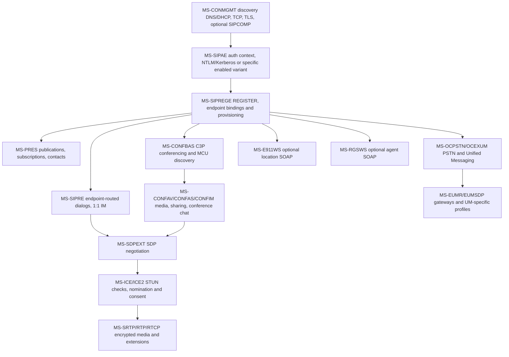

**Graph is a dependency map, not unconditional packet order.** SIP registration does not itself guarantee presence availability, conferencing, media connectivity, browser/response-group provisioning or successful PSTN dialing; ICE is not a general requirement for every text-message transaction. Both `A` and `R` are protocol states rather than global `connected=true` flags.

## III. Seven complete-client workflow research ledgers

### 1. Client startup, discovery and transport

**P:** MS-OCSPROT 9.0 §§2.5.1–2; MS-CONMGMT 10.0 §§3.1.4–3.1.5, 3.2–3.4; MS-SIPCOMP 10.0 §§2.2.3–4, 3.1.5 and 3.2.5; RFC3261/RFC3263/RFC2782/DHCP references still partly open.

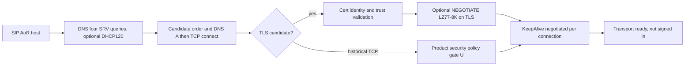

**P**: Four SRV service prefixes; candidate order is Microsoft-defined; optional compression negotiation must occur after successful TLS but before other data on that channel; keepalive only when successfully negotiated. **U**: full RFC2782 weight ties, RFC3361 DHCP byte fields, full TLS/SAN/revocation product policy, decompressed MPPC total frame boundaries. See [startup/TLS](ms-conmgmt10-ocsprot9-startup-discovery-tls-keepalive-2026-10-22.md), [compression negotiation](ms-sipcomp10-conmgmt10-negotiation-inactivity-original-2026-10-22.md), [binary SIPCOMP](ms-sipcomp10-binary-frame-flags-receiver-state-2026-10-22.md).

### 2. TLS identity, authentication and signing

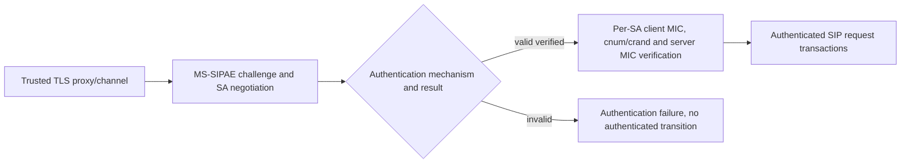

**P:** MS-SIPAE 11.0 §3.2.4.1 client 16-position canonical signing input, counter/crand and signature algorithms (NTLM/Kerberos GSS MIC or TLS-DSK-specific HMAC where applicable); client/server security context and replay trust must be verified before marking authenticated. **S**: combine with TLS name proof and REGISTER admission. **U**: every Kerberos/NTLM TLS-DSK scheme product note, PKI/realm, context rollover on proxy migration, cross-hop response MIC requirements. See [client MIC original](ms-sipae-11-direct-pdf-client-signature-and-digest-2026-10-22.md), [SA trust](ms-sipae-cross-section-authentication-trust-state-2026-10-22.md), [bidirectional integrity](ms-sipae-bidirectional-integrity-and-epid-media-2026-10-22.md).

### 3. REGISTER, provisioning and bootstrap

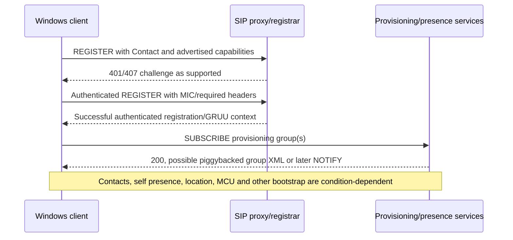

**P:** MS-SIPREGE 17.1 §§2.2.2.4–5, 3.3.1–2, MS-OCSPROT 9.0 §2.5.3; provisioning request and response group element names differ; 200 may carry XML if first-notify piggyback supported. **S:** higher-level bootstrap composition; original overview order expressly not universal. **U:** entire provisioning XML schema, subscription renewal and failure recovery under historical RFC3265 vs modern RFC6665. See [provisioning](ms-siprege-17-original-pdf-provisioning-lifecycle-2026-10-22.md), [client subscribe](ms-siprege-17-client-provisioning-state-rfc3265-2026-10-22.md), [bootstrap](ms-ocsprot9-bootstrap-and-siprege17-piggyback-fork-2026-10-22.md).

### 4. Presence, contacts, personal IM, multi-device

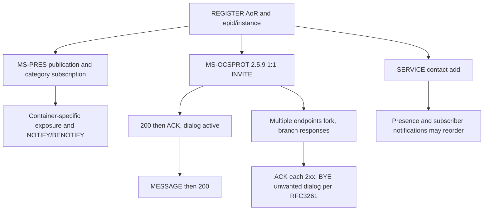

**P:** MS-PRES 13 §§3.2.5.3–5.1 category container priority and metadata privacy; MS-SIP 8 BENOTIFY negotiation; MS-OCSPROT 9 §§2.5.9–11 explicit IM/contact/multi-device examples; MS-SIPRE 13 §§3.2–3.4 endpoint routing, EPID-derived SIP.INSTANCE and GRUU; RFC3261 §13 fork races. **U:** full contact/group XML, typing, all 1:1 MIME variants, endpoint-capability election, unknown client behavior on dual 2xx. See [presence](ms-pres-privacy-container-resolution-benotify-register-2026-10-22.md), [personal messaging](ms-ocsprot9-direct-im-contacts-multidevice-sequences-2026-10-22.md), [routing/identities](ms-sipre13-epid-instance-gruu-routing-original-2026-10-22.md), [fork races](rfc3261-forked-invite-ack-cancel-bye-state-ledger-2026-10-22.md).

### 5. Conference IM, A/V and sharing

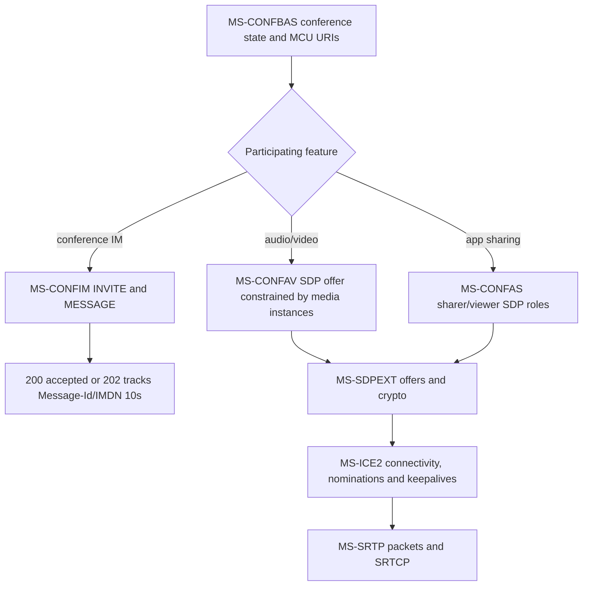

**P:** MS-CONFIM 11 §§3.3; MS-CONFAV 11 §3.1.5.2.1; MS-CONFAS 12 §§3.2.5.1.1–6; MS-SDPEXT 16 §3.1.5.1; MS-ICE2 19 §§3.1.6.2–5; MS-SRTP 14 §§3.1.5.1–2. **S:** media progression across services and conference control. **U:** complete C3P schemas, conference joining failures, exact sharing RDP data channel, codec matrices, ICE1↔ICE2 and older-client media policies. See [conference IM](ms-confim-pres-registration-lifecycle-cross-spec-2026-10-22.md), [media matrix](media-sdpext-ice2-confav-srtp-avedgea-original-pdf-2026-10-22.md), [app sharing](ms-sipre-dlx-confas-original-source-cross-analysis-2026-10-22.md).

### 6. PSTN, voicemail, location services and response-group agents

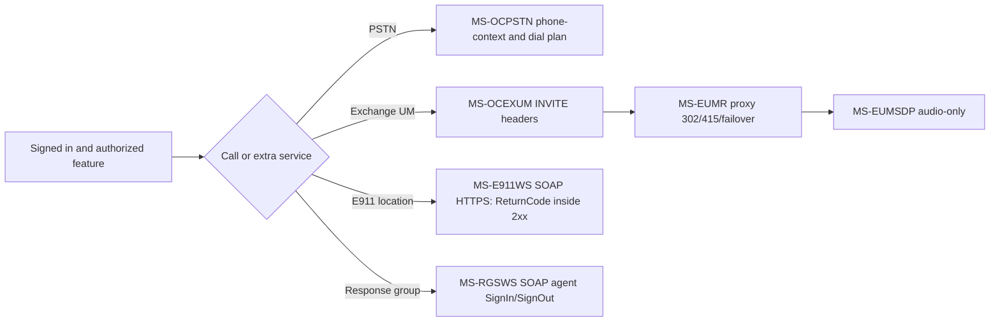

**P:** Six 2025 original specs each verified at selected clauses (not whole documents); role- and error-qualified ledger in [PSTN/E911/UM original cross-analysis](ms-ocpstn-eumr-eumsdp-ocexum-e911ws-rgsws-cross-spec-2026-10-22.md). **U:** emergency-calling routing itself, full location verification/UI, PSTN codec fallback, agent authorization and product-specific feature presence. **Important:** E911 web lookup success is not proof that an emergency call is correctly placed or routed.

### 7. Signout, transport failure, registration expiration and recovery

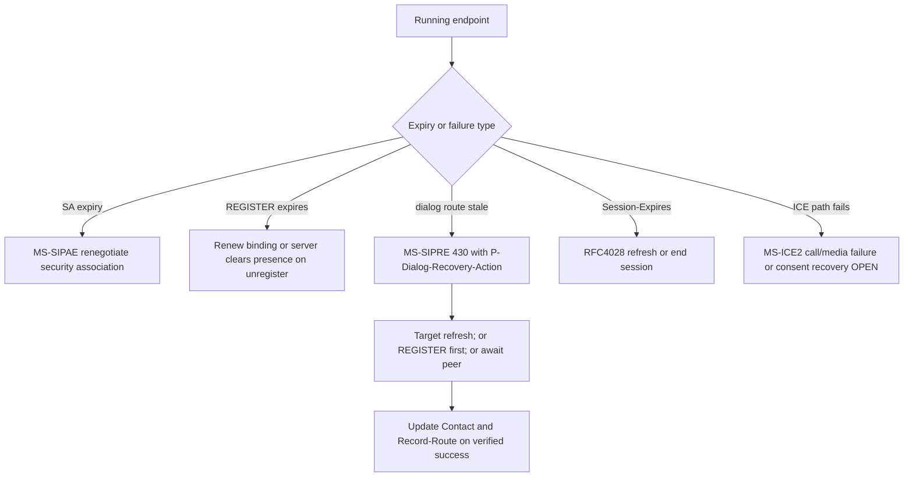

**P:** MS-SIPRE 13 §3.7, MS-SIPAE 11 §3.2.6, MS-PRES 13 §§3.2.5.5–5.1, MS-SIPREGE 17.1, RFC4028, MS-ICE2. **S:** concurrent independent timeouts; never collapse to a single reconnect state. **U:** accurate simultaneous expiry order, transport certificate/key changes and media reconnect, correct retry limits across branches and complete signout semantics. See [dialog recovery](ms-sipre13-dialog-recovery-430-flow-failed-2026-10-22.md) and [multiple lifetimes](rfc4028-ms-sipre-siprege-sipae-multilifecycle-recovery-2026-10-22.md).

## IV. Full-client requirement gate matrix (research status only)

| Feature gate | Evidence level | Deep-source proof still required |
|---|---|---|
| Server discovery / DNS / DHCP | P partial | All error/resolver and product policy branches |
| TLS/PKI and proxy name identity | P partial | Names/SAN, trust, revocation, modern TLS vs historical profile |
| SIP compression | P partial | Full MPPC bitstream, frame delimiting, malformed packet recovery |
| Keepalive/transport reconnect | P partial | Expiry, proxy migration, exact SIP keepalive bytes |
| Kerberos/NTLM/TLS-DSK | P partial | All authenticated handshake branches and target profiles |
| Per-request/response MIC and replay | P partial | All schemes, error recovery, concurrent SAs |
| REGISTER, GRUU, EPID, SIP.INSTANCE | P partial | Expiration races and full wire property cases |
| Provisioning and bootstrap | P partial | All service groups, XML, subscriptions, policy matrix |
| Presence/category containers | P partial | All category schemas, privacy and federation |
| Contact lists/search/roaming | P partial | MS-ABS/MS-DLX all WSDL/errors and MS-PRES contact XML |
| 1:1 text / forked dialogs | P high-level | Detailed SDP, MIME, receipts, SIP dialog errors |
| Conference IM | P partial | IMDN XML, lifecycle, conference role errors |
| Peer audio/video | P partial | Codec, hold/reinvite, full SDP/ICE/MS-SRTP packet profile |
| App/desktop sharing | P partial | MS-RDPBCGR/MS-RDPEMC streaming and ASMCU state |
| PSTN/voicemail/UM | P partial | More MS-OCPSTN/OCEXUM/EUMR and dialplan security |
| E911/emergency calling | P for SOAP only | Emergency call placement/routing, geolocation rules |
| Response group agent controls | P SOAP operations | Client deployment and agent status behavior |
| Graceful signout/unregister | P partial | Full teardown ordering across presence/media/service |
| Network loss, dialog/SA recovery | P partial | All timers/races, product-specific fallback and security |
| Client telemetry/QoE/error reporting | U or references only | MS-QoE, MS-OCER original end-to-end data flow |

**Research completion conditions:** (1) every relevant original document's edition, URL, hash, RFC/MS references and client applicability; (2) section-level normative verification including negative/error and timers, security and conformance examples; (3) each wire format and state diagram independently proof-linked; (4) conflict/obsolescence and product behavior matrix resolved or explicitly stated as blocking; (5) owner reviews proof completeness. **A detailed implementation plan is not produced until this research gate is closed.**

## V. Source conflicts and high-risk assumptions to avoid

1. `MS-SIP` supplied edition **2017** while many other PDF editions are **2025/2026**. Do not assume same feature matrix or full update compatibility.
2. RFC3265 references in Microsoft 2025 PDF vs obsoleting RFC6665: deployment/edition applicability open.
3. RFC5246/TLS 1.2, RFC4346/TLS 1.1 and historically 'SSL' wording in service specs: not an authorization for obsolete crypto.
4. Historic ICE RFC5245 vs RFC8445 and Microsoft ICE/ICE2: don't force modern candidate and consent semantics onto a legacy negotiated variant.
5. RFC3428 direct MESSAGE has no *intrinsic* dialog but Microsoft's MS-OCSPROT §2.5.9 IM example uses separately established INVITE dialog. Both true.
6. Microsoft conference-specific 202/IMDN/Message-Id/timer ≠ automatic personal-IM requirement.
7. REGISTER binding vs authenticated SA vs session refresh vs routable dialog vs ICE consent all have separate timers and fail conditions.
8. SIP gateway/proxy/UM-server-only MUSTs should not become Windows UAC MUSTs.
9. Historical PDF is present ≠ required Windows feature ≠ analyzed ≠ current recommended security behavior.
10. An error in SOAP `ReturnCode` or SIP route negotiation may occur despite HTTP 2xx / SIP 200 on a different layer; never flatten status meanings.

## VI. Repo source traceability and research-only delivery

Additional published research under `docs/` includes:
- [Corpus intake / SHA validation](uploaded-specification-corpus-intake-2026-10-22.md)
- [MS-OCSPROT SIP reference list](ms-ocsprot-sip-protocol-reference-catalog-2026-10-22.md)
- [RFC3261 REGISTER / transaction ledger](rfc3261-uac-registration-transaction-clause-ledger-2026-10-22.md)
- [MS-SIPAE challenge flow](ms-sipae-challenge-state-machine-research-2026-10-22.md)
- [Unregistration](ms-siprege-unregistration-wire-and-security-analysis-2026-10-22.md)
- [MS-CONMGMT presence linkage](ms-conmgmt-presence-cross-spec-research-2026-10-22.md)
- [MS-SIP BENOTIFY](ms-pres-privacy-container-resolution-benotify-register-2026-10-22.md)
- [RFC3428/RFC8591 boundaries](direct-and-conference-im-rfc3428-8591-profile-boundaries-2026-10-22.md)

## VII. 2026-10-22 contacts/directory evidence expansion (new primary-clause audit)

This subsection **supersedes the earlier generic 'contacts partially checked' description with concrete proof**, but does NOT close the Windows Full Client contact requirement gate.

- [MS-ABS 10.1 original binary address-book audit](ms-abs10-original-binary-book-delta-compression-and-rnl-2026-10-22.md): `v20250819`, §§1.3, 2.1.1, 2.2.1–16, 5.1–5.3 and product notes; 13 role/data-qualified findings. HTTP GET from provisioned ABS URL, little-endian full/delta/compact formats, block CRC32, 12-byte headers, two-byte base/full file hash, local normalization, compact-delta missing-vs-deleted attribute behavior, device-only .dabs distinction. **One original PDF page was visually rendered and checked** for endian/product notes.
- [MS-PRES 13.0 / MS-DLX 13.0 original presence-and-directory audit](ms-pres13-dlx13-batch-presence-directory-contacts-2026-10-22.md): `v20250520` sections MS-PRES §§2.2.2.4.1–3, 3.4.5.1.1–3.4.5.2, 3.6.5.1 and MS-DLX §§2.1, 2.2.5.1, 3.1.4.1.3–4. **23 source- and role-qualified rules**: batch vs single SUBSCRIBE, poll vs persistent, accepted/rejected resources in 200 multipart RLMI, re-subscribe/pool GRUU, private category exclusion, BENOTIFY, SOAP response group status, Users/NestedGroups, nested results and independent authorization failures. Linked MS-OCSPROT 9.0 §§2.5.7,2.5.10.
- **Evidence distinction:** local Microsoft Address Book AD `objectGUID` ≠ user-contact-roster membership ≠ MS-SIPRE `epid`/SIP.INSTANCE/GRUU. Cached offline address-book `HTTP GET` ≠ SOAP distribution-list expansion ≠ persistent SIP category subscription. This is crucial to avoid sharing authorization and expiry state improperly.
- **Blocking new questions:** full MS-PRES roster-creation SERVICE XML, 200 response with partial RLMI rejection and real-client handling, DLX WSDL authentication and nested-group traversal, historical vs current TLS for HTTPS, exact MS-ABS .dabs and compact delta product notes, all remaining original-source RFC and schema references.

**Research gate remains OPEN.** These links document the source sections actually checked; not proof of complete specifications or sufficient implementation planning.

### RFC event-notification editions: dedicated primary-series analysis

- [RFC 3265 → RFC 6665 → RFC 7621 normative edition reconciliation](rfc3265-6665-7621-event-subscription-edition-reconciliation-2026-10-22.md): 12 direct RFC Editor checks: RFC6665 obsoletes 3265, modifies event-dialog creation and Timer N (`64*T1`), no 202 for SUBSCRIBE/NOTIFY, RFC7621 clarifies GRUU for notifier/dialogs. The Microsoft's 2017/2025/2025 documents still refer to RFC3265; exact behavior per Windows-client edition and `ms-piggyback-first-notify` / `ms-benotify` remains an **explicit blocking compatibility gate**.

## VIII. 2026-10-22 conference control foundation: provisioning, focus dialogs, roster and media events

**Edition-and-section qualified original research** (not complete conferencing):

- [Focus Factory provisioning MS-CONFPRO 13.0, May 2025](ms-confpro13-focus-factory-c3p-provisioning-version-key-2026-10-22.md): **17** original requirements across §§2.1–2.2.3,3.1–3.2: SERVICE with UTF-8 `application/cccp+xml`, requestId correlation, organizer/delegate identities, 32-second ORQ Request Timer, addConference/static/modify version and conflict, deletion, capability probe, `getConference` encrypted conference key and role-qualified server authorization.
- [Conference Focus MS-CONFBAS 15.0 and XML media control MS-XMLMC 10.0, May 2025](ms-confbas15-xmlmc10-focus-lobby-roster-video-control-2026-10-22.md): separate Focus INVITE/C3P `addUser` and endorsements, BYE/UPDATE, multiple endpoints, optional MCU bootstrap failure (conference remains activated), admission/lobby privacy, first-full roster 32s and RFC4575 partial version state, MCU URI discovery and distinct XML picture_freeze over INFO. Additional **asynchronous C3P INFO** state machine: 202 Accepted is provisional *command processing*, later C3P success/failure arrives in INFO or direct 200; requestId/pending timer initially 32 seconds, extended 180 seconds on pending, Focus timer 28 seconds. **Do not confuse** with provisioning SERVICE or MS-CONFIM MESSAGE 202/IMDN.
- Original RFC Editor source: [RFC4575](https://www.rfc-editor.org/rfc/rfc4575) §4.6 (full/partial/deleted and version gap refresh), [RFC4353](https://www.rfc-editor.org/rfc/rfc4353) architecture, [RFC6086](https://www.rfc-editor.org/rfc/rfc6086) (2011 obsoletes RFC2976 but explicitly preserves legacy INFO). Microsoft 2025 references RFC2976/3265, so the **correct Windows-client edition profile and supported INFO/event extensions remain open**.

**Additional feature gate:** `conference reservation` ≠ `focus signaling dialog` ≠ `focus conference subscription` ≠ `MCU media dialog`. Model organizer/delegate/presenter/attendee/lobby, per endpoint roster state and per-MCU availability separately, and do not expose conference keys/web URLs through ordinary conference-info notifications. The master feature 'conference IM/A/V/sharing' remains **P partial** rather than complete: full C3P command schemas, independent MCU protocol, event package versions, legacy auth, all errors and end-to-end media failure states still block planning.

## IX. 2026-10-22 original media transport, consent and crypto contradiction review

**New original clause-level studies** expand media coverage (not complete RFC conformance):

- [MS-ICE2 19.0 ICE/consent ledger](ms-ice2-19-original-checks-nomination-consent-rfc-profile-2026-10-22.md): original May 2025 §§3.1.2,3.1.4,3.1.5.2–3,3.1.6.1–5; **17** scoped requirements for UDP/TCP modes, candidates, ICE provisional fork handling, 20-provisional/80-pair resource bounds, timeout/reset, integrity, regular nomination, 19s keepalive, STUN consent freshness at 5s/30s and strict response validation. Modern RFC8445/8839/7675/8489 explicitly **not equivalent** to Microsoft legacy draft profile.
- [MS-SDPEXT 16.0 + MS-SRTP 14.0 + MS-AVEDGEA 12.0 security ledger](ms-sdpext16-srtp14-avedgea12-security-negotiation-conflict-2026-10-22.md): original May 2025 crypto field constraints, AVP/SAVP optional security, early media and non-reINVITE renegotiation, SRTP contexts and replay windows, Edge SIP SERVICE token issue and per-credential errors.
- [MS-TURN 21.0 relay allocation challenge ledger](ms-turn21-original-allocation-401-relay-legacy-rfc-2026-10-22.md): original May 2025 allocation challenge/retry, MS-Version/IPv4/IPv6/multiplex, authenticated responses, fixed 650ms nine-attempt recommendation, distinction from SIP REGISTER and ICE consent; modern RFC8656 cannot replace legacy TURN draft-specific packets.

**BLOCKING SECURITY DISAGREEMENT CRYPTO-01 (two independently verified original primary clauses, also confirmed in Microsoft Learn's May 2025 pages):** MS-SDPEXT §3.1.5.1 requires suite `AES_CM_128_HMAC_SHA1_80`, whereas MS-SRTP §3.1.3.3.2 requires **HMAC-SHA-256** with 80-bit tag. These names do **not** unambiguously designate one hash. Do not implement or resolve by assumption: check Microsoft errata and product notes, MS-SSRTP and RFC3711/4568 precise contexts. Profile/edition trust gate stays **OPEN**.

**Media state plane boundaries:** SIP registration + per-hop TLS + SIPAE MIC, A/V Edge credential token, TURN relay allocation, ICE candidate/check state, ICE consent, SDP SRTP security agreement and per-direction/SSRC SRTP replay contexts are **independent**. Successful SIP 200, TURN Allocate, or ICE connectivity does **not** alone prove secure RTP can begin. Microsoft may allow optional unencrypted media in a historical profile; this is **not** a present-day safety recommendation.

**Next blockers:** obtain IETFDRAFT-ICENAT-19/STUN-02/TURN-08/ICETCP-07 originals; validate MS-ICE vs MS-ICE2 / RTCP mux / full ICE-state matrix; MS-TURN byte serialization and nonce/auth; MS-SSRTP; RFC4568/3711 suite contradiction errata; MS-CONFAV full MCU media SDP; product-specific time/version gates and network-loss recovery. **No code until full research.**

## IX. Media-plane encryption, TURN relay and ICE consent, with unresolved SHA profile conflict (2026-10-22)

**Primary cross-system research:**
- [MS-ICE2 19.0 original candidate checks/nomination/consent/RFC-profile](ms-ice2-19-original-checks-nomination-consent-rfc-profile-2026-10-22.md) — §3.1.4–3.1.6, selected MS STUN behaviors incl per-stream and forked SDP checklists, 80-pair limit, 10s gathering and check windows, 5s check-reset, 19s keepalive, 30s consent validity and recommendation to terminate after expiry; compare historic IETFDRAFT-ICENAT-19 with RFC5245→8445 and 5389→8489. **Not** blanket media session rules.
- [MS-SDPEXT 16.0, MS-SRTP 14.0 and MS-AVEDGEA 12.0](ms-sdpext16-srtp14-avedgea12-security-negotiation-conflict-2026-10-22.md) — separate SDP negotiated a=crypto/a=cryptoscale keys, per-SSRC replay contexts, optional encryption, relay-credential SIP SERVICE and 430/415/501 error profiles.
- [Blocking SRTP cryptographic hash edition conflict with historical 2015 Microsoft PDF](srtp-crypto-hash-edition-conflict-2015-2025-evidence-2026-10-22.md) — **MS-SDPEXT May 2025** advertises RFC4568 `AES_CM_128_HMAC_SHA1_80`; **MS-SRTP May 2025** explicitly states **HMAC-SHA256**; **MS-SSRTP September 2025** specifies SHA1; **MS-SRTP September 2015 rev5.0** also SHA1. This is a primary-source contradiction with no proven client runtime resolution. **CRYPTO PROFILE GATE: BLOCKED** pending intervening revisions/errata/product behavior; never infer a chosen digest.
- [MS-TURN 21.0 original legacy relay/allocations/negotiated integrity, RFC8656 comparison](ms-turn21-legacy-framing-hmac-allocation-rfc8656-2026-10-22.md) — 20-byte legacy TURN header with 16-byte Transaction ID and *attribute* Magic Cookie `0x72c64bc6`; Allocate authentication challenge, 650ms/9 attempts, per-MS-Version SHA1/SHA256 HMAC selection, 0xFF10 multiplexed data and relay capability gates. Distinct from RFC8489 header layout and modern TURN/ICE families.

**Cross-protocol failure/state matrix — original clauses vs open synthesis:**

| Event | Proven local transition | Important unknown (no implementation inference) |
|---|---|---|
| MS-AVEDGEA relay token expires | Server-side token lifetime provisioned in minutes, separate credentials | Client refresh scheduling and clock skew, server pool failover |
| TURN 401 challenge | Allocate resend with Realm/Nonce/Username and integrity, MS-TURN §3.2.5.2 | Historic draft TURN-08 errata and all nonce/update failures |
| TURN permission/allocation fails | Relayed candidate unusable; distinguished from media SRTP failure | ICE checklist restart or re-INVITE under exact Microsoft client profile |
| ICE connectivity checklist has no valid pair | Fail call per MS-ICE2 §3.1.4.8.2.6 | Which UI/retry and focus membership cleanup sequence follows |
| Consent expires after 30 s | MS-ICE2 §3.1.6.5 SHOULD terminate media; ignore late consent responses | Does SIP BYE follow? Not determined by this ICE clause |
| SRTP packet authentication fails | Receiver per-SSRC integrity/replay policy applies | Do not automatically infer SIP registration or SA failure |
| Hash mismatch SHA1 SDP versus SHA256 SRTP text | **Document-level normative conflict** | Runtime transform, first-party correction, exact product/role variant |

**Research gate remains open:** media crypto cannot be declared fully specified or ready for algorithm selection until conflict is resolved with authoritative version/profile evidence. SRTP, TURN integrity, SIPAE MIC and ICE consent all involve independent credentials and timers. No implementation plan or server testing is authorized.

## X. 2026-10-22 historical media reference closure: MS-ICE vs MS-ICE2 and exact 2005 STUN/TURN draft lineage

**Primary clauses and archival references newly tied together:**

- [MS-ICE 11.0 vs MS-ICE2 19.0 original side-by-side compatibility ledger](ms-ice11-vs-ice2-19-historic-drafts-client-state-matrix-2026-10-22.md), both owner-provided Microsoft **v20250520**: 15 role- and version-scoped rules, including **IPv4-only MS-ICE vs dual-stack MS-ICE2**, old ICE `draft-ietf-mmusic-ice-06` vs newer `-19`, **3-second versus 5-second check timer reset**, candidate states and regular nomination differences, explicit **no ICE restarts** and lite/aggressive nomination exclusion in MS-ICE2, dual STUN wire format selected by peer **IMPLEMENTATION-VERSION**. Found original `ice-tcp-00` and `ice-tcp-07` too.
- [Exact 2005 TURN/STUN original draft and Microsoft exception ledger](ms-turn21-ietf-2005-original-draft-reference-closure-2026-10-22.md): **MS-TURN 21.0 §1.2 refers to `draft-rosenberg-midcom-turn-08` Sept 9 2005** (not `draft-ietf-behave-turn-08` June 2008); `IETFDRAFT-STUN-02` is `draft-ietf-behave-rfc3489bis-02` July 17 2005. Both archived IETF first-party texts **FOUND**. MS-TURN bypasses 2005 draft Set Active Destination **transition-state** machine per its §§3.2.4.3 and 3.2.5.3: don't impose draft's 3s Ta/2s 439 retry as a Windows UAC MUST.
- [Previous MS-TURN 21.0 original study, corrected](ms-turn21-legacy-framing-hmac-allocation-rfc8656-2026-10-22.md): now points to exactly matching archived historical Internet-Draft rather than an unresolved name. Distinct **MS-Version (TURN HMAC)** and **IMPLEMENTATION-VERSION (ICE2 STUN wire choice)** state variables, although both use a version threshold of 3.

**Source-status update:** `draft-rosenberg-midcom-turn-08`, `draft-ietf-behave-rfc3489bis-02`, `draft-ietf-mmusic-ice-06`, `draft-ietf-mmusic-ice-tcp-00`, `draft-ietf-mmusic-ice-19`, `draft-ietf-mmusic-ice-tcp-07`: all **accessible at IETF Datatracker**. Do not mislabel as missing. Their full normative clause-by-clause applicability remains **OPEN**, and 2005 draft text is not a current IETF standard. Previous historical references to draft retrieval as blocking must be read as superseded with a new blocker: **full specific normative draft text audit and product edition profile**.

**Feature matrix adjustment:** replace a generic 'ICE connected' flag with at least a variant/role/peer-format/stream/candidate-check/nomination/consent/relay-binding distinction in **research models only**; do not begin implementation planning. A SIP 200, TURN allocation, ICE nominated pair and 30s consent success are independent events. SDP must supply evidence for choosing which Microsoft ICE variant in target Windows client builds, and exact legacy TCP mux behavior requires separate comparison. The SHA1/SHA256 SRTP source conflict remains independently **BLOCKED**.

**Overall research incomplete; no protocol code, tests against live servers, merge or release.**

## XI. 2026-10-22 teardown and full-client recovery across registrar, presence, dialogs, media and QoE

The following **new primary-source** studies address an important gap in workflow 7 and call completion without asserting a single universal shutdown packet trace:

- [MS-SIPREGE 17.1 / MS-PRES 13.0 / MS-CONMGMT 10.0 registration-loss, survivable mode and multi-device cleanup](ms-siprege17-pres13-conmgmt10-registration-loss-survivable-cleanup-2026-10-22.md): **29 section/role-qualified constraints**. On *REGISTER refresh*, a SIP 200 with `Presence-State register-action=added|fixed` **MUST be treated by client as registration failure** and prior dialogs SHOULD be considered terminated; `refreshed` differs. Binding expiry clears registrar state; status may be `fixed` or `added` depending retained endpoint identifier. Original §3.1.1.6 requires SAME TCP connection for registration refresh. Server-initiated `registration-notify` has explicit `unregistered/rejected/deactivated/preferred-registrar-change/userservices-unavailable` reasons and survivable mode variant; but on connection inactivity **MS-CONMGMT §3.4.6 forbids NOTIFY to the inactive endpoint**. On **one** endpoint logout, MS-PRES removes only that endpoint's published categories; only when **last** endpoint deregisters are user-bounded publications also removed. Other reachable subscribers may still receive NOTIFY/BENOTIFY despite missing deregister NOTIFY to inaccessible UA. RFC3261 §10.2.2 forbids treating `Contact: *; Expires:0` as equivalent to specific end-user device logout.
- [MS-OCSPROT 9.0 / MS-QoE 12.0 original call BYE, media Edge cleanup and post-call reporting](ms-ocsprot9-qoe12-call-bye-relay-release-reporting-2026-10-22.md): **16 verified rules** based on §§2.5.15–16 and MS-QoE §§1.3,2.2,3.1–3.2. After ordinary SIP BYE, media stops and Edge allocations are removed per applicable profile; each endpoint optionally reports *independently* to QoE Monitoring Agent via SIP SERVICE `application/vq-rtcpxr+xml` or `application/ms-cqf+xml`. Monitoring agent 202 means **accepted, not necessarily processed/stored**; semantic QoE faults 400 XML, 401 identity, 413 >300KB, 415 MIME, 606 unsupported report XML. Required normative IETF draft **`draft-deason-sip-soap-00`** 2000 expired but archived at Datatracker, found; full historical draft/service profile review still open.

### Recovery/effective-state cross-protocol matrix (primary clause gate)

| Independent subsystem | Normal completion | Invalidated state / loss signal | Source of recovery requirement; unresolved edges |
|---|---|---|---|
| Network channel | Closed by user or after use | TCP/TLS break, proxy no keepalive | MS-CONMGMT §§3.4.6,3.5; discovery TLS/identity must be verified anew |
| Registrar binding | **Specific** Contact REGISTER Expires=0 | expiry, quota/policy NOTIFY, lost flow, 200 `added|fixed` on refresh | MS-SIPREGE §§3.1–3.2; full re-sign-in ordering U |
| SIP security association | SA disposed after validity | SA lifetime expired | MS-SIPAE §3.2.6; renewal independently of registration/route |
| Presence publisher/categories | User/endp-scoped category expires | one endpoint leaves vs last endpoint leaves | MS-PRES §§3.2.5.5–5.1; subscriber BENOTIFY routing and aggregated result |
| Active SIP session/dialog | BYE accepted, dialogs close | RFC4028 408/481 refresh, MS-SIPRE 430 stale dialog route | MS-SIPRE §3.7 recovery target refresh and RFC4028 §10, but a replacement connection may invalidate flows |
| ICE/TURN/RTP media | Stop RTP, free relayed allocation | ICE consent expiry or TURN allocated address failure | MS-ICE2 §3.1.6.5, MS-TURN §§3.2; no generic REGISTER termination |
| QoE monitoring (when enabled) | SIP SERVICE independent per endpoint, 202 accepted | bad XML, auth/body mismatch, report size, offline signaling | MS-QoE §§2.2,3.1–3.2; no mandated persistence queue/retry timer or report after abrupt crash |

**Blocking version/race semantics:** do not interpret RFC3261 registration as an INVITE dialog just because MS-SIPREGE text sometimes uses "REGISTER dialog"; do not interpret 200 REGISTER success as confirmation that prior conference/IM dialog route remains. **No original audited source yet proves universal exact signout ordering** among ending conference IM, optional QoE SERVICE, media teardown, presence subscription cancellation, clearing published data and REGISTER Expires=0. Transport crash cannot by definition guarantee delivery of BYE/NOTIFY/QoE. These open issues must remain blocking for a client-wide implementation plan.

**Research status NOT COMPLETE; no protocol code, live server tests, main merge or release.**

## XII. 2026-10-22 150-original-PDF reference graph — now actually committed in the draft branch

The initial **54-primary** bibliography/catalog audit did **not** establish whole-archive recursive closure. [New audit: full normative/informative reference extraction from all 150 owner-supplied Microsoft PDFs](full-150-pdf-normative-informative-reference-graph-2026-10-22.md) corrects the scope. Its two permanent machine-readable research files are **[150-node source/edition/date/SHA256 catalog](research-corpus/microsoft-originals-150-edition-and-source-index-2026-10-22.csv)** and **[3,060-source-edge provenance table](research-corpus/microsoft-originals-150-classified-reference-edges-2026-10-22.csv)**, fully committed without touching protocol code.

**Classification:** 138 PDFs have directly separable §1.2.1 normative and §1.2.2 informative lists; 7 system protocol overviews have **unsplit references**; 5 AD schema docs lack equivalent sections. Among **3,060 bibliography rows**, 1,816 are under normative sections, 804 informative, and 440 unclassified overview; RFC IDs mentioned total **251** across all categories (not '251 relevant RFCs'). **191 unique Microsoft IDs** referenced from full archive are not locally present, **68** of them cited normatively in infrastructure specs (not necessarily Windows SIP Full Client). **31 immediate Windows client root protocols: zero missing direct Microsoft referenced PDFs** at extracted bibliography level. This is not transitive completeness; absent references in Windows SMB/AD/RDP support documents have separate relevance and availability proof tasks.

**Correction:** `MS-SIPRE-2015.pdf` footer `v20150904` now correctly extracted; prior `95/96 additional footer dates` status was extraction strictness, not genuinely absent original date. Physical 150 PDFs include one historic MS-SIPRE edition. A Microsoft PDF footer date alone is not certified revision history or the exact official URL for the 96 unindexed PDFs.

**Open gate:** Every RFC/Internet-Draft original and its normative update chain, target-client product profile, all inline section references, five schema special cases, 96 missing URL/version metadata records, actual rule/role applicability, 68 off-archive **normative cited** Windows-infrastructure MS PDFs (prioritize only when client dependence shown) and explicit **SRTP SHA-1/SHA-256** contradiction remain OPEN. No implementation planning or server testing authorized.

## XIII. 2026-10-23 original security-chain investigation: discovery TLS versus SIPAE, PKI and STS

**New original primary clause studies:** 

- [MS-CONMGMT 10.0 outbound proxy discovery and TLS certificate identity against RFC3263/5922/8446](ms-conmgmt10-discovery-proxy-tls-identity-rfc-profiles-2026-10-23.md): **11 numbered original obligations**, plus six RFC/profile conflict findings. Four parallel DNS SRV queries, optional DHCP120 (5s timer), strict candidate ordering and DNS A/TCP failure fallback conditions. **Certificate failure is not normative evidence to downgrade to plaintext TCP**. Source server-side certificate subject FQDN rule uses RFC2459; RFC5922 §7 SIP domain SAN identity and RFC9525 newer generic service identity rules require role/edition-specific reconciliation.
- [MS-SIPAE 11.0 SA authentication state and client/server signing, replay, expiry](ms-sipae11-ntlmk-tlsdsk-security-association-states-2026-10-23.md): **24 source-based rules** spanning §§2.2 and 3.2–3.3, NTLM SSPI, Kerberos GSS, embedded TLS-DSK handshake using SIP gssapi-data, separate client/server HMAC key PRF blocks, signature cnum/crand vs incoming snum/srand/rspauth **256-entry replay window**, auth realm/target/proxy UAS role, 8h less 5m safety margin, anonymous conference digest exception. Security association expiry, REGISTER binding lifetime and outer TLS channel lifetime are **three separate states**.
- [MS-OCAUTHWS 11.0 Web Ticket, PKCS#10 certificate provisioning, optional TLS-DSK broker](ms-ocauthws11-webticket-certificate-tlsdsk-broker-boundaries-2026-10-23.md): **15 source-qualified requirements** for SOAP/HTTPS WS-Trust issue-ticket, GetAndPublishCert ErrorInfo not SOAP fault, Web Ticket HTTP diagnostics and optional Auth Broker V2 1.2 TLS profile. **Broker is explicitly for client lacking local TLS support**, NOT proof the classic Windows Full Client calls that endpoint. Explicit TLS 1.2 in V2 not proof of inner TLS1.3 support.

### Unified sign-in causal dependencies — evidence graph, not universal packet chronology

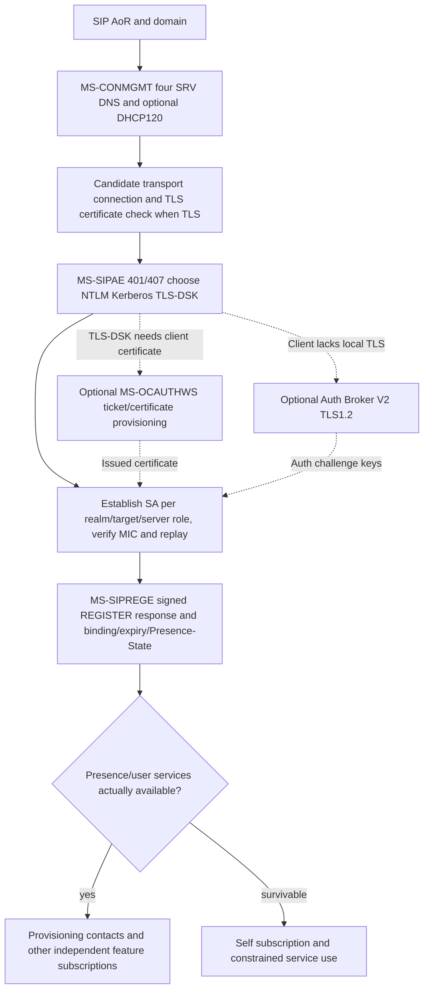

**Important qualification:** Web Ticket credential/service URL is not the SIP-AE SA challenge realm, and neither alone proves a user is registered. A successful TLS channel is only transport security; a successful SIP-AE SA is not SIP registrar success. Likewise successful REGISTER cannot establish presence/service availability without processing source-specific Presence-State/provisioning semantics. Do not synthesize a mandatory sequence in which all three NTLM/Kerberos/TLS-DSK mechanisms are executed; they are alternatives selected by negotiated policy.

### Combined failure evidence matrix

| Trigger | Source-specific action | Must not be conflated |
|---|---|---|
| DNS candidate lookup or all IP TCP connects fail | MS-CONMGMT §3.1.5: try next candidate as stated | Certificate mismatch (source says other failures end autodiscovery) |
| TLS certificate trust/host identity fails | TLS authentication required for chosen TLS candidate | Automatic silent switch to unencrypted TCP (not proven) |
| 401/407 challenge | MS-SIPAE §3.2.5.1: scheme-specific SA creation, possibly multiple rounds | Permanent invalid credentials without checking existing SA/state |
| Signed challenge repeats despite SA-signature | MS-SIPAE: destroy existing SA and renegotiate | Blind replay of stale MIC |
| Incoming signed response fails MIC, is missing SA, or repeats snum | Client discards message, distinct 256-window checks | Meaning of SIP status code before authenticity established |
| Kerberos ticket expires or >5m clock skew | Reestablish SA or prompt clock sync under relevant failure | Media ICE consent or REGISTER expiration |
| TLS-DSK inner handshake certificate rejected | TLS-DSK SA not established; obtain/validate certificate by source | Outer TLS proxy channel automatically invalid too |
| Web Ticket IssueToken 403/28000 | Web user authenticated but not SIP-enabled under that Web Ticket service | SIP 403 from registrar or conference focus |
| Certificate provisioning ErrorInfo | Web CSR issuance failed, different from SOAP transport success | SIP REGISTER or TLS-DSK completed |
| Signed REGISTER 200 Presence-State added/fixed during refresh | MS-SIPREGE §3.1.1.5.1 prior dialogs SHOULD terminate and re-register | SA existence or TLS channel still valid |

**Full analysis still BLOCKED** on Microsoft exact legacy Windows edition selection, cert SAN/FQDN/EKU/revocation, HTTP STS trust and token audiences, full version-4 signature byte examples, TLS1.3 inner-TLS-DSK feasibility, and specific external service discovery. No new protocol implementations, external tests or main merges.

## XIV. 2026-10-23 original SIPCOMP/MPPC and SIPRE 430 route recovery/crypto state audit

**New primary evidence files:**

- [MS-SIPCOMP 10.0 complete negotiation/transport-state and error ledger](ms-sipcomp10-negotiate-mppc-transport-error-state-2026-10-23.md) — 21 section-qualified rules verified against May 20 2025 original PDF §2.2 and §§3.1–3.2, RFC3261 §§17.1.2 and RFC2118 §§3–4. `NEGOTIATE` SIP extension **after TLS and before regular SIP** to **first-hop proxy**, `Compression: LZ77-8K`, `Max-Forwards:0`, server receives within 5s (client Timer F SHOULD 5s vs normal RFC3261 default 32s). Non-200/timeout **declines** compression; 200 with wrong algorithm **MUST close TCP**. Post-negotiation **6-byte header**, **8KiB separate send/receive histories**, `FLUSHED 0x8`, `AT_FRONT 0x4`, `COMPRESSED 0x2`; inconsistent flag combination => **MUST close TCP**. **Server may compress first, client MUST NOT compress until receiving server compressed traffic**, authentication separate. **Not IETF SigComp RFC3320**. The 2025 document cites older **RFC4346 TLS1.1** while MS-CONMGMT TLS profile cites RFC5246 TLS1.2; historical citation mismatch requiring actual TLS mode validation rather than assuming insecure version.
- [MS-SIPRE 13.0 route-HMAC lifetime, 430 Flow Failed/481 routing and per-dialog target-refresh recovery](ms-sipre13-dialog-route-integrity-430-recovery-2026-10-23.md) — 22 source-qualified rules (6 routing, 16 dialog recovery) under §§3.6–3.7, plus named critical conflicts. Proxy-HMAC key retention on protected Via/Record-Route/Contact route params **SHOULD >=1h** for transaction routing and **>=8h** for long-lived route-set tokens. These proxy keys are **not SIPAE SA MIC keys**. `Ms-Dialog-Route-Set-Update` Supported, `430 Flow Failed` with `P-Dialog-Recovery-Action`: **registration+dialog refresh**, **dialog-only target refresh**, or **wait for peer/session update**, versus unsupported extension **481**. When target refresh succeeds the client **MUST refresh route set and remote target** and may resend original failed request; stop repeated 430 loop after 2+ unsuccessful re-sends. Audio/video INVITE dialogs more recovery-appropriate than replaceable presence SUBSCRIBE dialogs; conference sub-dialogs can require distinct recovery actions.

### Cross-system state and error matrix for signaling

| State/trigger | Microsoft source action | Independent state not proven by event |
|---|---|---|
| Outer TLS established | Eligible to attempt `NEGOTIATE` on fresh first-hop connection | Not yet SA authenticated, REGISTER successful or SIP body compression ready |
| `NEGOTIATE` no response after 5s | Compression declined; reject unsolicited compressed server bytes | Does not imply user account password invalid |
| `NEGOTIATE 200` with wrong Compression header | TCP transport teardown required | Cannot treat as successful compressed transport |
| Compression accepted, no compressed server traffic yet | Client must not send compressed bytes | Does not invalidate ordinary SIP transaction layer |
| Compression packet `FLUSHED + COMPRESSED` | Terminate TCP connection | SIP dialog may continue only via separately proven reconnect/recovery |
| Proxy lost old `ms-route-sig`/route HMAC context | Route can fail with 481 or 430 depending recovery capability | SA signature, end-to-end dialog and media consent have independent lifetimes |
| SIP 430 + dialog update action | Target refresh UPDATE/SUBSCRIBE; update Contact/Record-Route before retry | Does not renew REGISTER automatically if only dialog route changed |
| SIP 430 + combined registration & dialog action | REGISTER refresh before dialog target refresh | Re-register success not proof all conference/media dialogs restored |
| `Presence-State added|fixed` on REGISTER refresh | **MS-SIPREGE v20250819 MUST treat registration refresh as failure**, while **MS-SIPRE v20250520 §3.7.5.3.2 SHOULD recover recovery-enabled dialogs** | **REC-X01 BLOCKED** until authoritative edition/branch precedence and product notes clarified |
| RFC4028 session timer and dialog route recovery timer | Independently scheduled, source says recovery timer >= negotiated session timer | Media ICE consent/reconnect and QoE timers unrelated |

### Combined signaling lifecycle sketch (S, not guaranteed Windows wire order)

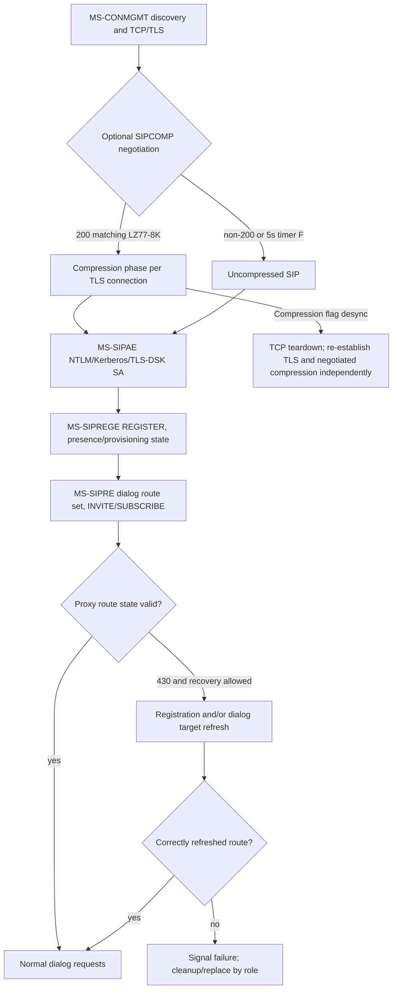

**Notable source conflict:** MS-SIPRE v20250520 §3.7.5.3.2 advises recovery-enabled dialogs on REGISTER refresh `200 + added|fixed`, whereas MS-SIPREGE v20250819 §3.1.1.5.1 says treat corresponding REGISTER refresh 200 as registration failure and previous dialogs SHOULD terminate. **No proven precedence rule**. Do not select a coding behavior or claim protocol analysis finished.

**Open gates:** Microsoft product-specific compression enablement/first-server-packet timing, exact MPPC encoding and 6-byte framing relative to TLS records, full route URI/mic canonicalization, source edition compatibility for 430 versus registrar `added|fixed`, different server-farm credential and long-lived media refresh handling, per-version historical notes. No implementation, live-server tests, merge or release.

## XV. 2026-10-23 deeper original presence, contact roaming and IM delivery (64 individually enumerated source rules)

**Original studies extending prior partial presence/contact coverage, with separate server roles and source status:**
- [MS-CONFIM rev11.0 (2025-05-20): conference IM message forwarding, 202/200 and IMDN, INFO typing, 40s MCU history](ms-confim11-conference-im-message-id-imdn-typing-history-original-2026-10-23.md): **24 section-qualified rules** (§§2.2.1–6,3.1–3.4) including `m=message 5060 sip null`, `a=accept-types`, `Supported: ms-sender`, per-conference `Message-Id`, **MCU 200** if sender sole connected participant, **202** otherwise and downstream `BENOTIFY application/ms-imdn+xml`. After 202 client waits **10s default** for matching IMDN; timeout means per-recipient **408**. MCU provides **40s temporary creation-time history**, not offline indefinite queue. A forwarded MESSAGE `From` can be conference URI; actual sender is `Ms-Sender`. Typing `INFO 202` has no IMDN; outgoing forwarding only to `ms-sender`-capable endpoints. **DOC-ERR-IM01:** in original PDF p26 §3.4.1.5.2 the heading says receiving **INFO**, but normative sentence says 200 on incoming **MESSAGE**, immediately reverting to INFO in next sentence. **Unresolved editorial inconsistency — implementation blocker** pending original errata/secondary source.
- [MS-SIP rev8.0 (2017-06-01) and MS-PRES rev13.0 (2025-05-20) contact list / ACL / Unified Contact Store migration](ms-sip8-pres13-roaming-contacts-acl-ucs-migration-version-security-2026-10-23.md): **12 roaming contact/ACL, 7 UCS and 5 privacy rules**, with full/delta `contactList` and `contactDelta prevDeltaNum/deltaNum`, separate legacy roster ACL counters, SIP `SERVICE` SOAP setContact/group, optional `BENOTIFY` no SIP response, legacy default group 1 and group IDs 1–63, `Supported: ms-ucs-ready` migration queue, **read-only contact list while migrating**, `Supported: ms-ucs` mail-server access capabilities after migration and legacy server-side proxying. Actual UCS/error status requires MS-OCER §7.3 and target Windows/client server edition. Contact membership ≠ presence subscription ≠ privacy permission.
- [MS-PRES rev13.0 atomic enhanced publication, visibility and error contract](ms-pres13-atomic-publish-container-visibility-error-policy-2026-10-23.md): **16 original section-qualified rules** (§§3.2.1–3.2.5.5,3.5.5). Client REGISTER advertises `msrtc-event-categories`; SERVICE `application/msrtc-category-publish+xml` requires identity From/To/publication URI equality and optimistic version per category instance, 0 for new; **entire batch atomic** and **409 rejects all** on version conflict; **488** for `expireType=endpoint` without corresponding registered endpoint; 200 self response returns current instances/versions. NOTIFY/BENOTIFY propagates to same-user endpoint and other authorized watchers. Visibility resolves per-category through user/domain/sameEnterprise/federated/publicCloud/default with highest numbered matching container; **watcher payload omits confidential internal container ID, version, expiry type and endpoint ID**. Container membership edits are separately atomic/versioned and can trigger notification even without changed category XML.

### Distinct identities, versions and timers across contact/presence/IM

| Dimension | First-party source | Do **not** conflate with |
|---|---|---|
| Legacy roster `deltaNum/prevDeltaNum` | MS-SIP §2.2.4.1, §3.7 | Category `version`, container membership version, ACL version, SIP CSeq |
| ACL version and access control | MS-SIP §3.7 | Enhanced presence category container priority and UCS migration mode |
| UCS `ms-ucs` vs `ms-ucs-ready` | MS-PRES §3.10 | User auth success, auto migration completed, full roster already fetched |
| Publisher/category/instance/container/version | MS-PRES §3.2.1–.5 | User roster group ID (1–63), SIP GRUU, MCU conference Message-Id |
| Conference MCU `Message-Id` | MS-CONFIM §2.2.4,3.3 | SIP CSeq/Call-ID or universal 1:1 IM ID |
| Conference sender `Ms-Sender` | MS-CONFIM §2.2.3 | Routing `From` (conference URI) or spoofable legacy text prefix |
| MCU client IMDN timeout default **10s** | MS-CONFIM §3.3.1.6 | MCU message history **40s**, conference C3P command **32s/180s** |
| Conference INFO typing 202 | MS-CONFIM §3.4 | MS-CONFBAS Focus C3P `INFO` 202, MS-CONFIM `MESSAGE` 202, QoE `SERVICE` 202 |
| Successful publish SERVICE 200 | MS-PRES §3.2.5 | Proof of presence delivery to unauthorized contacts, or roster sync |
| Endpoint registration expiry | MS-PRES §3.2.5.5 | Entire user's contact list deletion, active unrelated endpoints and user-bound publications |

**Cross-system research model, not mandatory packet order:**

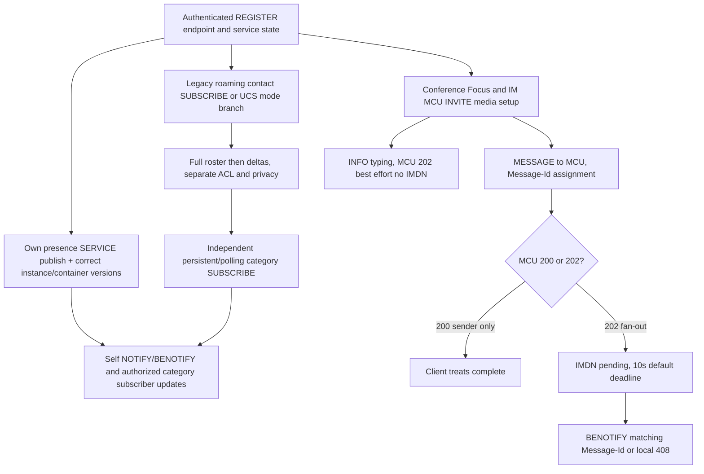

**Source authority guard:** Microsoft legacy MS-SIP **2017** and Microsoft MS-PRES **2025** edition differences are not proof that every Windows Full Client uses the same store at every deployment. RFC3428 permits MESSAGE within established SIP dialog without MESSAGE itself creating one; MS-CONFIM specifically requires the **MCU INVITE media dialog**. Legacy RFC2976→RFC6086 INFO and RFC3265→RFC6665 SUBSCRIBE event upgrades need per-product compatibility; BENOTIFY is an independently negotiated nonresponded Microsoft method, **not RFC NOTIFY**. The source §3.4.1.5.2 INFO/MESSAGE contradiction and all 2025 original product notes remain **OPEN**.

**Remaining gates:** full CONTACT SOAP schema/response/error codes; UCS mode and MS-OCER behavior; privacy subscriber list and presence aggregation; IMDN late/duplicate/Message-Id=0 and 40-second history ordering; legacy conference INFO editorial errata; actual 1:1 IM invitation, MIME and human read/delivery semantics; actual Windows and MCU editions. **Not full normative closure. No implementations, live-server or interoperability tests, merge or release.**

## XVI. 2026-10-23 telephony/PSTN, E911 civic location, Exchange UM audio and RTP DTMF

**New original-document studies:**

- [MS-OCPSTN 11.0 + MS-E911WS 9.0: SIP dial plan, phone-context, PSTN gateway role, E911 HTTPS/SOAP location](ms-ocpstn11-e911ws9-numbering-gateway-location-security-2026-10-23.md) — **25 numbered source-qualified rules** (13 PSTN and 12 LIS). Local dial plan may yield E.164 SIP URI or `phone-context=<location profile|dialstring|enterprise>`; **proxy** separately normalizes provisioned routing. `isGateway`, `Ms-Call-Source ms-rtc|non-ms-rtc`, **605 loop rejected by UAS → 480 by proxy**, `ms-early-media` permits gateway unreliable 183/SDP under MS-SDPEXT §3.1.5.12, optional `ms-bypass`, `ms-accepted-content-id` ties SDP answer to offered MIME part, anonymized `anonymous@...;user=phone`. **E911WS** is **HTTPS SOAP civic-location retrieval**, `GetLocations` with Entity + network identifiers, `GetLocationsInCity` with Entity/Country/State/City; client must separate HTTP 2xx from required XML `ReturnCode=200|400|404|500`. Returns **PIDF/GEOPRIV civic address**, sensitive and contingent on authenticated LIS identity; user can choose among multiple addresses. **The emergency SIP INVITE/PSAP/location conveyance remains NOT proven by this service.**
- [MS-EUMR 9.0 + MS-EUMSDP 9.0 + MS-DTMF 15.0: voicemail routing, notification, audio-only negotiation and RTP telephone events](ms-eumr9-eumsdp9-dtmf15-voicemail-routing-media-2026-10-23.md) — **31 numbered source-qualified rules** (10 UM routes, 9 UM notifications, 5 UM SDP, 7 DTMF). SIP **proxy** for UM-enabled user routes voice mail to selected **dial-plan UM server** via TLS5061 URI and A/V Edge GRUU when configured. Proxy UM routing timer **MUST <180s, SHOULD 5s**, limited **302** in-dial-plan single Contact reroute (at most four prior redirects), multipart 415 fallback via MS-SIPRE, next-server retry and terminal **480 SHOULD**. Proxy→UM missed/answered/forbidden **INFO** uses a dedicated **m=application 9 SIP *** INVITE dialog and mutual TLS with **10-minute inactivity timer**, *not desktop UI MESSAGE*. UM SDP **only audio** and **ignores same-fork provisional-to-final SDP changes**; bypass, feedback and video/sharing attributes ignored. RTP `telephone-event` negotiated dynamically (RFC4733) supports **0–16** under Microsoft, forbids zero duration, redundant blocks or multiple event payloads per packet.

### Client feature and role applicability

| Full Client feature / component | Direct Microsoft source | Verified / not yet substantiated |
|---|---|---|
| Dial a PSTN number or enterprise extension | MS-OCPSTN §§2.2.2,3.2 and RFC3966 §5.1.5 | P: client vs proxy dial-plan translation split; **U** actual client policy/provisioned user location profile |
| Gateway-originated call, UI gateway indicator, PSTN loop detection | MS-OCPSTN §§3.1,3.3 | P: gateway/proxy scoped, **not desktop UAC MUST generate** gateway headers |
| Early media and bypass | MS-OCPSTN §§3.4,3.6–3.7; MS-SDPEXT §3.1.5.12 | P: capability and MIME selection; **U** media security, consent and role-specific gates |
| Civic address retrieval and emergency feature | MS-E911WS §§2.2,3.1,5.1; MS-OCSPROT §2.5.4 | P: authenticated LIS HTTPS SOAP, PIDF/GEOPRIV privacy and XML return codes; **BLOCKED** SIP emergency call setup/routing/PSAP |
| Voicemail deposit / UM audio media | MS-EUMR §§3.1, MS-EUMSDP §3.1.5 | P: proxy routing and audio-only SDP; **U** actual UM deployment and product edition |
| Missed/answered/forbidden email notification | MS-EUMR §3.2 | P: proxy→UM dedicated INFO/MIME, not a desktop-originated email protocol |
| Keypad digits during connected audio | MS-DTMF §§2–3 and RFC4733 | P: dynamically negotiated RTP telephone-event, not universal SIP INFO DTMF |
| All phone transfer/hold/forward/E911 callbacks/IVR features | MS-SIPRE, MS-OCPSTN, MS-OCEXUM and other candidates | **U** all clauses and states NOT fully covered, therefore no implementation phase |

### Composed call/contact/address/media phases (S: branch-based explanatory model)

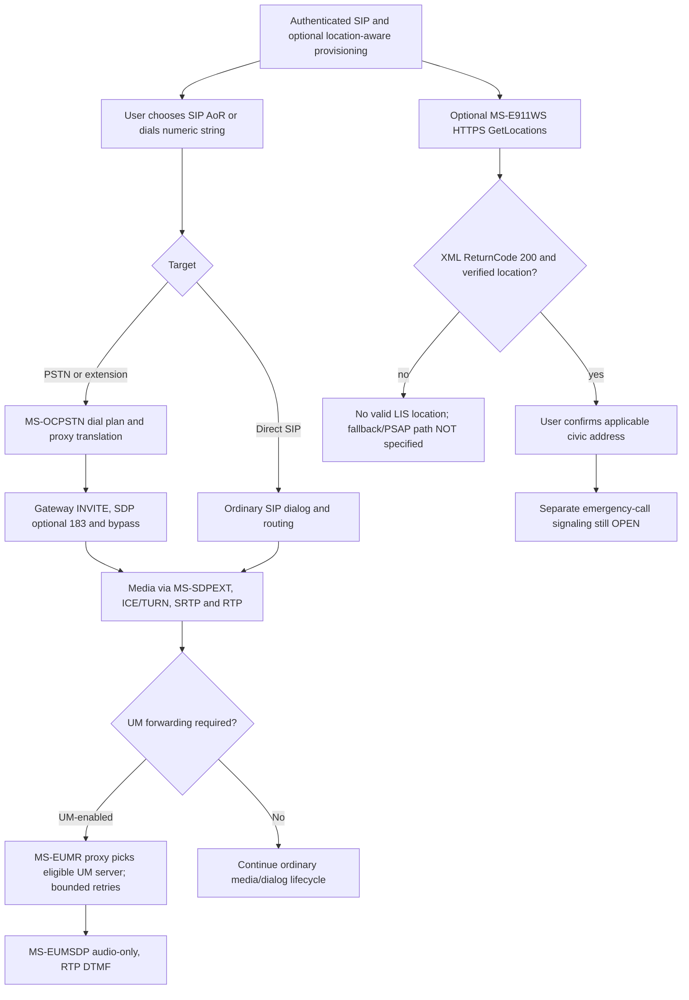

**Security and standards guards:** `phone-context` under RFC3966 is an identifier **scope, not a telephone-number prefix**. SIP `P-Asserted-Identity` belongs to a trusted network per RFC3325. UAS `605` with gateway `Ms-Call-Source` is not a normal client success. E911WS `ReturnCode 404` in HTTP 2xx is **application-level no match**, not SIP 404. UM SIP 302 rewrite is server-side, not a client browser redirect. RFC4733 events are RTP media data and need negotiated payload/security, not SIP MESSAGE. Microsoft EUMSDP’s provisional/final same-fork equality **overrides** generic MS-SDPEXT allowance for other peers, an **edition/role-specific** fork in media state. Full emergency SIP location conveyance, media privacy and regional E911 deployment remain research blockers; no emergency test traffic from assistant.

**Status remains NOT COMPLETE; no protocol code, live-server/interoperability testing, main merge or release.**

## XVII. 2026-10-23 conference creation, Focus admission/C3P and ASMCU desktop-sharing states

**Two new direct original-source technical audits (46 individually scoped requirements, not client conformance claim):**
- [MS-CONFPRO rev13.0 and MS-CONFBAS rev15.0, exact provisioning→Focus→lobby→C3P conference control](ms-confpro13-confbas15-conference-factory-focus-lobby-control-rfc4575-2026-10-23.md) — **28 numbered P/R/S requirements**, originals v20250520 §§2.2–3.5; RFC4575 conference event package and RFC4579 call control. `SERVICE application/cccp+xml` to **Focus Factory** handles `addConference`/`modifyConference`/`getConference`/`deleteConference` with requestId correlation; creation conference-key is *deprecated* even though GetEncryptionKey X509 public-certificate operation remains; optimistic conference version and static-meeting product limits. `INVITE` with `addUser` creates independent **Focus signaling dialog**; then conference `SUBSCRIBE` first full roster (piggyback 200 or NOTIFY/BENOTIFY), own lobby/admission and MCU URI table. **32s** optional first full subscription timeout; Focus lobby hides other participants and MCU details; Focus **400/403/404/603** join failures. Authorized Focus `INFO application/cccp+xml` operation receives **SIP 202 accepted** then **C3P pending/success/failure** via later Focus INFO or inline 200. Client command timeout **32s initial, 180s after C3P pending**, Focus processing timer **28s**; all distinct from SIP and media timers.
- [MS-CONFAS rev12.0, sharer/viewer SDP roles, RDP-over-RTP conference media and permissions](ms-confas12-application-sharing-sdp-rdp-handoff-policy-2026-10-23.md) — **18 numbered clauses**, v20250520 §§2.2,3.2–3.3. ASMCU uses separate `conf-uris` purpose **applicationsharing** and modality INVITE. `m=applicationsharing` + SDP `x-applicationsharing-role:sharer|viewer` with **reversed MCU answer**; share-video direction corresponding to role, SDP 488 for malformed/no usable media or mismatched video direction, additional role m-lines individually refused `port=0` under RFC3264. Sharer↔viewer renegotiation uses ASMCU **re-INVITE**, old m-line disabled port 0 and new line created. The MCU announces **signaling connected → media-state joining → (SHOULD after RDP connected) media-state connected**. New sharer ejects previous sharing user on this **ASMCU dialog** by SIP BYE diagnostic **21000**, with roster media removal; this does **not automatically terminate Focus dialog**. Source permissions include **21001** appsharing policy, **21002** attendee sharer policy and capability **desktop|singleApplication|none**; `singleApplication` MUST NOT begin desktop-wide sharing. RDP/RTASPF framing/security remains to be audited.

### Feature-by-feature independently observable evidence

| Goal / user-visible event | Necessary documented protocol evidence | What does **not** prove it |
|---|---|---|
| Meeting successfully scheduled | Focus Factory SERVICE 200 + C3P `code=success`, conference URI and conference version, with verified requestId | SIP 200 without XML parse; Focus INVITE from another client |
| Meeting detail changed | `modifyConference` based on current version; server increments version | Old local version, published presence category version |
| User entered meeting | Focus INVITE `addUser` successful, own endpoint status from full roster | Factory addConference success or global registration 200 |
| Lobby admitted | Conference subscription own endpoint `connected` full-state rather than lobby-limited state | 200 Focus INVITE by itself; visible empty roster |
| Moderator command completed | C3P final success/failure with matching command requestId (possibly after SIP 202 and C3P pending) | SIP INFO 202 alone |
| Application-sharing media negotiated | ASMCU SIP INVITE with correct role/media SDP, 200 SDP answer | Focus conference joining or simple C3P roster activation |
| Viewer or sharer actually streaming | ASMCU / Focus roster media-state connected after RDP connection and separately proven ICE/RTP security | SDP 200 or `media-state=joining` |
| Screen sharing displaced by another user | ASMCU BYE `ms-diagnostics-public:21000` and media roster updates | Account deregistration, Focus conference ended |
| Attendee forbidden to share | Conferencing policy and role, diagnostics 21001 or 21002 under respective guards | Generic SIPAE failed authentication, unsupported local resolution |
| Screen vs single application | Capability `supports-application-desktop-sharing:desktop|singleApplication|none` and admin permission | Declared `sharer` alone |
| One endpoint leaves a conference | That endpoint's Focus dialog/roster state only; remaining endpoints independent | User removed globally across other endpoints |

### Conference signaling subsystem synthesis (not a mandatory observed packet trace)

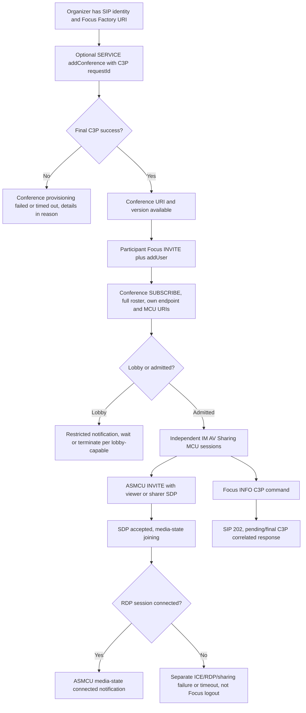

**Critical unresolved matters:** MS-CONFAS refers to a `server-mode=13` attendee sharer gate, while MS-CONFPRO describes `server-mode` as obsolete for **MCU-type selection**; these are distinct use cases, do not claim universal conflict or ignore either without edition policy audit. MS-CONFAS prose uses both `sharing/viewing` and `sharer/viewer` token strings; formal MS-SDPEXT ABNF and original wire examples must resolve exact sent values. **Full MS-RDPBCGR, MS-RDPEMC and MS-RTASPF**, authentication and integrity of RDP-over-RTP media, policy/role mapping, end-to-end SDP/ICE/SRTP and eventual moderator/participant leave sequence all remain OPEN. These source gaps are not license to plan implementation.

**Research continues, global protocol analysis NOT COMPLETE; no code, live-server or interop tests, main merge or release.**

Research lives on `security/offline-register-mic-bridge-20261021` in draft PR #51. **No protocol implementation or owner live-server interoperability tests by assistant; no merge/release. Global research status: NOT COMPLETE.**
