# CommSCraft / classic Skype for Business Windows Full Client — research evidence master index

**Last evidence update: 2026-10-23. Status: INCOMPLETE, implementation gate CLOSED.**
This is a durable entry point for research under draft PR #51, **not** an assertion of complete normative/functional compliance. Its tables explicitly distinguish examined original clauses, reconstructed cross-protocol behavior and unresolved normative gaps. Nothing here authorizes new protocol code, real-server traffic, merges or releases.

## I. Evidence, roles and provenance

**Evidence codes:** `P` = primary Microsoft Open Specification or RFC text directly verified at cited edition/section; `S` = cross-spec synthesis inferred from multiple `P` rules, needing full sequence proof; `U` = unverified or unavailable behavior; `H` = historical/feature-conditional deployment rule. Each rule must be independently assigned a *role* (UAC, UAS, registrar, proxy, MCU, web-service client, web-service server, media peer) and an applicability guard (client version, topology, auth scheme and negotiated extensions). Server MUST ≠ client MUST.

**Corpus boundary (current):** owner's archive includes **150 MS-PDF physical editions** and a separate FIPS197 original; 54 original-index primaries and 96 additional physical PDF editions, with the historical MS-SIPRE v20150904 footer now verified. Complete [150-node PDF source hashes and dates](research-corpus/microsoft-originals-150-edition-and-source-index-2026-10-22.csv) and [3060 classified reference edges](research-corpus/microsoft-originals-150-classified-reference-edges-2026-10-22.csv) are committed. **138 split normative/informative lists, 7 unsplit overviews, 5 AD schema special cases**. Whole-client *normative transitive* closure is still NOT established: 191 Microsoft IDs referenced by broad Windows+Office corpus are not local (68 from normative sections), distinct from **zero missing directly cited Microsoft PDFs within selected 31 immediate client roots**. RFC edition chains/client applicability remain open. See [full dependency audit](full-150-pdf-normative-informative-reference-graph-2026-10-22.md). 112 assessment files are secondary, not original proof.

**Selected directly checked original editions** (not proof of full reading): MS-OCSPROT 9.0 (2025-05-20), MS-CONMGMT 10.0 (2025-05-20), MS-SIPAE 11.0 (2025-05-20), MS-SIPREGE 17.1 (2025-08-19), MS-SIPRE 13.0 (2025-05-20), MS-PRES 13.0 (2025-05-20), MS-SIP 8.0 (2017-06-01), MS-SIPCOMP 10.0 (2025-05-20), MS-CONFIM 11.0, MS-CONFAV 11.0, MS-CONFAS 12.0, MS-SDPEXT 16.0, MS-ICE2 19.0, MS-SRTP 14.0, MS-AVEDGEA 12.0, MS-OCPSTN 11.0, MS-EUMR 9.0, MS-EUMSDP 9.0, MS-OCEXUM 11.0, MS-E911WS 9.0, MS-RGSWS 9.0 (remaining dates 2025-05-20). For source URL, PDF SHA and section references use the ZIP inventory and linked per-protocol research. A date on original PDF is **not proof** that every target Skype for Business build implements every rule.

## II. Layered architecture and constraints

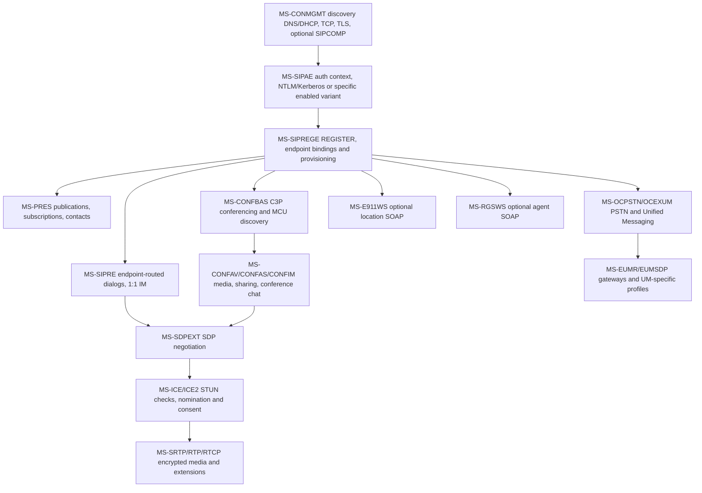

**Graph is a dependency map, not unconditional packet order.** SIP registration does not itself guarantee presence availability, conferencing, media connectivity, browser/response-group provisioning or successful PSTN dialing; ICE is not a general requirement for every text-message transaction. Both `A` and `R` are protocol states rather than global `connected=true` flags.

## III. Seven complete-client workflow research ledgers

### 1. Client startup, discovery and transport

**P:** MS-OCSPROT 9.0 §§2.5.1–2; MS-CONMGMT 10.0 §§3.1.4–3.1.5, 3.2–3.4; MS-SIPCOMP 10.0 §§2.2.3–4, 3.1.5 and 3.2.5; RFC3261/RFC3263/RFC2782/DHCP references still partly open.

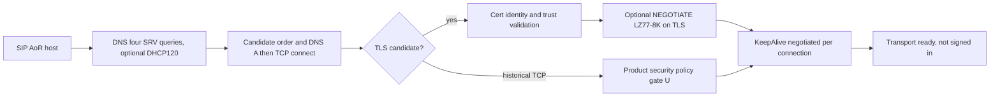

**P**: Four SRV service prefixes; candidate order is Microsoft-defined; optional compression negotiation must occur after successful TLS but before other data on that channel; keepalive only when successfully negotiated. **U**: full RFC2782 weight ties, RFC3361 DHCP byte fields, full TLS/SAN/revocation product policy, decompressed MPPC total frame boundaries. See [startup/TLS](ms-conmgmt10-ocsprot9-startup-discovery-tls-keepalive-2026-10-22.md), [compression negotiation](ms-sipcomp10-conmgmt10-negotiation-inactivity-original-2026-10-22.md), [binary SIPCOMP](ms-sipcomp10-binary-frame-flags-receiver-state-2026-10-22.md).

### 2. TLS identity, authentication and signing

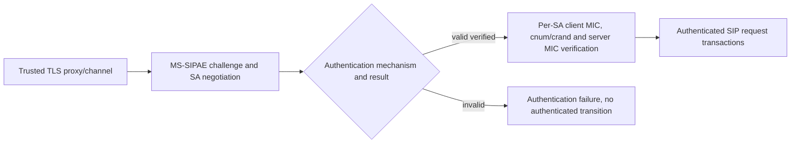

**P:** MS-SIPAE 11.0 §3.2.4.1 client 16-position canonical signing input, counter/crand and signature algorithms (NTLM/Kerberos GSS MIC or TLS-DSK-specific HMAC where applicable); client/server security context and replay trust must be verified before marking authenticated. **S**: combine with TLS name proof and REGISTER admission. **U**: every Kerberos/NTLM TLS-DSK scheme product note, PKI/realm, context rollover on proxy migration, cross-hop response MIC requirements. See [client MIC original](ms-sipae-11-direct-pdf-client-signature-and-digest-2026-10-22.md), [SA trust](ms-sipae-cross-section-authentication-trust-state-2026-10-22.md), [bidirectional integrity](ms-sipae-bidirectional-integrity-and-epid-media-2026-10-22.md).

### 3. REGISTER, provisioning and bootstrap

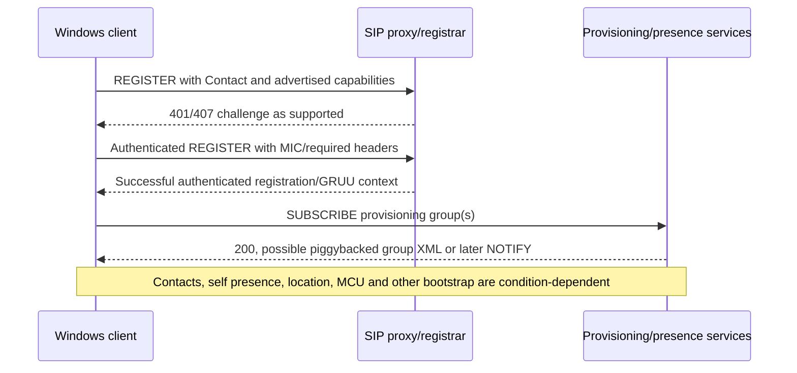

**P:** MS-SIPREGE 17.1 §§2.2.2.4–5, 3.3.1–2, MS-OCSPROT 9.0 §2.5.3; provisioning request and response group element names differ; 200 may carry XML if first-notify piggyback supported. **S:** higher-level bootstrap composition; original overview order expressly not universal. **U:** entire provisioning XML schema, subscription renewal and failure recovery under historical RFC3265 vs modern RFC6665. See [provisioning](ms-siprege-17-original-pdf-provisioning-lifecycle-2026-10-22.md), [client subscribe](ms-siprege-17-client-provisioning-state-rfc3265-2026-10-22.md), [bootstrap](ms-ocsprot9-bootstrap-and-siprege17-piggyback-fork-2026-10-22.md).

### 4. Presence, contacts, personal IM, multi-device

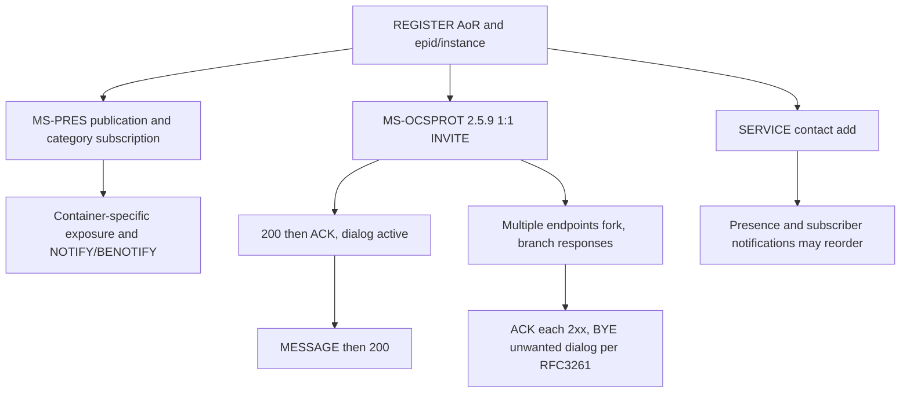

**P:** MS-PRES 13 §§3.2.5.3–5.1 category container priority and metadata privacy; MS-SIP 8 BENOTIFY negotiation; MS-OCSPROT 9 §§2.5.9–11 explicit IM/contact/multi-device examples; MS-SIPRE 13 §§3.2–3.4 endpoint routing, EPID-derived SIP.INSTANCE and GRUU; RFC3261 §13 fork races. **U:** full contact/group XML, typing, all 1:1 MIME variants, endpoint-capability election, unknown client behavior on dual 2xx. See [presence](ms-pres-privacy-container-resolution-benotify-register-2026-10-22.md), [personal messaging](ms-ocsprot9-direct-im-contacts-multidevice-sequences-2026-10-22.md), [routing/identities](ms-sipre13-epid-instance-gruu-routing-original-2026-10-22.md), [fork races](rfc3261-forked-invite-ack-cancel-bye-state-ledger-2026-10-22.md).

### 5. Conference IM, A/V and sharing

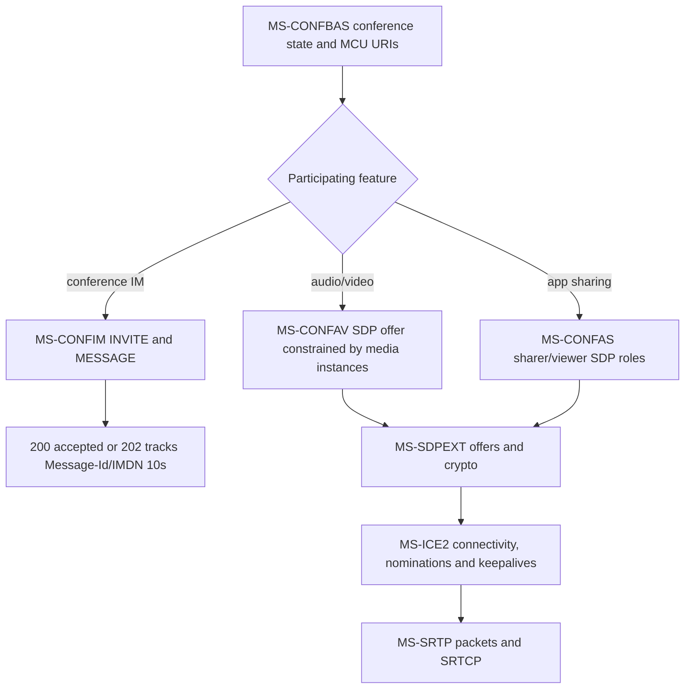

**P:** MS-CONFIM 11 §§3.3; MS-CONFAV 11 §3.1.5.2.1; MS-CONFAS 12 §§3.2.5.1.1–6; MS-SDPEXT 16 §3.1.5.1; MS-ICE2 19 §§3.1.6.2–5; MS-SRTP 14 §§3.1.5.1–2. **S:** media progression across services and conference control. **U:** complete C3P schemas, conference joining failures, exact sharing RDP data channel, codec matrices, ICE1↔ICE2 and older-client media policies. See [conference IM](ms-confim-pres-registration-lifecycle-cross-spec-2026-10-22.md), [media matrix](media-sdpext-ice2-confav-srtp-avedgea-original-pdf-2026-10-22.md), [app sharing](ms-sipre-dlx-confas-original-source-cross-analysis-2026-10-22.md).

### 6. PSTN, voicemail, location services and response-group agents

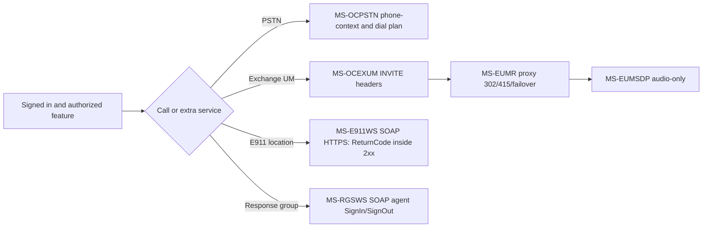

**P:** Six 2025 original specs each verified at selected clauses (not whole documents); role- and error-qualified ledger in [PSTN/E911/UM original cross-analysis](ms-ocpstn-eumr-eumsdp-ocexum-e911ws-rgsws-cross-spec-2026-10-22.md). **U:** emergency-calling routing itself, full location verification/UI, PSTN codec fallback, agent authorization and product-specific feature presence. **Important:** E911 web lookup success is not proof that an emergency call is correctly placed or routed.

### 7. Signout, transport failure, registration expiration and recovery

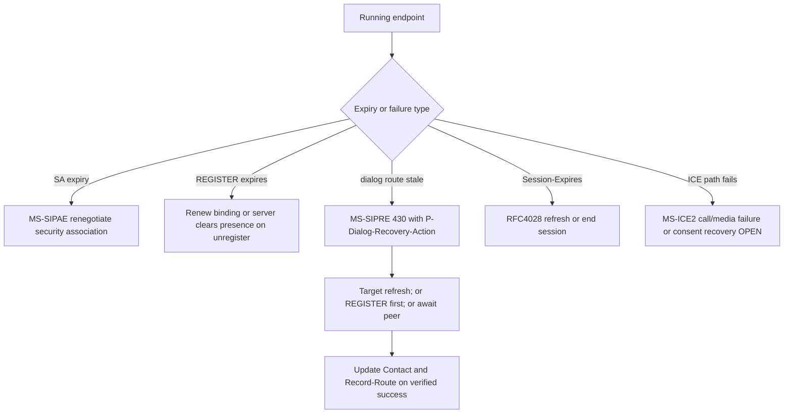

**P:** MS-SIPRE 13 §3.7, MS-SIPAE 11 §3.2.6, MS-PRES 13 §§3.2.5.5–5.1, MS-SIPREGE 17.1, RFC4028, MS-ICE2. **S:** concurrent independent timeouts; never collapse to a single reconnect state. **U:** accurate simultaneous expiry order, transport certificate/key changes and media reconnect, correct retry limits across branches and complete signout semantics. See [dialog recovery](ms-sipre13-dialog-recovery-430-flow-failed-2026-10-22.md) and [multiple lifetimes](rfc4028-ms-sipre-siprege-sipae-multilifecycle-recovery-2026-10-22.md).

## IV. Full-client requirement gate matrix (research status only)

| Feature gate | Evidence level | Deep-source proof still required |
|---|---|---|
| Server discovery / DNS / DHCP | P partial | All error/resolver and product policy branches |
| TLS/PKI and proxy name identity | P partial | Names/SAN, trust, revocation, modern TLS vs historical profile |
| SIP compression | P partial | Full MPPC bitstream, frame delimiting, malformed packet recovery |
| Keepalive/transport reconnect | P partial | Expiry, proxy migration, exact SIP keepalive bytes |
| Kerberos/NTLM/TLS-DSK | P partial | All authenticated handshake branches and target profiles |
| Per-request/response MIC and replay | P partial | All schemes, error recovery, concurrent SAs |
| REGISTER, GRUU, EPID, SIP.INSTANCE | P partial | Expiration races and full wire property cases |
| Provisioning and bootstrap | P partial | All service groups, XML, subscriptions, policy matrix |
| Presence/category containers | P partial | All category schemas, privacy and federation |
| Contact lists/search/roaming | P partial | MS-ABS/MS-DLX all WSDL/errors and MS-PRES contact XML |
| 1:1 text / forked dialogs | P high-level | Detailed SDP, MIME, receipts, SIP dialog errors |
| Conference IM | P partial | IMDN XML, lifecycle, conference role errors |
| Peer audio/video | P partial | Codec, hold/reinvite, full SDP/ICE/MS-SRTP packet profile |
| App/desktop sharing | P partial | MS-RDPBCGR/MS-RDPEMC streaming and ASMCU state |
| PSTN/voicemail/UM | P partial | More MS-OCPSTN/OCEXUM/EUMR and dialplan security |
| E911/emergency calling | P for SOAP only | Emergency call placement/routing, geolocation rules |
| Response group agent controls | P SOAP operations | Client deployment and agent status behavior |
| Graceful signout/unregister | P partial | Full teardown ordering across presence/media/service |
| Network loss, dialog/SA recovery | P partial | All timers/races, product-specific fallback and security |
| Client telemetry/QoE/error reporting | U or references only | MS-QoE, MS-OCER original end-to-end data flow |

**Research completion conditions:** (1) every relevant original document's edition, URL, hash, RFC/MS references and client applicability; (2) section-level normative verification including negative/error and timers, security and conformance examples; (3) each wire format and state diagram independently proof-linked; (4) conflict/obsolescence and product behavior matrix resolved or explicitly stated as blocking; (5) owner reviews proof completeness. **A detailed implementation plan is not produced until this research gate is closed.**

## V. Source conflicts and high-risk assumptions to avoid

1. `MS-SIP` supplied edition **2017** while many other PDF editions are **2025/2026**. Do not assume same feature matrix or full update compatibility.
2. RFC3265 references in Microsoft 2025 PDF vs obsoleting RFC6665: deployment/edition applicability open.
3. RFC5246/TLS 1.2, RFC4346/TLS 1.1 and historically 'SSL' wording in service specs: not an authorization for obsolete crypto.
4. Historic ICE RFC5245 vs RFC8445 and Microsoft ICE/ICE2: don't force modern candidate and consent semantics onto a legacy negotiated variant.
5. RFC3428 direct MESSAGE has no *intrinsic* dialog but Microsoft's MS-OCSPROT §2.5.9 IM example uses separately established INVITE dialog. Both true.
6. Microsoft conference-specific 202/IMDN/Message-Id/timer ≠ automatic personal-IM requirement.
7. REGISTER binding vs authenticated SA vs session refresh vs routable dialog vs ICE consent all have separate timers and fail conditions.
8. SIP gateway/proxy/UM-server-only MUSTs should not become Windows UAC MUSTs.
9. Historical PDF is present ≠ required Windows feature ≠ analyzed ≠ current recommended security behavior.
10. An error in SOAP `ReturnCode` or SIP route negotiation may occur despite HTTP 2xx / SIP 200 on a different layer; never flatten status meanings.

## VI. Repo source traceability and research-only delivery

Additional published research under `docs/` includes:
- [Corpus intake / SHA validation](uploaded-specification-corpus-intake-2026-10-22.md)
- [MS-OCSPROT SIP reference list](ms-ocsprot-sip-protocol-reference-catalog-2026-10-22.md)
- [RFC3261 REGISTER / transaction ledger](rfc3261-uac-registration-transaction-clause-ledger-2026-10-22.md)
- [MS-SIPAE challenge flow](ms-sipae-challenge-state-machine-research-2026-10-22.md)
- [Unregistration](ms-siprege-unregistration-wire-and-security-analysis-2026-10-22.md)
- [MS-CONMGMT presence linkage](ms-conmgmt-presence-cross-spec-research-2026-10-22.md)
- [MS-SIP BENOTIFY](ms-pres-privacy-container-resolution-benotify-register-2026-10-22.md)
- [RFC3428/RFC8591 boundaries](direct-and-conference-im-rfc3428-8591-profile-boundaries-2026-10-22.md)

## VII. 2026-10-22 contacts/directory evidence expansion (new primary-clause audit)

This subsection **supersedes the earlier generic 'contacts partially checked' description with concrete proof**, but does NOT close the Windows Full Client contact requirement gate.

- [MS-ABS 10.1 original binary address-book audit](ms-abs10-original-binary-book-delta-compression-and-rnl-2026-10-22.md): `v20250819`, §§1.3, 2.1.1, 2.2.1–16, 5.1–5.3 and product notes; 13 role/data-qualified findings. HTTP GET from provisioned ABS URL, little-endian full/delta/compact formats, block CRC32, 12-byte headers, two-byte base/full file hash, local normalization, compact-delta missing-vs-deleted attribute behavior, device-only .dabs distinction. **One original PDF page was visually rendered and checked** for endian/product notes.
- [MS-PRES 13.0 / MS-DLX 13.0 original presence-and-directory audit](ms-pres13-dlx13-batch-presence-directory-contacts-2026-10-22.md): `v20250520` sections MS-PRES §§2.2.2.4.1–3, 3.4.5.1.1–3.4.5.2, 3.6.5.1 and MS-DLX §§2.1, 2.2.5.1, 3.1.4.1.3–4. **23 source- and role-qualified rules**: batch vs single SUBSCRIBE, poll vs persistent, accepted/rejected resources in 200 multipart RLMI, re-subscribe/pool GRUU, private category exclusion, BENOTIFY, SOAP response group status, Users/NestedGroups, nested results and independent authorization failures. Linked MS-OCSPROT 9.0 §§2.5.7,2.5.10.
- **Evidence distinction:** local Microsoft Address Book AD `objectGUID` ≠ user-contact-roster membership ≠ MS-SIPRE `epid`/SIP.INSTANCE/GRUU. Cached offline address-book `HTTP GET` ≠ SOAP distribution-list expansion ≠ persistent SIP category subscription. This is crucial to avoid sharing authorization and expiry state improperly.
- **Blocking new questions:** full MS-PRES roster-creation SERVICE XML, 200 response with partial RLMI rejection and real-client handling, DLX WSDL authentication and nested-group traversal, historical vs current TLS for HTTPS, exact MS-ABS .dabs and compact delta product notes, all remaining original-source RFC and schema references.

**Research gate remains OPEN.** These links document the source sections actually checked; not proof of complete specifications or sufficient implementation planning.

### RFC event-notification editions: dedicated primary-series analysis

- [RFC 3265 → RFC 6665 → RFC 7621 normative edition reconciliation](rfc3265-6665-7621-event-subscription-edition-reconciliation-2026-10-22.md): 12 direct RFC Editor checks: RFC6665 obsoletes 3265, modifies event-dialog creation and Timer N (`64*T1`), no 202 for SUBSCRIBE/NOTIFY, RFC7621 clarifies GRUU for notifier/dialogs. The Microsoft's 2017/2025/2025 documents still refer to RFC3265; exact behavior per Windows-client edition and `ms-piggyback-first-notify` / `ms-benotify` remains an **explicit blocking compatibility gate**.

## VIII. 2026-10-22 conference control foundation: provisioning, focus dialogs, roster and media events

**Edition-and-section qualified original research** (not complete conferencing):

- [Focus Factory provisioning MS-CONFPRO 13.0, May 2025](ms-confpro13-focus-factory-c3p-provisioning-version-key-2026-10-22.md): **17** original requirements across §§2.1–2.2.3,3.1–3.2: SERVICE with UTF-8 `application/cccp+xml`, requestId correlation, organizer/delegate identities, 32-second ORQ Request Timer, addConference/static/modify version and conflict, deletion, capability probe, `getConference` encrypted conference key and role-qualified server authorization.
- [Conference Focus MS-CONFBAS 15.0 and XML media control MS-XMLMC 10.0, May 2025](ms-confbas15-xmlmc10-focus-lobby-roster-video-control-2026-10-22.md): separate Focus INVITE/C3P `addUser` and endorsements, BYE/UPDATE, multiple endpoints, optional MCU bootstrap failure (conference remains activated), admission/lobby privacy, first-full roster 32s and RFC4575 partial version state, MCU URI discovery and distinct XML picture_freeze over INFO. Additional **asynchronous C3P INFO** state machine: 202 Accepted is provisional *command processing*, later C3P success/failure arrives in INFO or direct 200; requestId/pending timer initially 32 seconds, extended 180 seconds on pending, Focus timer 28 seconds. **Do not confuse** with provisioning SERVICE or MS-CONFIM MESSAGE 202/IMDN.
- Original RFC Editor source: [RFC4575](https://www.rfc-editor.org/rfc/rfc4575) §4.6 (full/partial/deleted and version gap refresh), [RFC4353](https://www.rfc-editor.org/rfc/rfc4353) architecture, [RFC6086](https://www.rfc-editor.org/rfc/rfc6086) (2011 obsoletes RFC2976 but explicitly preserves legacy INFO). Microsoft 2025 references RFC2976/3265, so the **correct Windows-client edition profile and supported INFO/event extensions remain open**.

**Additional feature gate:** `conference reservation` ≠ `focus signaling dialog` ≠ `focus conference subscription` ≠ `MCU media dialog`. Model organizer/delegate/presenter/attendee/lobby, per endpoint roster state and per-MCU availability separately, and do not expose conference keys/web URLs through ordinary conference-info notifications. The master feature 'conference IM/A/V/sharing' remains **P partial** rather than complete: full C3P command schemas, independent MCU protocol, event package versions, legacy auth, all errors and end-to-end media failure states still block planning.

## IX. 2026-10-22 original media transport, consent and crypto contradiction review

**New original clause-level studies** expand media coverage (not complete RFC conformance):

- [MS-ICE2 19.0 ICE/consent ledger](ms-ice2-19-original-checks-nomination-consent-rfc-profile-2026-10-22.md): original May 2025 §§3.1.2,3.1.4,3.1.5.2–3,3.1.6.1–5; **17** scoped requirements for UDP/TCP modes, candidates, ICE provisional fork handling, 20-provisional/80-pair resource bounds, timeout/reset, integrity, regular nomination, 19s keepalive, STUN consent freshness at 5s/30s and strict response validation. Modern RFC8445/8839/7675/8489 explicitly **not equivalent** to Microsoft legacy draft profile.
- [MS-SDPEXT 16.0 + MS-SRTP 14.0 + MS-AVEDGEA 12.0 security ledger](ms-sdpext16-srtp14-avedgea12-security-negotiation-conflict-2026-10-22.md): original May 2025 crypto field constraints, AVP/SAVP optional security, early media and non-reINVITE renegotiation, SRTP contexts and replay windows, Edge SIP SERVICE token issue and per-credential errors.
- [MS-TURN 21.0 relay allocation challenge ledger](ms-turn21-original-allocation-401-relay-legacy-rfc-2026-10-22.md): original May 2025 allocation challenge/retry, MS-Version/IPv4/IPv6/multiplex, authenticated responses, fixed 650ms nine-attempt recommendation, distinction from SIP REGISTER and ICE consent; modern RFC8656 cannot replace legacy TURN draft-specific packets.

**BLOCKING SECURITY DISAGREEMENT CRYPTO-01 (two independently verified original primary clauses, also confirmed in Microsoft Learn's May 2025 pages):** MS-SDPEXT §3.1.5.1 requires suite `AES_CM_128_HMAC_SHA1_80`, whereas MS-SRTP §3.1.3.3.2 requires **HMAC-SHA-256** with 80-bit tag. These names do **not** unambiguously designate one hash. Do not implement or resolve by assumption: check Microsoft errata and product notes, MS-SSRTP and RFC3711/4568 precise contexts. Profile/edition trust gate stays **OPEN**.

**Media state plane boundaries:** SIP registration + per-hop TLS + SIPAE MIC, A/V Edge credential token, TURN relay allocation, ICE candidate/check state, ICE consent, SDP SRTP security agreement and per-direction/SSRC SRTP replay contexts are **independent**. Successful SIP 200, TURN Allocate, or ICE connectivity does **not** alone prove secure RTP can begin. Microsoft may allow optional unencrypted media in a historical profile; this is **not** a present-day safety recommendation.

**Next blockers:** obtain IETFDRAFT-ICENAT-19/STUN-02/TURN-08/ICETCP-07 originals; validate MS-ICE vs MS-ICE2 / RTCP mux / full ICE-state matrix; MS-TURN byte serialization and nonce/auth; MS-SSRTP; RFC4568/3711 suite contradiction errata; MS-CONFAV full MCU media SDP; product-specific time/version gates and network-loss recovery. **No code until full research.**

## IX. Media-plane encryption, TURN relay and ICE consent, with unresolved SHA profile conflict (2026-10-22)

**Primary cross-system research:**
- [MS-ICE2 19.0 original candidate checks/nomination/consent/RFC-profile](ms-ice2-19-original-checks-nomination-consent-rfc-profile-2026-10-22.md) — §3.1.4–3.1.6, selected MS STUN behaviors incl per-stream and forked SDP checklists, 80-pair limit, 10s gathering and check windows, 5s check-reset, 19s keepalive, 30s consent validity and recommendation to terminate after expiry; compare historic IETFDRAFT-ICENAT-19 with RFC5245→8445 and 5389→8489. **Not** blanket media session rules.
- [MS-SDPEXT 16.0, MS-SRTP 14.0 and MS-AVEDGEA 12.0](ms-sdpext16-srtp14-avedgea12-security-negotiation-conflict-2026-10-22.md) — separate SDP negotiated a=crypto/a=cryptoscale keys, per-SSRC replay contexts, optional encryption, relay-credential SIP SERVICE and 430/415/501 error profiles.
- [Blocking SRTP cryptographic hash edition conflict with historical 2015 Microsoft PDF](srtp-crypto-hash-edition-conflict-2015-2025-evidence-2026-10-22.md) — **MS-SDPEXT May 2025** advertises RFC4568 `AES_CM_128_HMAC_SHA1_80`; **MS-SRTP May 2025** explicitly states **HMAC-SHA256**; **MS-SSRTP September 2025** specifies SHA1; **MS-SRTP September 2015 rev5.0** also SHA1. This is a primary-source contradiction with no proven client runtime resolution. **CRYPTO PROFILE GATE: BLOCKED** pending intervening revisions/errata/product behavior; never infer a chosen digest.
- [MS-TURN 21.0 original legacy relay/allocations/negotiated integrity, RFC8656 comparison](ms-turn21-legacy-framing-hmac-allocation-rfc8656-2026-10-22.md) — 20-byte legacy TURN header with 16-byte Transaction ID and *attribute* Magic Cookie `0x72c64bc6`; Allocate authentication challenge, 650ms/9 attempts, per-MS-Version SHA1/SHA256 HMAC selection, 0xFF10 multiplexed data and relay capability gates. Distinct from RFC8489 header layout and modern TURN/ICE families.

**Cross-protocol failure/state matrix — original clauses vs open synthesis:**

| Event | Proven local transition | Important unknown (no implementation inference) |
|---|---|---|
| MS-AVEDGEA relay token expires | Server-side token lifetime provisioned in minutes, separate credentials | Client refresh scheduling and clock skew, server pool failover |
| TURN 401 challenge | Allocate resend with Realm/Nonce/Username and integrity, MS-TURN §3.2.5.2 | Historic draft TURN-08 errata and all nonce/update failures |
| TURN permission/allocation fails | Relayed candidate unusable; distinguished from media SRTP failure | ICE checklist restart or re-INVITE under exact Microsoft client profile |
| ICE connectivity checklist has no valid pair | Fail call per MS-ICE2 §3.1.4.8.2.6 | Which UI/retry and focus membership cleanup sequence follows |
| Consent expires after 30 s | MS-ICE2 §3.1.6.5 SHOULD terminate media; ignore late consent responses | Does SIP BYE follow? Not determined by this ICE clause |
| SRTP packet authentication fails | Receiver per-SSRC integrity/replay policy applies | Do not automatically infer SIP registration or SA failure |
| Hash mismatch SHA1 SDP versus SHA256 SRTP text | **Document-level normative conflict** | Runtime transform, first-party correction, exact product/role variant |

**Research gate remains open:** media crypto cannot be declared fully specified or ready for algorithm selection until conflict is resolved with authoritative version/profile evidence. SRTP, TURN integrity, SIPAE MIC and ICE consent all involve independent credentials and timers. No implementation plan or server testing is authorized.

## X. 2026-10-22 historical media reference closure: MS-ICE vs MS-ICE2 and exact 2005 STUN/TURN draft lineage

**Primary clauses and archival references newly tied together:**

- [MS-ICE 11.0 vs MS-ICE2 19.0 original side-by-side compatibility ledger](ms-ice11-vs-ice2-19-historic-drafts-client-state-matrix-2026-10-22.md), both owner-provided Microsoft **v20250520**: 15 role- and version-scoped rules, including **IPv4-only MS-ICE vs dual-stack MS-ICE2**, old ICE `draft-ietf-mmusic-ice-06` vs newer `-19`, **3-second versus 5-second check timer reset**, candidate states and regular nomination differences, explicit **no ICE restarts** and lite/aggressive nomination exclusion in MS-ICE2, dual STUN wire format selected by peer **IMPLEMENTATION-VERSION**. Found original `ice-tcp-00` and `ice-tcp-07` too.
- [Exact 2005 TURN/STUN original draft and Microsoft exception ledger](ms-turn21-ietf-2005-original-draft-reference-closure-2026-10-22.md): **MS-TURN 21.0 §1.2 refers to `draft-rosenberg-midcom-turn-08` Sept 9 2005** (not `draft-ietf-behave-turn-08` June 2008); `IETFDRAFT-STUN-02` is `draft-ietf-behave-rfc3489bis-02` July 17 2005. Both archived IETF first-party texts **FOUND**. MS-TURN bypasses 2005 draft Set Active Destination **transition-state** machine per its §§3.2.4.3 and 3.2.5.3: don't impose draft's 3s Ta/2s 439 retry as a Windows UAC MUST.
- [Previous MS-TURN 21.0 original study, corrected](ms-turn21-legacy-framing-hmac-allocation-rfc8656-2026-10-22.md): now points to exactly matching archived historical Internet-Draft rather than an unresolved name. Distinct **MS-Version (TURN HMAC)** and **IMPLEMENTATION-VERSION (ICE2 STUN wire choice)** state variables, although both use a version threshold of 3.

**Source-status update:** `draft-rosenberg-midcom-turn-08`, `draft-ietf-behave-rfc3489bis-02`, `draft-ietf-mmusic-ice-06`, `draft-ietf-mmusic-ice-tcp-00`, `draft-ietf-mmusic-ice-19`, `draft-ietf-mmusic-ice-tcp-07`: all **accessible at IETF Datatracker**. Do not mislabel as missing. Their full normative clause-by-clause applicability remains **OPEN**, and 2005 draft text is not a current IETF standard. Previous historical references to draft retrieval as blocking must be read as superseded with a new blocker: **full specific normative draft text audit and product edition profile**.

**Feature matrix adjustment:** replace a generic 'ICE connected' flag with at least a variant/role/peer-format/stream/candidate-check/nomination/consent/relay-binding distinction in **research models only**; do not begin implementation planning. A SIP 200, TURN allocation, ICE nominated pair and 30s consent success are independent events. SDP must supply evidence for choosing which Microsoft ICE variant in target Windows client builds, and exact legacy TCP mux behavior requires separate comparison. The SHA1/SHA256 SRTP source conflict remains independently **BLOCKED**.

**Overall research incomplete; no protocol code, tests against live servers, merge or release.**

## XI. 2026-10-22 teardown and full-client recovery across registrar, presence, dialogs, media and QoE

The following **new primary-source** studies address an important gap in workflow 7 and call completion without asserting a single universal shutdown packet trace:

- [MS-SIPREGE 17.1 / MS-PRES 13.0 / MS-CONMGMT 10.0 registration-loss, survivable mode and multi-device cleanup](ms-siprege17-pres13-conmgmt10-registration-loss-survivable-cleanup-2026-10-22.md): **29 section/role-qualified constraints**. On *REGISTER refresh*, a SIP 200 with `Presence-State register-action=added|fixed` **MUST be treated by client as registration failure** and prior dialogs SHOULD be considered terminated; `refreshed` differs. Binding expiry clears registrar state; status may be `fixed` or `added` depending retained endpoint identifier. Original §3.1.1.6 requires SAME TCP connection for registration refresh. Server-initiated `registration-notify` has explicit `unregistered/rejected/deactivated/preferred-registrar-change/userservices-unavailable` reasons and survivable mode variant; but on connection inactivity **MS-CONMGMT §3.4.6 forbids NOTIFY to the inactive endpoint**. On **one** endpoint logout, MS-PRES removes only that endpoint's published categories; only when **last** endpoint deregisters are user-bounded publications also removed. Other reachable subscribers may still receive NOTIFY/BENOTIFY despite missing deregister NOTIFY to inaccessible UA. RFC3261 §10.2.2 forbids treating `Contact: *; Expires:0` as equivalent to specific end-user device logout.
- [MS-OCSPROT 9.0 / MS-QoE 12.0 original call BYE, media Edge cleanup and post-call reporting](ms-ocsprot9-qoe12-call-bye-relay-release-reporting-2026-10-22.md): **16 verified rules** based on §§2.5.15–16 and MS-QoE §§1.3,2.2,3.1–3.2. After ordinary SIP BYE, media stops and Edge allocations are removed per applicable profile; each endpoint optionally reports *independently* to QoE Monitoring Agent via SIP SERVICE `application/vq-rtcpxr+xml` or `application/ms-cqf+xml`. Monitoring agent 202 means **accepted, not necessarily processed/stored**; semantic QoE faults 400 XML, 401 identity, 413 >300KB, 415 MIME, 606 unsupported report XML. Required normative IETF draft **`draft-deason-sip-soap-00`** 2000 expired but archived at Datatracker, found; full historical draft/service profile review still open.

### Recovery/effective-state cross-protocol matrix (primary clause gate)

| Independent subsystem | Normal completion | Invalidated state / loss signal | Source of recovery requirement; unresolved edges |
|---|---|---|---|
| Network channel | Closed by user or after use | TCP/TLS break, proxy no keepalive | MS-CONMGMT §§3.4.6,3.5; discovery TLS/identity must be verified anew |
| Registrar binding | **Specific** Contact REGISTER Expires=0 | expiry, quota/policy NOTIFY, lost flow, 200 `added|fixed` on refresh | MS-SIPREGE §§3.1–3.2; full re-sign-in ordering U |
| SIP security association | SA disposed after validity | SA lifetime expired | MS-SIPAE §3.2.6; renewal independently of registration/route |
| Presence publisher/categories | User/endp-scoped category expires | one endpoint leaves vs last endpoint leaves | MS-PRES §§3.2.5.5–5.1; subscriber BENOTIFY routing and aggregated result |
| Active SIP session/dialog | BYE accepted, dialogs close | RFC4028 408/481 refresh, MS-SIPRE 430 stale dialog route | MS-SIPRE §3.7 recovery target refresh and RFC4028 §10, but a replacement connection may invalidate flows |
| ICE/TURN/RTP media | Stop RTP, free relayed allocation | ICE consent expiry or TURN allocated address failure | MS-ICE2 §3.1.6.5, MS-TURN §§3.2; no generic REGISTER termination |
| QoE monitoring (when enabled) | SIP SERVICE independent per endpoint, 202 accepted | bad XML, auth/body mismatch, report size, offline signaling | MS-QoE §§2.2,3.1–3.2; no mandated persistence queue/retry timer or report after abrupt crash |

**Blocking version/race semantics:** do not interpret RFC3261 registration as an INVITE dialog just because MS-SIPREGE text sometimes uses "REGISTER dialog"; do not interpret 200 REGISTER success as confirmation that prior conference/IM dialog route remains. **No original audited source yet proves universal exact signout ordering** among ending conference IM, optional QoE SERVICE, media teardown, presence subscription cancellation, clearing published data and REGISTER Expires=0. Transport crash cannot by definition guarantee delivery of BYE/NOTIFY/QoE. These open issues must remain blocking for a client-wide implementation plan.

**Research status NOT COMPLETE; no protocol code, live server tests, main merge or release.**

## XII. 2026-10-22 150-original-PDF reference graph — now actually committed in the draft branch

The initial **54-primary** bibliography/catalog audit did **not** establish whole-archive recursive closure. [New audit: full normative/informative reference extraction from all 150 owner-supplied Microsoft PDFs](full-150-pdf-normative-informative-reference-graph-2026-10-22.md) corrects the scope. Its two permanent machine-readable research files are **[150-node source/edition/date/SHA256 catalog](research-corpus/microsoft-originals-150-edition-and-source-index-2026-10-22.csv)** and **[3,060-source-edge provenance table](research-corpus/microsoft-originals-150-classified-reference-edges-2026-10-22.csv)**, fully committed without touching protocol code.

**Classification:** 138 PDFs have directly separable §1.2.1 normative and §1.2.2 informative lists; 7 system protocol overviews have **unsplit references**; 5 AD schema docs lack equivalent sections. Among **3,060 bibliography rows**, 1,816 are under normative sections, 804 informative, and 440 unclassified overview; RFC IDs mentioned total **251** across all categories (not '251 relevant RFCs'). **191 unique Microsoft IDs** referenced from full archive are not locally present, **68** of them cited normatively in infrastructure specs (not necessarily Windows SIP Full Client). **31 immediate Windows client root protocols: zero missing direct Microsoft referenced PDFs** at extracted bibliography level. This is not transitive completeness; absent references in Windows SMB/AD/RDP support documents have separate relevance and availability proof tasks.

**Correction:** `MS-SIPRE-2015.pdf` footer `v20150904` now correctly extracted; prior `95/96 additional footer dates` status was extraction strictness, not genuinely absent original date. Physical 150 PDFs include one historic MS-SIPRE edition. A Microsoft PDF footer date alone is not certified revision history or the exact official URL for the 96 unindexed PDFs.

**Open gate:** Every RFC/Internet-Draft original and its normative update chain, target-client product profile, all inline section references, five schema special cases, 96 missing URL/version metadata records, actual rule/role applicability, 68 off-archive **normative cited** Windows-infrastructure MS PDFs (prioritize only when client dependence shown) and explicit **SRTP SHA-1/SHA-256** contradiction remain OPEN. No implementation planning or server testing authorized.

## XIII. 2026-10-23 original security-chain investigation: discovery TLS versus SIPAE, PKI and STS

**New original primary clause studies:** 

- [MS-CONMGMT 10.0 outbound proxy discovery and TLS certificate identity against RFC3263/5922/8446](ms-conmgmt10-discovery-proxy-tls-identity-rfc-profiles-2026-10-23.md): **11 numbered original obligations**, plus six RFC/profile conflict findings. Four parallel DNS SRV queries, optional DHCP120 (5s timer), strict candidate ordering and DNS A/TCP failure fallback conditions. **Certificate failure is not normative evidence to downgrade to plaintext TCP**. Source server-side certificate subject FQDN rule uses RFC2459; RFC5922 §7 SIP domain SAN identity and RFC9525 newer generic service identity rules require role/edition-specific reconciliation.
- [MS-SIPAE 11.0 SA authentication state and client/server signing, replay, expiry](ms-sipae11-ntlmk-tlsdsk-security-association-states-2026-10-23.md): **24 source-based rules** spanning §§2.2 and 3.2–3.3, NTLM SSPI, Kerberos GSS, embedded TLS-DSK handshake using SIP gssapi-data, separate client/server HMAC key PRF blocks, signature cnum/crand vs incoming snum/srand/rspauth **256-entry replay window**, auth realm/target/proxy UAS role, 8h less 5m safety margin, anonymous conference digest exception. Security association expiry, REGISTER binding lifetime and outer TLS channel lifetime are **three separate states**.
- [MS-OCAUTHWS 11.0 Web Ticket, PKCS#10 certificate provisioning, optional TLS-DSK broker](ms-ocauthws11-webticket-certificate-tlsdsk-broker-boundaries-2026-10-23.md): **15 source-qualified requirements** for SOAP/HTTPS WS-Trust issue-ticket, GetAndPublishCert ErrorInfo not SOAP fault, Web Ticket HTTP diagnostics and optional Auth Broker V2 1.2 TLS profile. **Broker is explicitly for client lacking local TLS support**, NOT proof the classic Windows Full Client calls that endpoint. Explicit TLS 1.2 in V2 not proof of inner TLS1.3 support.

### Unified sign-in causal dependencies — evidence graph, not universal packet chronology

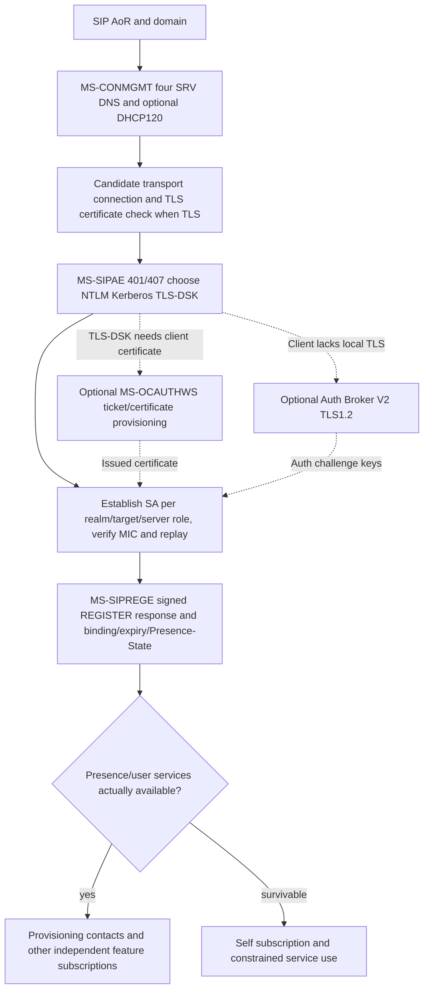

**Important qualification:** Web Ticket credential/service URL is not the SIP-AE SA challenge realm, and neither alone proves a user is registered. A successful TLS channel is only transport security; a successful SIP-AE SA is not SIP registrar success. Likewise successful REGISTER cannot establish presence/service availability without processing source-specific Presence-State/provisioning semantics. Do not synthesize a mandatory sequence in which all three NTLM/Kerberos/TLS-DSK mechanisms are executed; they are alternatives selected by negotiated policy.

### Combined failure evidence matrix

| Trigger | Source-specific action | Must not be conflated |
|---|---|---|
| DNS candidate lookup or all IP TCP connects fail | MS-CONMGMT §3.1.5: try next candidate as stated | Certificate mismatch (source says other failures end autodiscovery) |
| TLS certificate trust/host identity fails | TLS authentication required for chosen TLS candidate | Automatic silent switch to unencrypted TCP (not proven) |
| 401/407 challenge | MS-SIPAE §3.2.5.1: scheme-specific SA creation, possibly multiple rounds | Permanent invalid credentials without checking existing SA/state |
| Signed challenge repeats despite SA-signature | MS-SIPAE: destroy existing SA and renegotiate | Blind replay of stale MIC |
| Incoming signed response fails MIC, is missing SA, or repeats snum | Client discards message, distinct 256-window checks | Meaning of SIP status code before authenticity established |
| Kerberos ticket expires or >5m clock skew | Reestablish SA or prompt clock sync under relevant failure | Media ICE consent or REGISTER expiration |
| TLS-DSK inner handshake certificate rejected | TLS-DSK SA not established; obtain/validate certificate by source | Outer TLS proxy channel automatically invalid too |
| Web Ticket IssueToken 403/28000 | Web user authenticated but not SIP-enabled under that Web Ticket service | SIP 403 from registrar or conference focus |
| Certificate provisioning ErrorInfo | Web CSR issuance failed, different from SOAP transport success | SIP REGISTER or TLS-DSK completed |
| Signed REGISTER 200 Presence-State added/fixed during refresh | MS-SIPREGE §3.1.1.5.1 prior dialogs SHOULD terminate and re-register | SA existence or TLS channel still valid |

**Full analysis still BLOCKED** on Microsoft exact legacy Windows edition selection, cert SAN/FQDN/EKU/revocation, HTTP STS trust and token audiences, full version-4 signature byte examples, TLS1.3 inner-TLS-DSK feasibility, and specific external service discovery. No new protocol implementations, external tests or main merges.

## XIV. 2026-10-23 original SIPCOMP/MPPC and SIPRE 430 route recovery/crypto state audit

**New primary evidence files:**

- [MS-SIPCOMP 10.0 complete negotiation/transport-state and error ledger](ms-sipcomp10-negotiate-mppc-transport-error-state-2026-10-23.md) — 21 section-qualified rules verified against May 20 2025 original PDF §2.2 and §§3.1–3.2, RFC3261 §§17.1.2 and RFC2118 §§3–4. `NEGOTIATE` SIP extension **after TLS and before regular SIP** to **first-hop proxy**, `Compression: LZ77-8K`, `Max-Forwards:0`, server receives within 5s (client Timer F SHOULD 5s vs normal RFC3261 default 32s). Non-200/timeout **declines** compression; 200 with wrong algorithm **MUST close TCP**. Post-negotiation **6-byte header**, **8KiB separate send/receive histories**, `FLUSHED 0x8`, `AT_FRONT 0x4`, `COMPRESSED 0x2`; inconsistent flag combination => **MUST close TCP**. **Server may compress first, client MUST NOT compress until receiving server compressed traffic**, authentication separate. **Not IETF SigComp RFC3320**. The 2025 document cites older **RFC4346 TLS1.1** while MS-CONMGMT TLS profile cites RFC5246 TLS1.2; historical citation mismatch requiring actual TLS mode validation rather than assuming insecure version.
- [MS-SIPRE 13.0 route-HMAC lifetime, 430 Flow Failed/481 routing and per-dialog target-refresh recovery](ms-sipre13-dialog-route-integrity-430-recovery-2026-10-23.md) — 22 source-qualified rules (6 routing, 16 dialog recovery) under §§3.6–3.7, plus named critical conflicts. Proxy-HMAC key retention on protected Via/Record-Route/Contact route params **SHOULD >=1h** for transaction routing and **>=8h** for long-lived route-set tokens. These proxy keys are **not SIPAE SA MIC keys**. `Ms-Dialog-Route-Set-Update` Supported, `430 Flow Failed` with `P-Dialog-Recovery-Action`: **registration+dialog refresh**, **dialog-only target refresh**, or **wait for peer/session update**, versus unsupported extension **481**. When target refresh succeeds the client **MUST refresh route set and remote target** and may resend original failed request; stop repeated 430 loop after 2+ unsuccessful re-sends. Audio/video INVITE dialogs more recovery-appropriate than replaceable presence SUBSCRIBE dialogs; conference sub-dialogs can require distinct recovery actions.

### Cross-system state and error matrix for signaling

| State/trigger | Microsoft source action | Independent state not proven by event |
|---|---|---|
| Outer TLS established | Eligible to attempt `NEGOTIATE` on fresh first-hop connection | Not yet SA authenticated, REGISTER successful or SIP body compression ready |
| `NEGOTIATE` no response after 5s | Compression declined; reject unsolicited compressed server bytes | Does not imply user account password invalid |
| `NEGOTIATE 200` with wrong Compression header | TCP transport teardown required | Cannot treat as successful compressed transport |
| Compression accepted, no compressed server traffic yet | Client must not send compressed bytes | Does not invalidate ordinary SIP transaction layer |
| Compression packet `FLUSHED + COMPRESSED` | Terminate TCP connection | SIP dialog may continue only via separately proven reconnect/recovery |
| Proxy lost old `ms-route-sig`/route HMAC context | Route can fail with 481 or 430 depending recovery capability | SA signature, end-to-end dialog and media consent have independent lifetimes |
| SIP 430 + dialog update action | Target refresh UPDATE/SUBSCRIBE; update Contact/Record-Route before retry | Does not renew REGISTER automatically if only dialog route changed |
| SIP 430 + combined registration & dialog action | REGISTER refresh before dialog target refresh | Re-register success not proof all conference/media dialogs restored |
| `Presence-State added|fixed` on REGISTER refresh | **MS-SIPREGE v20250819 MUST treat registration refresh as failure**, while **MS-SIPRE v20250520 §3.7.5.3.2 SHOULD recover recovery-enabled dialogs** | **REC-X01 BLOCKED** until authoritative edition/branch precedence and product notes clarified |
| RFC4028 session timer and dialog route recovery timer | Independently scheduled, source says recovery timer >= negotiated session timer | Media ICE consent/reconnect and QoE timers unrelated |

### Combined signaling lifecycle sketch (S, not guaranteed Windows wire order)

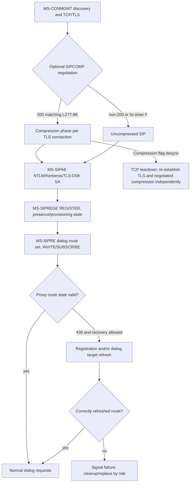

**Notable source conflict:** MS-SIPRE v20250520 §3.7.5.3.2 advises recovery-enabled dialogs on REGISTER refresh `200 + added|fixed`, whereas MS-SIPREGE v20250819 §3.1.1.5.1 says treat corresponding REGISTER refresh 200 as registration failure and previous dialogs SHOULD terminate. **No proven precedence rule**. Do not select a coding behavior or claim protocol analysis finished.

**Open gates:** Microsoft product-specific compression enablement/first-server-packet timing, exact MPPC encoding and 6-byte framing relative to TLS records, full route URI/mic canonicalization, source edition compatibility for 430 versus registrar `added|fixed`, different server-farm credential and long-lived media refresh handling, per-version historical notes. No implementation, live-server tests, merge or release.

## XV. 2026-10-23 deeper original presence, contact roaming and IM delivery (64 individually enumerated source rules)

**Original studies extending prior partial presence/contact coverage, with separate server roles and source status:**
- [MS-CONFIM rev11.0 (2025-05-20): conference IM message forwarding, 202/200 and IMDN, INFO typing, 40s MCU history](ms-confim11-conference-im-message-id-imdn-typing-history-original-2026-10-23.md): **24 section-qualified rules** (§§2.2.1–6,3.1–3.4) including `m=message 5060 sip null`, `a=accept-types`, `Supported: ms-sender`, per-conference `Message-Id`, **MCU 200** if sender sole connected participant, **202** otherwise and downstream `BENOTIFY application/ms-imdn+xml`. After 202 client waits **10s default** for matching IMDN; timeout means per-recipient **408**. MCU provides **40s temporary creation-time history**, not offline indefinite queue. A forwarded MESSAGE `From` can be conference URI; actual sender is `Ms-Sender`. Typing `INFO 202` has no IMDN; outgoing forwarding only to `ms-sender`-capable endpoints. **DOC-ERR-IM01:** in original PDF p26 §3.4.1.5.2 the heading says receiving **INFO**, but normative sentence says 200 on incoming **MESSAGE**, immediately reverting to INFO in next sentence. **Unresolved editorial inconsistency — implementation blocker** pending original errata/secondary source.
- [MS-SIP rev8.0 (2017-06-01) and MS-PRES rev13.0 (2025-05-20) contact list / ACL / Unified Contact Store migration](ms-sip8-pres13-roaming-contacts-acl-ucs-migration-version-security-2026-10-23.md): **12 roaming contact/ACL, 7 UCS and 5 privacy rules**, with full/delta `contactList` and `contactDelta prevDeltaNum/deltaNum`, separate legacy roster ACL counters, SIP `SERVICE` SOAP setContact/group, optional `BENOTIFY` no SIP response, legacy default group 1 and group IDs 1–63, `Supported: ms-ucs-ready` migration queue, **read-only contact list while migrating**, `Supported: ms-ucs` mail-server access capabilities after migration and legacy server-side proxying. Actual UCS/error status requires MS-OCER §7.3 and target Windows/client server edition. Contact membership ≠ presence subscription ≠ privacy permission.
- [MS-PRES rev13.0 atomic enhanced publication, visibility and error contract](ms-pres13-atomic-publish-container-visibility-error-policy-2026-10-23.md): **16 original section-qualified rules** (§§3.2.1–3.2.5.5,3.5.5). Client REGISTER advertises `msrtc-event-categories`; SERVICE `application/msrtc-category-publish+xml` requires identity From/To/publication URI equality and optimistic version per category instance, 0 for new; **entire batch atomic** and **409 rejects all** on version conflict; **488** for `expireType=endpoint` without corresponding registered endpoint; 200 self response returns current instances/versions. NOTIFY/BENOTIFY propagates to same-user endpoint and other authorized watchers. Visibility resolves per-category through user/domain/sameEnterprise/federated/publicCloud/default with highest numbered matching container; **watcher payload omits confidential internal container ID, version, expiry type and endpoint ID**. Container membership edits are separately atomic/versioned and can trigger notification even without changed category XML.

### Distinct identities, versions and timers across contact/presence/IM

| Dimension | First-party source | Do **not** conflate with |
|---|---|---|
| Legacy roster `deltaNum/prevDeltaNum` | MS-SIP §2.2.4.1, §3.7 | Category `version`, container membership version, ACL version, SIP CSeq |
| ACL version and access control | MS-SIP §3.7 | Enhanced presence category container priority and UCS migration mode |
| UCS `ms-ucs` vs `ms-ucs-ready` | MS-PRES §3.10 | User auth success, auto migration completed, full roster already fetched |
| Publisher/category/instance/container/version | MS-PRES §3.2.1–.5 | User roster group ID (1–63), SIP GRUU, MCU conference Message-Id |
| Conference MCU `Message-Id` | MS-CONFIM §2.2.4,3.3 | SIP CSeq/Call-ID or universal 1:1 IM ID |
| Conference sender `Ms-Sender` | MS-CONFIM §2.2.3 | Routing `From` (conference URI) or spoofable legacy text prefix |
| MCU client IMDN timeout default **10s** | MS-CONFIM §3.3.1.6 | MCU message history **40s**, conference C3P command **32s/180s** |
| Conference INFO typing 202 | MS-CONFIM §3.4 | MS-CONFBAS Focus C3P `INFO` 202, MS-CONFIM `MESSAGE` 202, QoE `SERVICE` 202 |
| Successful publish SERVICE 200 | MS-PRES §3.2.5 | Proof of presence delivery to unauthorized contacts, or roster sync |
| Endpoint registration expiry | MS-PRES §3.2.5.5 | Entire user's contact list deletion, active unrelated endpoints and user-bound publications |

**Cross-system research model, not mandatory packet order:**

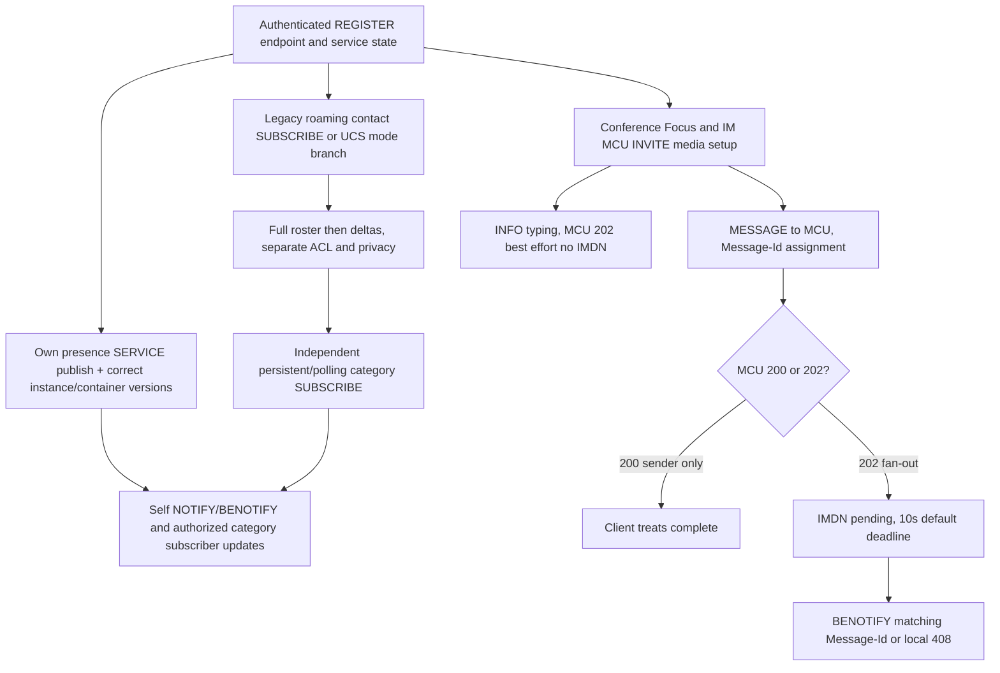

**Source authority guard:** Microsoft legacy MS-SIP **2017** and Microsoft MS-PRES **2025** edition differences are not proof that every Windows Full Client uses the same store at every deployment. RFC3428 permits MESSAGE within established SIP dialog without MESSAGE itself creating one; MS-CONFIM specifically requires the **MCU INVITE media dialog**. Legacy RFC2976→RFC6086 INFO and RFC3265→RFC6665 SUBSCRIBE event upgrades need per-product compatibility; BENOTIFY is an independently negotiated nonresponded Microsoft method, **not RFC NOTIFY**. The source §3.4.1.5.2 INFO/MESSAGE contradiction and all 2025 original product notes remain **OPEN**.

**Remaining gates:** full CONTACT SOAP schema/response/error codes; UCS mode and MS-OCER behavior; privacy subscriber list and presence aggregation; IMDN late/duplicate/Message-Id=0 and 40-second history ordering; legacy conference INFO editorial errata; actual 1:1 IM invitation, MIME and human read/delivery semantics; actual Windows and MCU editions. **Not full normative closure. No implementations, live-server or interoperability tests, merge or release.**

## XVI. 2026-10-23 telephony/PSTN, E911 civic location, Exchange UM audio and RTP DTMF

**New original-document studies:**

- [MS-OCPSTN 11.0 + MS-E911WS 9.0: SIP dial plan, phone-context, PSTN gateway role, E911 HTTPS/SOAP location](ms-ocpstn11-e911ws9-numbering-gateway-location-security-2026-10-23.md) — **25 numbered source-qualified rules** (13 PSTN and 12 LIS). Local dial plan may yield E.164 SIP URI or `phone-context=<location profile|dialstring|enterprise>`; **proxy** separately normalizes provisioned routing. `isGateway`, `Ms-Call-Source ms-rtc|non-ms-rtc`, **605 loop rejected by UAS → 480 by proxy**, `ms-early-media` permits gateway unreliable 183/SDP under MS-SDPEXT §3.1.5.12, optional `ms-bypass`, `ms-accepted-content-id` ties SDP answer to offered MIME part, anonymized `anonymous@...;user=phone`. **E911WS** is **HTTPS SOAP civic-location retrieval**, `GetLocations` with Entity + network identifiers, `GetLocationsInCity` with Entity/Country/State/City; client must separate HTTP 2xx from required XML `ReturnCode=200|400|404|500`. Returns **PIDF/GEOPRIV civic address**, sensitive and contingent on authenticated LIS identity; user can choose among multiple addresses. **The emergency SIP INVITE/PSAP/location conveyance remains NOT proven by this service.**
- [MS-EUMR 9.0 + MS-EUMSDP 9.0 + MS-DTMF 15.0: voicemail routing, notification, audio-only negotiation and RTP telephone events](ms-eumr9-eumsdp9-dtmf15-voicemail-routing-media-2026-10-23.md) — **31 numbered source-qualified rules** (10 UM routes, 9 UM notifications, 5 UM SDP, 7 DTMF). SIP **proxy** for UM-enabled user routes voice mail to selected **dial-plan UM server** via TLS5061 URI and A/V Edge GRUU when configured. Proxy UM routing timer **MUST <180s, SHOULD 5s**, limited **302** in-dial-plan single Contact reroute (at most four prior redirects), multipart 415 fallback via MS-SIPRE, next-server retry and terminal **480 SHOULD**. Proxy→UM missed/answered/forbidden **INFO** uses a dedicated **m=application 9 SIP *** INVITE dialog and mutual TLS with **10-minute inactivity timer**, *not desktop UI MESSAGE*. UM SDP **only audio** and **ignores same-fork provisional-to-final SDP changes**; bypass, feedback and video/sharing attributes ignored. RTP `telephone-event` negotiated dynamically (RFC4733) supports **0–16** under Microsoft, forbids zero duration, redundant blocks or multiple event payloads per packet.

### Client feature and role applicability

| Full Client feature / component | Direct Microsoft source | Verified / not yet substantiated |
|---|---|---|
| Dial a PSTN number or enterprise extension | MS-OCPSTN §§2.2.2,3.2 and RFC3966 §5.1.5 | P: client vs proxy dial-plan translation split; **U** actual client policy/provisioned user location profile |
| Gateway-originated call, UI gateway indicator, PSTN loop detection | MS-OCPSTN §§3.1,3.3 | P: gateway/proxy scoped, **not desktop UAC MUST generate** gateway headers |
| Early media and bypass | MS-OCPSTN §§3.4,3.6–3.7; MS-SDPEXT §3.1.5.12 | P: capability and MIME selection; **U** media security, consent and role-specific gates |
| Civic address retrieval and emergency feature | MS-E911WS §§2.2,3.1,5.1; MS-OCSPROT §2.5.4 | P: authenticated LIS HTTPS SOAP, PIDF/GEOPRIV privacy and XML return codes; **BLOCKED** SIP emergency call setup/routing/PSAP |
| Voicemail deposit / UM audio media | MS-EUMR §§3.1, MS-EUMSDP §3.1.5 | P: proxy routing and audio-only SDP; **U** actual UM deployment and product edition |
| Missed/answered/forbidden email notification | MS-EUMR §3.2 | P: proxy→UM dedicated INFO/MIME, not a desktop-originated email protocol |
| Keypad digits during connected audio | MS-DTMF §§2–3 and RFC4733 | P: dynamically negotiated RTP telephone-event, not universal SIP INFO DTMF |
| All phone transfer/hold/forward/E911 callbacks/IVR features | MS-SIPRE, MS-OCPSTN, MS-OCEXUM and other candidates | **U** all clauses and states NOT fully covered, therefore no implementation phase |

### Composed call/contact/address/media phases (S: branch-based explanatory model)

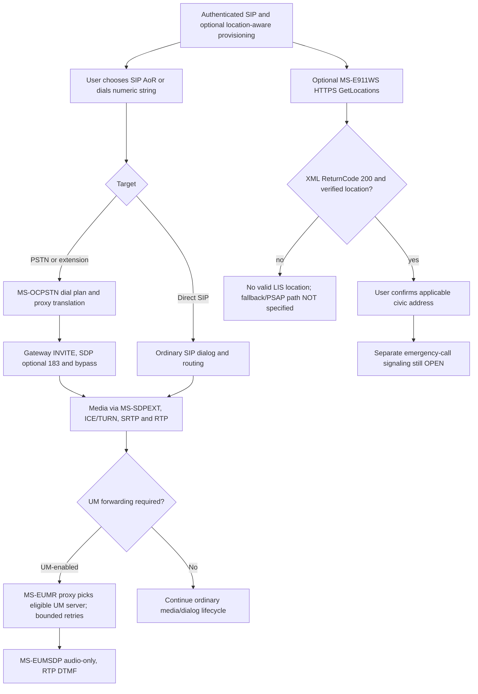

**Security and standards guards:** `phone-context` under RFC3966 is an identifier **scope, not a telephone-number prefix**. SIP `P-Asserted-Identity` belongs to a trusted network per RFC3325. UAS `605` with gateway `Ms-Call-Source` is not a normal client success. E911WS `ReturnCode 404` in HTTP 2xx is **application-level no match**, not SIP 404. UM SIP 302 rewrite is server-side, not a client browser redirect. RFC4733 events are RTP media data and need negotiated payload/security, not SIP MESSAGE. Microsoft EUMSDP’s provisional/final same-fork equality **overrides** generic MS-SDPEXT allowance for other peers, an **edition/role-specific** fork in media state. Full emergency SIP location conveyance, media privacy and regional E911 deployment remain research blockers; no emergency test traffic from assistant.

**Status remains NOT COMPLETE; no protocol code, live-server/interoperability testing, main merge or release.**

## XVII. 2026-10-23 conference creation, Focus admission/C3P and ASMCU desktop-sharing states

**Three direct original-source technical audits (67 individually scoped requirements, not client conformance claim):**
- [MS-CONFPRO rev13.0 and MS-CONFBAS rev15.0, exact provisioning→Focus→lobby→C3P conference control](ms-confpro13-confbas15-conference-factory-focus-lobby-control-rfc4575-2026-10-23.md) — **28 numbered P/R/S requirements**, originals v20250520 §§2.2–3.5; RFC4575 conference event package and RFC4579 call control. `SERVICE application/cccp+xml` to **Focus Factory** handles `addConference`/`modifyConference`/`getConference`/`deleteConference` with requestId correlation; creation conference-key is *deprecated* even though GetEncryptionKey X509 public-certificate operation remains; optimistic conference version and static-meeting product limits. `INVITE` with `addUser` creates independent **Focus signaling dialog**; then conference `SUBSCRIBE` first full roster (piggyback 200 or NOTIFY/BENOTIFY), own lobby/admission and MCU URI table. **32s** optional first full subscription timeout; Focus lobby hides other participants and MCU details; Focus **400/403/404/603** join failures. Authorized Focus `INFO application/cccp+xml` operation receives **SIP 202 accepted** then **C3P pending/success/failure** via later Focus INFO or inline 200. Client command timeout **32s initial, 180s after C3P pending**, Focus processing timer **28s**; all distinct from SIP and media timers.
- [MS-CONFAS rev12.0, sharer/viewer SDP roles, RDP-over-RTP conference media and permissions](ms-confas12-application-sharing-sdp-rdp-handoff-policy-2026-10-23.md) — **18 numbered clauses**, v20250520 §§2.2,3.2–3.3. ASMCU uses separate `conf-uris` purpose **applicationsharing** and modality INVITE. `m=applicationsharing` + SDP `x-applicationsharing-role:sharer|viewer` with **reversed MCU answer**; share-video direction corresponding to role, SDP 488 for malformed/no usable media or mismatched video direction, additional role m-lines individually refused `port=0` under RFC3264. Sharer↔viewer renegotiation uses ASMCU **re-INVITE**, old m-line disabled port 0 and new line created. The MCU announces **signaling connected → media-state joining → (SHOULD after RDP connected) media-state connected**. New sharer ejects previous sharing user on this **ASMCU dialog** by SIP BYE diagnostic **21000**, with roster media removal; this does **not automatically terminate Focus dialog**. Source permissions include **21001** appsharing policy, **21002** attendee sharer policy and capability **desktop|singleApplication|none**; `singleApplication` MUST NOT begin desktop-wide sharing. RDP/RTASPF framing/security remains to be audited.

- [MS-RTASPF rev10.0 (2025) + MS-RDPEMC v20240423 (RDP multiparty virtual channel)](ms-rtaspf10-rdpemc2024-sharing-payload-encomsp-control-security-2026-10-23.md) — **21 original clause-based RDP-media and authorization checks** (9 RTP sharing profile, 12 RDP multiparty control). RTP-for-RDP under MS-RTASPF uses **TCP-only RTP, payload type 127, marker 0**, total packet and network/link headers **<=1500 bytes**, receiver sequences fragments before interpreting RDP. **RDP encryption level None / omit Security Exchange PDU**, while **outer SRTP encryption is mandatory**. MS-RTASPF stops sending on detected packet loss, recovery undefined in checked clauses; RDP bulk compression enabled in sharer-MCU direction but not viewer-MCU. MS-RDPEMC provides dedicated **encomsp** virtual channel carrying 4-byte ORDER_HDR Type/Length with participant/window/application, control-level and graphics-paused PDUs. Sharing manager **SHOULD verify permissions before giving mouse/keyboard control**; requested control is not automatic grant. **Three non-aligned versions**: MS-RDPEMC v20240423 (unindexed official revision/URL), MS-RTASPF v20250520, MS-RDPBCGR rev62 v20260309 — exact vintage compatibility still OPEN. This is directly connected to unresolved **SRTP SHA-1/SHA-256 transform** conflict, now critical for screen sharing confidentiality/integrity.

### Feature-by-feature independently observable evidence

| Goal / user-visible event | Necessary documented protocol evidence | What does **not** prove it |
|---|---|---|
| Meeting successfully scheduled | Focus Factory SERVICE 200 + C3P `code=success`, conference URI and conference version, with verified requestId | SIP 200 without XML parse; Focus INVITE from another client |
| Meeting detail changed | `modifyConference` based on current version; server increments version | Old local version, published presence category version |
| User entered meeting | Focus INVITE `addUser` successful, own endpoint status from full roster | Factory addConference success or global registration 200 |
| Lobby admitted | Conference subscription own endpoint `connected` full-state rather than lobby-limited state | 200 Focus INVITE by itself; visible empty roster |
| Moderator command completed | C3P final success/failure with matching command requestId (possibly after SIP 202 and C3P pending) | SIP INFO 202 alone |
| Application-sharing media negotiated | ASMCU SIP INVITE with correct role/media SDP, 200 SDP answer | Focus conference joining or simple C3P roster activation |
| Viewer or sharer actually streaming | ASMCU / Focus roster media-state connected after RDP connection and separately proven ICE/RTP security | SDP 200 or `media-state=joining` |
| Screen sharing displaced by another user | ASMCU BYE `ms-diagnostics-public:21000` and media roster updates | Account deregistration, Focus conference ended |
| Attendee forbidden to share | Conferencing policy and role, diagnostics 21001 or 21002 under respective guards | Generic SIPAE failed authentication, unsupported local resolution |
| Screen vs single application | Capability `supports-application-desktop-sharing:desktop|singleApplication|none` and admin permission | Declared `sharer` alone |
| One endpoint leaves a conference | That endpoint's Focus dialog/roster state only; remaining endpoints independent | User removed globally across other endpoints |

### Conference signaling subsystem synthesis (not a mandatory observed packet trace)

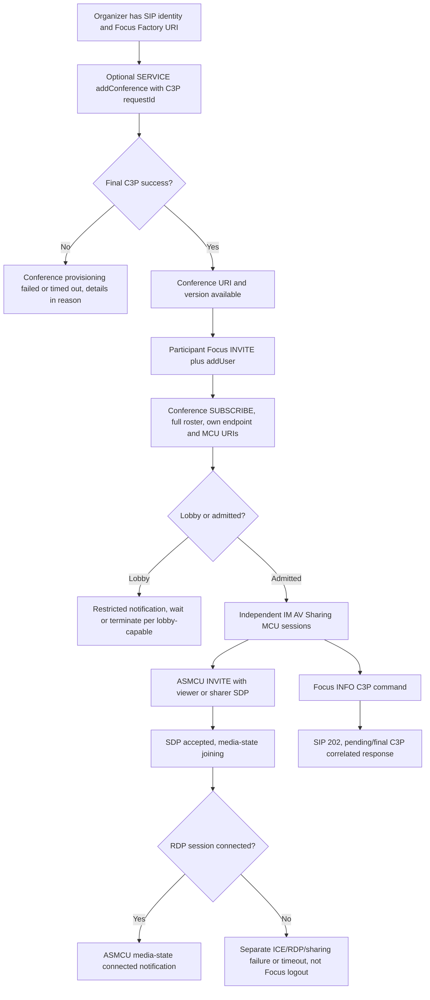

**Critical unresolved matters:** MS-CONFAS refers to a `server-mode=13` attendee sharer gate, while MS-CONFPRO describes `server-mode` as obsolete for **MCU-type selection**; these are distinct use cases, do not claim universal conflict or ignore either without edition policy audit. MS-CONFAS prose uses both `sharing/viewing` and `sharer/viewer` token strings; formal MS-SDPEXT ABNF and original wire examples must resolve exact sent values. **Full MS-RDPBCGR, MS-RDPEMC and MS-RTASPF**, authentication and integrity of RDP-over-RTP media, policy/role mapping, end-to-end SDP/ICE/SRTP and eventual moderator/participant leave sequence all remain OPEN. These source gaps are not license to plan implementation.

**Research continues, global protocol analysis NOT COMPLETE; no code, live-server or interop tests, main merge or release.**

## XVIII. 2026-10-23 media security forensic cross-standards, early media and SSRTP transport

**Three new original-source/primary RFC studies, exact editions and P/S/U evidence:**
- [MS-SRTP 14.0 vs MS-SDPEXT 16.0 vs MS-SSRTP 11.1 and RFC3711/4568: contradictory SHA1/SHA256 MUST statements](ms-srtp14-sdpext16-ssrtp11-sha1-sha256-original-normative-conflict-2026-10-23.md) — **18 numbered primary/standard source checks**: MS-SDPEXT rev16 §3.1.5.1 **MUST only `AES_CM_128_HMAC_SHA1_80`**; RFC4568 §6.2.1 explicitly maps that suite to **HMAC-SHA1**. MS-SRTP rev14 §§3.1.3.2/.3.3.2 instead **MUST HMAC-SHA256**, yet misleadingly calls it default per RFC3711 §4.2 (which is SHA1), retaining 160-bit auth key and 80-bit tag. MS-SSRTP rev11.1 §§3.1.3.2/.3.3.2 explicitly **MUST HMAC-SHA1** while specifying inherited MS-SRTP crypto settings must match. The 2025 conference media example in MS-CONFAV §4.2 uses SHA1 suite. **Official normative clarification and historical source diff NOT FOUND**; do not invent SHA256 SDP transform, reinterpret SHA1 suite token, silently fix an alleged typo, or downgrade to unencrypted RTP. 2018 old MS-SRTP web snippet suggests SHA1 but historical PDF not fully fetched/audited, thus an **H clue only**, not settled edition precedence.
- [MS-SDPEXT rev16 complete conditional security negotiation, forked early media, PRACK/199, hold and application sharing SDP](ms-sdpext16-early-media-hold-srtp-scale-profile-and-rfc-conflicts-2026-10-23.md) — **26 numbered source qualifications**: optional `RTP/AVP + a=crypto|a=cryptoscale` offer can result in secure SAVP answer or unencrypted AVP answer *only when caller policy permits*, mandatory SAVP cannot be automatically lowered; secure SAVP continues on re-INVITEs. SSRTP `client|server` asymmetry makes each media direction distinct. **No re-INVITE crypto parameter changes after established**, whereas **provisional 18x→final 200 SDP for same fork can change inline key, direction or reject a line** under §3.1.5.12.3 — **not an established-session rekey**. Early media needs ICE; DTMF allowed after incoming packets, speech SHOULD NOT before final 200; UAC cannot send `Require:100rel` in request, UAS SHOULD include it in early 183 response, RFC3262 PRACK not carrier of SDP. Hold audio/video `inactive + sip.rendering=no`, retrieve `sendrecv` and remove rendering. MS-SDPEXT §3.1.5.18.2 **formal wire ABNF confirms sharer|viewer**, while §3.1.5.18.5 **prose/ABNF spelling differs between x-applicationsharing-contentflow and x-application-contentflow**; unresolved. RTP/RTCP mux only with ICE draft19 and both components `a=remote-candidates` — do not substitute generic 1-component ICE behavior.
- [MS-SSRTP 11.1 actual 48-bit ESN, special virtual packet authenticated portion, per-direction SDP and key/replay checks](ms-ssrtp11-esn48-virtual-auth-rtcp-key-replay-original-2026-10-23.md) — **16 directly enumerated checks**: SSRTP packet uses **6-octet ESN + 1-octet MKI + 10-octet auth tag**; ESN global across sender SSRCs under crypto context, 48-bit network order, skip values where low 8 bits zero, ensure no reuse under same master key. Nonstandard AES-CM IV `(k_s*2^16) XOR ((ESN>>16)*2^64) XOR (ESN*2^16)`; authentication rearranges packet fields into a **virtual** buffer and appends ROC (on-wire order unchanged), 64-entry replay. Receiver verifies replay/MIC before decrypting and updating state; invalid packet discarded. **SSRTCP uses ordinary MS-SRTP SRTCP profile** without RTP ESN trailer. Original MS-SSRTP test vector values were read, **not executed** or independently tested.

### Media per-modality gates (required research state distinction)

| Layer/trigger | Source-specific rule | Not sufficient for, or not to conflate |
|---|---|---|
| SIP INVITE and 18x SDP | MS-SDPEXT §3.1.5.12: early media requires ICE; provisional/final can differ on same fork in limited ways | Received 18x not equivalent to SIP 200 call established |
| SIP 200 with negotiated SAVP crypto | MS-SDPEXT §3.1.5.8: select SRTP or SSRTP flavor per media direction; post-session changes prohibited | **Algorithm SHA1/SHA256 contradiction still unresolved**, RTP packets not yet authenticated |
| SDP crypto suite | RFC4568 AES_CM_128_HMAC_SHA1_80 **means SHA1**, requires actual match with profile | MS-SRTP 14.0 SHA256 text cannot be ignored or altered |
| SRTP vs SSRTP on media direction | MS-SDPEXT §3.1.5.2.1 plus MS-SSRTP §2.2: SSRTP has ESN and rearranged auth | Same AES/key length does not mean common authenticated octets |
| Packet received, MKI/SSRC/sequence | MS-SRTP, MS-SSRTP: distinct direction/SSRC replay window and MAC verification before media | UDP packet/ICE nominated pair alone is not trusted media |
| RTP/RTCP mux negotiated | MS-SDPEXT §3.1.5.38 with ICE draft19 and both components | Generic RFC8445 single-component assumption unsupported |
| Early speech vs DTMF | MS-SDPEXT §3.1.5.12.2: don't start forward speech until INVITE 200; DTMF may be gated on received packets | Not global user mute/hold state |
| Hold and retrieve | MS-SDPEXT §3.1.5.23 with RFC3264 direction plus MS-SIPRE sip.rendering | Not a new SIPAE login, ICE restart, SRTP key renegotiation |
| RTP-carried remote desktop | MS-RTASPF §1.5–1.6: RDP inner encryption None, **SRTP outer required** | SDES profile ambiguity is high-risk for screen pixels/control integrity |

**Implementations remain BLOCKED, not merely 'SHA question under consideration'.** Require exact official erratum/diff and applicable Windows client build/MCU profile; no assistant interop tests. Full SDP §§3.1.5.19–.37 ICE variants/video bandwidth/forked responses and all MS-RTP packet extensions need further original clause audit. The total Full Client normative/functional research **NOT COMPLETE**; no protocol code, servers, tests, merges or releases.

## XIX. 2026-10-23 ICE2/ICE candidate and TURN/AV Edge relay trust, recovery and RFC edition cross-check

Two new owner-original full sections audits with **51 individually numbered direct-RFC/Microsoft research findings**:

- [MS-ICE2 rev19.0 vs MS-ICE rev11.0: candidate limits, final selected pair, validation/nomination and STUN consent vs RFC7675](ms-ice2-19-ice11-candidate-nomination-consent-rfc7675-differences-2026-10-23.md) — **24 source and RFC comparisons** from Microsoft original §§3.1.4–3.1.6, with PDF p27 and p31 directly rendered. ICE2 **regular** default UDP (no UDP → fail), **TCP-only** default TCP (no TCP → fail); **host/reflexive/relayed** types constrained, no TCP simultaneous-open, 80 pair MUST limit, forked provisional ICE checklists separately with 20 provisional response SHOULD bound. Binding check **USERNAME/MESSAGE-INTEGRITY/FINGERPRINT + CANDIDATE-IDENTIFIER**, with old STUN message serialization; invalid request **401 STUN missing integrity**, **431 STUN MIC fails**, other malformed headers discarded. Controlling chooses highest validated pair via Regular Nomination; **MUST issue final offer with exactly selected local+remote candidate even if defaults matched**, and controlled peer validates/answers then MAY trigger **TURN Set Active Destination SHOULD** when selected relay. ICE **checks 5s timer** and **USE-CANDIDATE** nomination timer independent. **Keepalive** to preserve NAT binding on RTP component distinct from **consent freshness**: consent **30s SHOULD expiry, checks 5s SHOULD**, RFC5389 STUN with new ID for each, reset timer only on **valid response matching most recently sent consent request**; expired responses **MUST ignore**, media **SHOULD terminate**. **RFC7675 §5.1** instead has MUST cease traffic on expired 5-tuple and 4–6s jitter/default5s, but RFC7675 **not cited by MS-ICE2** as its own normative reference and must be tagged **comparative modern standard**, not automatically substituted.
- [MS-TURN rev21.0 + MS-AVEDGEA rev12.0: separate SIP credential service, legacy TURN framing/permission and crypto/version](ms-turn21-avedgea12-legacy-relay-auth-allocation-pseudotls-security-2026-10-23.md) — **27 role/section-verified rules**. AVEDGEA authenticated SIP `SERVICE application/msrtc-media-relay-auth+xml` returns Base64 username/password with lifetime=min(requested, configured), relay host/location, request correlation and SIP status-specific errors. TURN original §2.1 supports **UDP datagram, TCP 4-byte framed, full TLS, HTTPS, and separate *pseudo-TLS* handshake mode** that mimics TLS1.0 records, **not proof of real TLS cryptographic handshake/certificate verification**. Historic **20-byte TURN header with 128-bit transaction ID** and first TLV `Magic Cookie 0x000F` (not modern RFC5389 fixed header cookie), `Allocate 0x0003`, `Send 0x0004`, `Data Indication 0x0115`, `Set Active Destination 0x0006`. Initial Allocate **MUST NOT** include MI, 401 challenge yields authenticated request. Both peer MS-Version >=3 ⇒ **TURN-control HMAC-SHA256 MUST**, otherwise SHA1; source v1=ICE, v2=ICE2, v3 SHA256, v4 IPv6, v5 multiplex UDP, v6 multiplex UDP+TCP. MS-Sequence Number with 20-byte Connection ID + 32-bit monotonic seq per authenticated request; HMAC-MI last TLV. Allocate/SetActiveDest timeout retries **650ms SHOULD**, **at most nine**. TURN relay allocation does **not** establish per-peer permission; sending TURN `Send` generates permission, and ICE nomination may use authenticated `Set Active Destination`. **New TURN-control SHA256 rule is independent of MS-SRTP media SHA1/SHA256 conflict.** Historical `IETFDRAFT-TURN-08` is not RFC5766/8656 wire compatibility proof.

### Media connection/permission end-to-end state ledger

| Independent protocol state | Entry evidence (actor/source) | Failure/change behavior | Never assume |
|---|---|---|---|
| SIP dialog, SDP media negotiation | MS-SIPRE/SDPEXT authenticated INVITE/answer | Early forks and final offer may change SDP under source | ICE or SRTP works just because SIP 200 |
| A/V Edge TURN credentials | MS-AVEDGEA SIP SERVICE response with authorized user credentials and bounded lifetime | Token expires or auth failure; no arbitrary client reuse | Same as SIPAE SA keys or SRTP inline key |
| TURN allocated transport address | MS-TURN authenticated Allocate response, Mapped relay address; 128-bit tx ID | 650ms retransmit, max nine, server error retry scoped | Any peer is allowed to send data via allocation |
| TURN peer permission and route | Send request establishes permission; Set Active Destination may select peer | Peer permission/active target must be tracked independently | Allocated means nominated or all peers accepted |
| ICE2 candidate checking | Valid STUN short-term credential check and pair states, fork-specific | STUN 401/431/430 distinct from SIP same-number errors; 5s check timer | Candidate gathered means reachable |
| ICE2 nomination and final offer/answer | Highest validated pair nominated by controlling endpoint, final SDP pair equality checked by both peers | No valid pair, nomination deadline, mismatched selected pair → call failure | Early provisional/default media delivery guaranteed |
| ICE NAT keepalive | MS-ICE2 §3.1.6.3 idle timer and RTP-component Binding request | NAT/relay mapping may time out | Keepalive request == response-proven consent |
| ICE consent freshness | MS-ICE2 §3.1.6.5 5s periodic requests, 30s timer, last request response validation | Late responses ignore, SHOULD terminate media after expiry | SIP BYE/REGISTER expiry necessarily accompanies loss |
| Media packet security | MS-SRTP/SSRTP and SDP negotiated directional keys, SSRC/replay | Hash/MKI validation failures discard media packets | ICE nomination proves SRTP integrity/confidentiality |
| SIP/compression transport / RTC QoE | MS-CONMGMT/RTC media service and MS-QoE independent | A failed SIP TCP connection need not imply immediate media path loss; vice versa | A single global connected state |

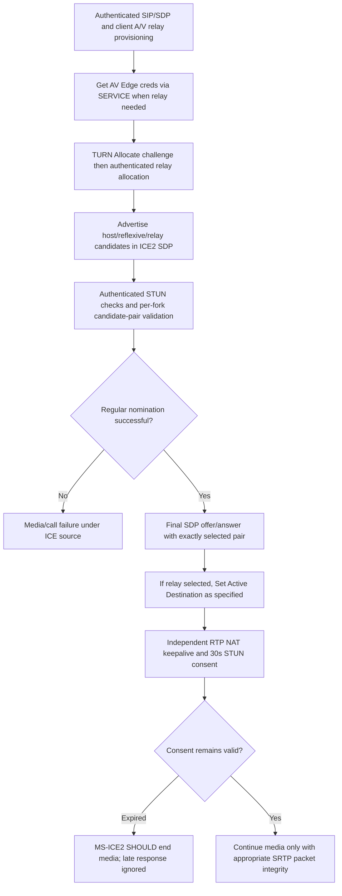

**Diagram class S**, not mandatory network trace: TURN allocation, relay credentials and ICE checks may interleave with provisional SDP; P2P paths do **not** require TURN. `TURN pseudo-TLS` is not a validated TLS tunnel, and the Windows deployment policy for secure TURN transport remains a high-priority **U** security gate. RFC5389 vs legacy TURN STUN header is an exact frame incompatibility; RFC7675 vs MS-ICE2 consent text is a **normative status and timer rule comparison** where the modern RFC must not be reported as explicitly incorporated by Microsoft ICE2.

**Blocking next source studies:** IETF old ICE draft19/ICETCP07/TURN08 and RFC obsolescence mappings; exact MS-TURN multiplex frame and 128-bit-ID field layout; AVEDGEA token XML and authorization; MS-ICE2 §2.2 STUN header/HMAC details and error branches; special **pseudo-TLS** trust/no downgrade from verified actual TLS; media re-INVITE/ICE restart after consent expiry; independent RTP/RTCP feedback and QoE. Overall Windows Full Client research **NOT COMPLETE**, implementation gate CLOSED; no protocol code, live-server tests, merge or release.

## XX. 2026-10-23 original MS-RTP, QoE and OCER: feedback versus retained reports versus client diagnostics

**Three new source-based original-document technical audits; 54 separate source-labelled rows:**
- [MS-RTP rev17.0 & MS-RTPRADEX rev13.0, real-time RTCP feedback, SSRC/mixer/quality states and RFC2198 audio redundancy](ms-rtp17-rtcp-feedback-bandwidth-ssrc-timers-rtpradex13-original-2026-10-23.md) — **25 numbered requirements**. Original 2025-05-20 §§2.2,3.1–3.2 checked, PDF pp17/42/45 and RADEX p9 rendered; RFC3550/3551/2198 compared. Microsoft accepts **simple RTCP SR/RR/SDES/BYE** besides RFC3550 compound validation; RTCP SR/RR profile extension `Type16 | Length16` network-order, length-inclusive, **<=20** per report, unknown types ignored via length. SSRC **participant timeout 50s SHOULD**, dominant speaker **3s SHOULD** and > ptime MUST, SSRC change throttling **2s SHOULD and <=2s MUST**; **RTCP packet loss feedback >=200ms MUST**, video lost packet report MAY trigger encoder I/SP frame, not guaranteed. Fast bandwidth probe packet pairs **250ms SHOULD** and trains **1s SHOULD**, count **40 and 21** before normal send-rate. RTCP feedback 190ms fast and VSR 3s slow with **unresolved source's slow retransmission count 5 vs 4** discrepancy (§§3.2.2 vs 3.2.6). RTCP BYE SSRC cleanup **20s SHOULD**, not SIP BYE. MS-RTPRADEX redundant audio **symmetric dynamic payload**, **<=3 packet distance**, **max one redundant+one primary block**, both **same codec**, whereas general RFC2198 permits more/different codecs; [MS-DTMF] prohibits redundant DTMF blocks.
- [MS-QoE rev12.0, post-call SIP SERVICE quality XML and QoE Monitoring Agent trust/response contract](ms-qoe12-postcall-service-xml-identity-202-monitoring-original-2026-10-23.md) — **14 numbered source rules** from 175-page 2025 original §§1.3–3.3 and selected XML subsections, p13/p79 visually rendered, [official release rev12](https://learn.microsoft.com/en-us/openspecs/office_protocols/ms-qoe/c1050431-f4b2-44d4-a425-63d75e99f5df). If QoE enabled, client sends **SIP SERVICE** through proxy to QoE GRUU/home pool: objective **`application/vq-rtcpxr+xml` VQReportEvent** with `VQSessionReport` (interval report defined by schema but *not used*); subjective **`application/ms-cqf+xml` CallQualityFeedbackReport** with user rating **1–5**, optional text/tokens and required CallId/FromTag/ToTag. Agent **202 Accepted ≠ committed/persisted**, errors **606 bad root, 400 schema/value, 401 body vs From/LocalPAI or anonymous focus identity, 415 wrong MIME, 413 >300KB**; **no special QoE client timers specified in §3.1**. Subjective feedback and detailed network identifiers are independent privacy/service-permission information.
- [MS-OCER rev11.0, private/public SIP diagnostics, reportError SERVICE and error-specific recovery/UX](ms-ocer11-diagnostics-presence-version-ids-reporterror-retry-original-2026-10-23.md) — **15 numbered role-scoped rules** from 2025 207-page original §§1–3,7.3,9–10; p11/p17 rendered. Server `ms-diagnostics` (internal **ErrorId;reason;source**) can reveal enterprise topology and SHOULD be removed across enterprise boundary; `ms-diagnostics-public` **must omit source**, client **must not originate** either server diagnostic header. `reason` free text **SHOULD NOT define client error state**; number is machine-handled. Client failed-request **SIP SERVICE `application/msrtc-reporterror+xml`** includes original Call-ID/method/SIP code and optional progress diagnostics; service **200** vs **503 with Retry-After** vs **503 + diagnostic 2019 or missing diagnostics ⇒ SHOULD NOT retry this login**, **413 ⇒ SHOULD NOT retry**. MS-OCER §7.3 uniquely distinguishes stale state ids **2044 publication version, 2045 container version, 2046 contact version, 2047 permission version**; also 2014 unknown presence dialog and 2016 new subscription, 2017 registration expired, 2039 contact change denied. The 207-page full error table and client product notes remain **OPEN**.

### Unified session-end, monitoring and error identity model (S, not a guaranteed mandatory Windows packet trace)

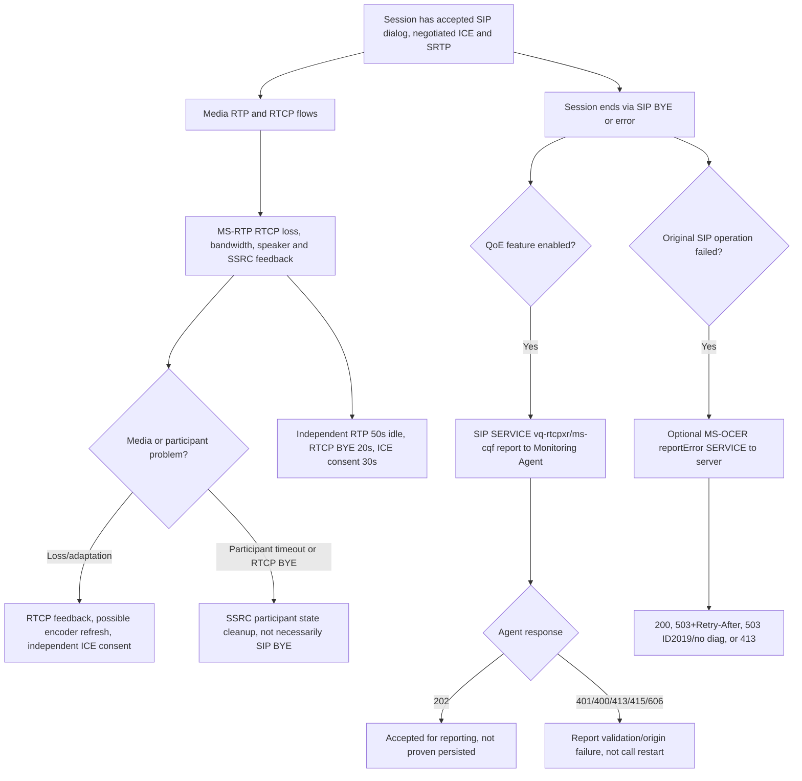

### New cross-domain semantics and failure guards

| Code/clock | Source and exact meaning | Forbidden false equivalence |
|---|---|---|
| **202 QoE** | QoE Monitoring Agent accepted XML report | Conference command C3P 202, MCU IM MESSAGE 202 and processing/storage success are all different |
| **200 OCER reportError** | Client's error report SERVICE accepted | Session recovered, original failed INVITE succeeded, or account has re-registered |
| **401 QoE** | SIP From not matched with XML LocalPAI/FromURI (or anonymous conference focus mismatch) | SIPAE 401/407 challenge and TURN 401 digest nonce |
| **2044–2047 Microsoft ErrorId** | Distinct publication/container/contact/permission stale versions under MS-OCER §7.3 | SIP HTTP/STUN response code 2044 and a universal 409 retry version |
| **503 OCER + Retry-After** | Reporting service busy, source recommends wait | 503 with no diagnostic or ErrorId 2019 — source says no retry within login session |
| **200ms/190ms RTCP intervals** | Packet loss suppression / RTCP feedback repeat | SIP RFC3261 Timer F, ICE connectivity checks, packet replay window |
| **50s RTP participant / 20s RTCP BYE** | Local mixer/SSRC participant lifecycle | SIP BYE/dialog termination, ICE consent 30s, TURN allocation expiry |
| **300KB QoE limit** | XML report rejected by QoE agent with 413 | OCER report field maxima, RTP 1500-byte sharing packet cap |
| **RFC2198 audio redundancy** | Negotiated symmetric dynamic PT, <=1 same-codec redundant block, distance<=3 | DTMF telephone-event redundancy or video loss feedback |

**Research blockers:** MS-RTP source §3.2.2 VSR slow retransmission **5 vs 4** conflict, exact packet extensions / 175-page QoE XML metrics / 207-page OCER ErrorIds and per-release UI rules not yet exhaustively reviewed. **No report SERVICE implies SIP logout or media auto-restart.** IEEE RFC3550 RTP feedback, SIP RFC3261 transactions, STUN/ICE consent and TURN credentials are different protocol lifecycles. Full normative documentation and Windows profile conformance remain **NOT COMPLETE; implementation gate CLOSED; no code, genuine-server/interop testing, main merge or release.**

## XXI. 2026-10-23 Video codec RTP, H.264 SVC and network bandwidth admission

**Three new direct original-PDF analyses with 56 source/role-qualified findings**; Microsoft source editions all dated **2025-05-20**:
- [MS-RTVPF rev11.0: proprietary RTVideo RTP payload, FEC, cached-SP frames and mixer forwarding](ms-rtvpf11-rtvideo-rtp-frame-fec-cached-sp-original-2026-10-23.md): **16 numbered first-party/standards findings** based on §§2.2.1–2.2.5,3.1.5.1–3.1.5.6, with §4 sample and rendered original PDF p11. RTVideo uses **90kHz RTP clock**, Basic mode 1–65-byte header (codec header <=63), Extended 4–68 bytes, Extended 2 8–72 bytes **MUST NOT be used as ordinary video** despite FEC's special 8-byte Extended2-derived header with S=0 E=1; FEC DV1 supports **<=31** metadata packets. Encoder fragments **<1200 bytes**, accounting for RTP/transport/IP/codec headers, same-size FEC data packets except final, **FEC metadata after data in shared RTP sequence space**. VC1 sequence header **first I-frame packet**, GOP-local frame/reference counters, synchronized cached frame and SP reference. **Server/mixer** with unrecovered uplink loss **MUST forward empty-payload RTP placeholder per lost packet**, preserving RTP sequence numbers (role-specific). Decoder incomplete reference frames may be skipped; these are not SIP failure.
- [MS-H264PF rev16.0: H.264/SVC noninterleaved NAL, PACSI simulcast and RFC5109 FEC](ms-h264pf16-h264-svc-pacsi-simulcast-fec-rfc6184-6190-5109-original-2026-10-23.md): **18 numbered original obligations** §§2.2.1–2.2.8,3.1.5–3.2.5, original PDF p18 rendered, RFC6184/6190/5109. **MST SVC only, noninterleaved RFC6184 packetization mode1**, Single-NAL / STAP-A / FU-A only, PACSI **exactly once per layer/access unit** and first NAL, never fragmented, STAP-A starts with PACSI. Stream-layout **full PACSI must be received before data**; update PACSI only toggles *previously defined* layers and must precede changes. Missing PACSI/full layout or unannounced PRID ⇒ receiver **MUST discard** affected SSRC/timestamp packets. H.264 FEC follows data with same SSRC/timestamp/sequence space but **distinct dynamic payload type**, RFC5109 FEC header with Microsoft 16-bit SN Offset rather than SN base; XOR with one FEC and Reed-Solomon explicitly not detailed by source. **Potential editorial width mismatch:** 2-byte SN Offset field described as calculated unsigned **32-bit** difference. **One optional RTVideo simulcast** can accompany H.264 with separate SSRC and SDP payload type, not H.264 PACSI layout; **mixer MUST forward at most one stream**, preferring H.264 if available.
- [MS-ICE2BWM rev9.0 + MS-TURNBWM rev9.0: call-admission check/commit/update, policy-validated ICE candidates and STUN 274/275](ms-ice2bwm9-turnbwm9-admission-candidate-error274-275-timers-2026-10-23.md): **22 numbered original requirements** §§2.2,3.1.4–3.1.6, PDF pages ICE2BWM14 and TURNBWM14 rendered. TURN Allocate Check/Commit/Update proprietary TLV **0x8056** action0/1/2; **0x8057 16-byte ReservationId**, **0x8058 16-byte min/max send+receive in kbps**, **0x8068 location profile** intranet/Internet/federation (not E911), optional SIP dialog/call-ID TLVs solely correlation. Admission denial of every path ⇒ **fail before initial SDP offer**; partial restrictions suppress affected candidates and prohibit ICE checks for them. **STUN Binding error 274 disables all pairs for one candidate**, **275 disables matching candidate pair**, not SIP failure codes. On successful ICE nomination Commit identified selected host/relay sites. **500ms Commit timer**, **<=19s Update** for unchanged bandwidth and **1s Update** when changed until response; successful server all-zero ReservationId ⇒ **no further BWM updates**. Different from MS-ICE2's consent freshness and MS-TURN allocation lifetime. These normative controls apply **only when bandwidth-management feature is enabled**.

### Extended source/standards dependency and applicability matrix

| Microsoft specification | Primary normative dependencies | Current evidence / edition guard |
|---|---|---|
| **MS-RTVPF rev11** | MS-RTP rev17 (2025), MS-SDPEXT rev16 (2025), RFC3550 (2003), **SMPTE VC-1** | 16 primary clause findings; **proprietary RTVC1 codec**, optional FEC profile, not universal Windows 2015 codec |
| **MS-H264PF rev16** | MS-RTP, MS-SDP, RFC3550 (2003), **RFC6184 (2011), RFC6190 (2011), RFC5109 (2007)**, ISO/IEC 14496-10:2014 | 18 clause findings; **noninterleaved/MST/first PACSI mandatory**, only subset of RFC6184 accepted |
| **MS-ICE2BWM rev9** | MS-ICE2 rev19 (2025), MS-TURN rev21 (2025), MS-TURNBWM rev9, IETFDRAFT-ICENAT-19 | 14 clause findings within BWM ledger; **optional bandwidth policy branch**, not every ICE profile |
| **MS-TURNBWM rev9** | MS-TURN rev21, IETFDRAFT-STUN-02, IETFDRAFT-TURN-08, RFC3261, RFC4566 | 8 BWM wire/action findings; **not RFC8656 modern TURN packet**, historical version set |
| **MS-SDPEXT/MS-SRTP/MS-SSRTP** | RFC3264, RFC4568, RFC3711 plus Microsoft crypto profile | **Existing SHA1/SHA256 contradiction still BLOCKED**: video packet format alone does not prove authenticated secure media |
| **MS-RTP/RTCP feedback** | RFC3550, MS-RTP rev17 | Encoder may react to loss, MCU sender/source state separate; no guarantee of repaired video or admitted bandwidth |

### Composite media health versus admission policy graph (S = synthesis, not packet capture)

~~~mermaid
flowchart TD
  A[Authorized SIP/SDP call or conference modality] --> B[Check media codec capabilities: H264/SVC, RTVideo, others]
  B --> C{Bandwidth-management policy enabled?}
  C -->|Yes| D[TURNBWM check allowed host/relay site and requested kbps]
  C -->|No| E[ICE2 candidate gathering without BWM branch]
  D --> F{At least one approved path?}
  F -->|No| G[Fail media offer before sending SDP]
  F -->|Yes| E
  E --> H[SDP codec/PT and ICE pairs, STUN authenticated checks]
  H --> I{Nominated approved pair?}
  I -->|No| G
  I -->|Yes| J[Optional bandwidth Commit and periodic Update]
  J --> K[Actual RTP video packets and FEC]
  K --> L{Codec format}
  L -->|H264| M[First PACSI/layout, noninterleaved NAL, optional RFC5109 FEC]
  L -->|RTVideo| N[VC1 I/P/B/SP ref, Extended headers, optional MS FEC]
  M --> O[RTCP feedback, receiver decoding and layer presence]
  N --> O
  O --> P[Independent ICE consent, RTP loss/SSRC and SRTP packet authenticity]
~~~

**Security/cross-layer constraints:** Call Admission Control (CAC) is a site-bandwidth policy, **not** a successful STUN pair or a media encryption algorithm. Its location TLV indicates site/federation topology rather than civic E911 location. A favorable bandwidth check does **not authorize** entering a protected Focus conference or sending private desktop frames. Microsoft H.264 FEC and RTVideo FEC are different packet formats; both differ from RTCP 200ms loss feedback, RFC2198 audio redundancy and RTP/DTMF. A successful SDP offer/answer and admitted kbps **do not** establish decoder-ready video until packet NAL/headers, RTP SSRC state, ICE consent and SRTP crypto valid.

**Named open source conflicts / unproven fields:**
1. **H264-SNOFFSET:** MS-H264PF §2.2.8.1.2 shows **2-byte** SN Offset but says **unsigned 32-bit** subtraction result; authoritative errata/examples needed for wrap bounds.
2. **RTV-EXT2:** Extended2 ordinary payload MUST NOT be used (§3.1.5.1), FEC special-case header (§2.2.5) separately defined. Do not misclassify legal FEC as forbidden Extended2.
3. **BWM-CONTROL:** Source §3.1.6.2 requires 500ms Commit vs 19s/1s Update timers, distinct from TURN ordinary transaction retransmit (650ms) and ICE consent (5s/30s). No automatic SIP BYE on BWM change without source.
4. **RFC EDITIONS:** MS-H264PF uses RFC6184/6190/5109; Microsoft ICE/TURN policy uses draft19/draft08. RFC8445/8656 later editions cannot be blindly substituted. Need exact client/MCU/server build and feature gate.
5. **Incomplete deep audit:** Full 36-page RTVideo header examples and FEC algorithms, complete H.264 SEI/RS codec details, complete 49-page TURNBWM site TLVs and server admission failure states and all historical deployed editions remain OPEN.

**Full client normative reconstruction remains NOT COMPLETE, implementation gate CLOSED; no code, real-server or interop tests, main merge or release.**

## XXII. 2026-10-23 original cross-spec coverage: Whiteboard/PSOM, persistent Group Chat file permissions and Call Park

**Three substantial first-party PDF analyses with 58 role-, edition- and clause-identified findings; source vintage materially differs by protocol:**

- [MS-PSOM **rev11.0 v20250520**, complete PSOM data-session entry and selected whiteboard/PPT/download/content-object mechanics](ms-psom11-datamcu-whiteboard-ppt-auth-rpc-recovery-2026-10-23.md): **22 source-qualified findings** from original PDF SHA256 `6eee9f7f42014a0806d887448bb5837a68eb56a2a5048ebfa9fd9a4814b6e049`. [MS-OCSPROT] rev9 §2.5.20 states **Focus join/conference subscription → C3P `addUser` SIP INFO/202 + later response INFO/200 → PSOM DataMCU connection and whiteboard creation**. [MS-CONFBAS] rev15 C3P addUser returns `sAuthId`, conditional proxyHeader, `pwrpc.modes=tls|fwdtls`, destination and conditional X509 alternativeName. PSOM wire auth sends signature **0x70773200**, zero auth version, length-prefixed token, validates server signature; **ConnMgr version/addProtocol/hash/doneProtocols** on implicit channel0 before application channel2; **30s ping**; complete fresh handshake on lost connection rather than live state resumption. RPC record **Close 0x00, SetChannel 0x04, Break 0x06, RpcMessage 0x16, RPCOpen 0x37** with byte type and conditional big-endian32 lengths, proxy identifiers ± across peers. Meeting ContentManager/ContentUserManager and title reservation / contentId / active presenter; `Content.Whiteboard` delegates annotations to AnnotationContainer with stale textVersion rejection, `Content.Ppt` has presentation/slide location and encrypted file metadata; **PSOM UploadManager OC Package** is distinct from group-chat repository and personal IM file transfer. `cSetImageFileInfo` carries AES-256 key/IV and **SHA-1 plaintext hash**, not proof of trusted origin or modern authenticated cipher. Whiteboard/PPT/Poll/SharedNotes/QnA subtype support is product-conditional.
- [MS-XCCOSIP **v20240820**, Group Chat SIP dialog, XCCOS room commands and short-lived file-repository tokens](ms-xccosip2024-persistent-chat-info-file-token-trust-2026-10-23.md): **18 source-qualified findings** from original PDF SHA256 `dedf341e7f1031453bab3bc5a196a8563ad7381895e0458eb51bf870e270077e`; MS-OCSPROT §2.5.21 confirms **INVITE/200/ACK**, client **SIP INFO cmd:getserverinfo/200**, server **SIP INFO rpl:getserverinfo/200**, then `cmd:bjoin/rpl:bjoin` in same split transaction. **SIP INFO 200 ≠ XCCOS command application 200**. Every command matches **CmdId EnvId:uint64 + SeqId:uint64** and exact reply ID with **10s client timer**, while server processing timer default **25s** can yield SIP 503 (potential race/late command discard). Room `ParticipantList` and `LastReceivedMessageId`; `GroupChatDataBlock` contains per-room ChatId, author SIP URI, timestamp, plain chat or optional RTF. `cmd:getfutok` with exactly one `ftdb channelUri/fileUrl` obtains short-lived **TokenDataBlock token+serveruri** for **Group Chat File Repository Web Service**, separate HTTPS service calls; this **does not describe HTTP file bytes transfer or personal 1:1 SIP file transfer**. Trust boundary: SIP-issued bearer token + returned server URL still needs independent HTTPS host identity/redirect and rights verification.
- [MS-SIPAPP **v20250520**, SIP Call Park 1.0 audio dialog, 350xx failure codes, reusable orbit and auto-ringback/fallback](ms-sipapp2025-call-park-orbit-replaces-refer-ringback-original-2026-10-23.md): **18 source-qualified findings** from original PDF SHA256 `9ba105dd85f05861b528f4fb5f527da65acda466b0480e5fb67d50dd64ac428a`, [RFC3515](https://www.rfc-editor.org/rfc/rfc3515) REFER, [RFC3891](https://www.rfc-editor.org/rfc/rfc3891) Replaces, RFC3840 Contact features. Park client new **INVITE `application/ms-call-park+xml`** to provisioned Call Park Service with `park-request version=1.0`, unique request-id, **original call dialog-info** and target parkee **GRUU**. CPS allocates reusable **orbit** and unique `ms-parked-call`, sends audio-only **INVITE Replaces** with hold/MOH; success CPS 200 includes park-response XML. Park failure **415 XML**, **488 unsupported version/35008**, **500 no orbit/35002**, **408 parkee Replace/35007**. Call retrieval via orbit **INVITE** and CPS **REFER with Replaces** toward parkee; CPS INFO `unpark-notification reason=retrieval|hang-up|ringback|fallback|drop` and role-dependent BYE/orbit cleanup. **CPS control-dialog BYE MUST NOT terminate parked voice dialog**. **Per-call auto-ringback duration NOT specified**, can route back to parker AoR via privacy-sensitive `ms-sensitivity=private-no-diversion`, then fallback/drop. **Ordinary SIP Park/REFER is not a guarantee resumed RTP/ICE/SRTP**, or automatic restoration after CPS restart.

### Independent control-plane/data-plane and user interface requirements matrix

| Feature/process | Verified primary control protocol and necessary state | Independent plane/security check / uncovered requirement |
|---|---|---|
| Join live whiteboard conference | MS-CONFBAS C3P `addUser` then **MS-PSOM AuthId/proxy/TLS + interface hashes + Meeting ready** | Not H.264 or RTP screen share; PSOM reconnection rebuilds state, no in-place recovery |
| View/create collaborative whiteboard | PSOM `ContentManager`, `Content.Whiteboard`, `AnnotationContainer`, reserved title and contentId | Permission level organizer/presenters/everyone, stale text delta, opaque image URLs and AES key integrity |
| View/share slide presentation | PSOM `PptContent`, `PptLocation`, `UploadManager` | Content package and encrypted resources; separate [MS-WOPI] and product gates |
| Send conference OC package | PSOM RPC **UploadStream** with incrementing packetNum and cWriteComplete, conditional HTTPS web upload | **Not** direct file transfer between SIP contacts; no inferred general attachment UI semantics |
| Enter persistent Group Chat | MS-XCCOSIP SIP INVITE then `cmd:getserverinfo` and `cmd:join|bjoin` over INFO and matching XCCOS rpl | Two SIP INFO transaction acknowledgments vs **separate** 10s application command, per-room IDs |
| Attach file to Group Chat room | XCCOSIP `cmd:getfutok`, short-lived channel+file token and returned repository `serveruri` | **Separate File Repository Web Service original not yet analyzed; token is not upload/download proof** |
| Transfer file in 1:1 personal IM | **Relevant normative profile not yet identified/proven in this corpus** | **BLOCKED**: cannot substitute group-chat token or PSOM OC package |
| Park a normal audio call | MS-SIPAPP 1.0 XML park-request dialog-info and parkee GRUU, CPS INVITE Replaces and park-response orbit | Different CPS control/parked-audio/original-dialog states and configurable auto-ringback |
| Retrieve parked audio call | Retriever orbit INVITE, CPS REFER/Replaces to parkee, INFO reason retrieval and cleanup | RFC3515/3891 and MS-SDPEXT audio hold/MOH, renewed media ICE+SRTP state |
| Ringback/fallback/drop | CPS per-call timer and configured fallback, `reason=ringback|fallback|drop` | Unknown timer numeric duration; privacy `ms-sensitivity`, SIP routing permissions and product settings |

### Combined 3-plane dependency sketch (S, not mandated serialization or production packet capture)

~~~mermaid
flowchart TD
 A[Signed-in user SIPAE, REGISTER and relevant user provisioning] --> B{Feature selected}
 B -->|Conference whiteboard or PPT| C[Focus joined and conference SUBSCRIBE]
 C --> D[C3P addUser returns PSOM DataMCU auth and endpoint]
 D --> E[Separate PSOM TLS/fwdtls, token validation, ConnMgr hashes]
 E --> F[Meeting ready -> Content, Annotation/PPT, UploadManager]
 F --> G[30s PSOM ping or on loss full fresh connect]
 B -->|Persistent chat| H[Group Chat server INVITE and XCCOS INFO commands]
 H --> I[10s command correlation, room bjoin and message/history]
 I --> J[Scoped getfutok token]
 J --> K[Separate Web Repository upload/download not yet fully specified]
 B -->|Telephone call park| L[Provisioned Call Park CPS URI, INVITE with old dialog-info]
 L --> M[CPS parked audio Replaces, orbit and callpark XML]
 M --> N{Retrieved or timer expiry?}
 N -->|Retrieved| O[REFER Replaces, unpark INFO and cleanup]
 N -->|Ringback/fallback/drop| P[REFER back to parker/fallback or BYE release]
~~~

**Notable security/edition guards:** (i) PSOM's `sAuthId` is an *independent* conference DataMCU auth token, not SIPAE SA nor HTTP Group Chat token; (ii) PSOM `fwdtls` and `alternativeName` handling demand original chain/hostname trust review; (iii) Web Repository `serveruri` cannot automatically become trusted download target; (iv) 2024 XCCOSIP vs 2025 MS-OCSPROT feature support is client/build conditional; (v) Call Park orbit can be **reused**, and identity of parked episode is **`ms-parked-call`**, not orbit alone; (vi) Call Park `isCps` feature tag and 350xx diagnostics belong to CPS role, not every desktop UA.

**Open research blockers:** PSOM complete 111-page marshaling appendix/encoding, PPT/WOPI and historical service product notes; persistent Group Chat HTTP File Repository WSDL and P2P personal file transfer normative RFC/MS profile discovery; full SIPAPP RFC3515 REFER/NOTIFY/Replaces and timer/transfer failure scenarios, exact deployment capabilities; original non-Windows server spec release and current 2025 edition updates. **Global Full Client analysis NOT COMPLETE, no implementation code, live-server or assistant interop tests, merge to main or release.**

## XXIII. 2026-10-23 exact 50-Microsoft/9-RFC overview source audit and SIPAE/SIPREGE survivable-mode ambiguity

**Direct original bibliography reconciliation + formal 21-use-case link:** The 2025-05-20 primary **[MS-OCSPROT] rev9.0 §1.2** contains exactly **50 direct Microsoft document citations and 9 RFC citations** (not 49/8). Source-verified research artifacts:
- [Official original PDF version/hash catalog for all 50 overview-referenced Microsoft IDs](research-corpus/ms-ocsprot9-50-direct-ms-reference-edition-audit-2026-10-23.csv) — **50/50 source PDFs available** in existing 150-PDF archive with pinned release/revision/SHA; **15** entries link to selected-clause original research files and **35** currently have no selected primary-clause research link in that focused crosswalk. **ALL 50 normative section-closure statuses remain OPEN**; this is bibliographic completion only, not an assertion of full client protocol comprehension.
- [Nine IETF RFC edition references, official RFC Editor links and legacy role](research-corpus/ms-ocsprot9-nine-direct-rfc-versions-2026-10-23.csv) — RFC2118, 3261, **3265**, 3325, 3550, 3551, 3892, 6120 and 6121. **RFC2118 = Microsoft Point-to-Point Compression, not RFC2119**, and **RFC3265** historic SIP-events document was later superseded by RFC6665; cannot replace historical source edition silently.
- [Overview graph discrepancy and explicit client evidence gates](ms-ocsprot9-direct-source50-rfc9-graph-reconciliation-and-architecture-gates-2026-10-23.md) — the 2026-10-22 [150-PDF edge ledger](research-corpus/microsoft-originals-150-classified-reference-edges-2026-10-22.csv) records **49 MS + 8 RFC** for MS-OCSPROT, omitting exactly **MS-OCGCWEB** and **RFC3265**; also normalizes original **MS-QoE** to **MS-QOE** in edge ID. These are **two dropped edges plus one noncanonical case**, not 2 missing MS physical PDFs. 2025 overview §1.2 has a unified *References* section: **no native normative-vs-informative split**. Preserve the old reproducible 3,060-edge graph unchanged and record correction as companion evidence pending full graph regeneration.
- [MS-OCSPROT 21 numbered §2.5 use cases](ms-ocsprot9-21-usecase-full-client-functional-protocol-trace-2026-10-23.md), [machine-readable per-use-case dependency/state CSV](research-corpus/ms-ocsprot9-21-usecase-client-coverage-trace-2026-10-23.csv), and [MS-CONMGMT rev10 DNS/TLS/keepalive original source](ms-conmgmt10-sip-discovery-tls-fqdn-keepalive-proxy-expiry-original-2026-10-23.md) integrate discovery, principal authentication, registration, provisioning, MPOP, IM, voice/video, conference Focus/media, whiteboard/chat and errors. Microsoft **§2.5.3 explicitly permits nonfixed ordering** of bootstrap requests; §2.5.17 has async conference branches. These overview flows are not complete mandatory one-line packet traces.

**New direct protocol source-conflict audit:** [MS-SIPAE rev11 (May 2025) / MS-SIPREGE rev17.1 (Aug 2025) combined authentication and registration state](ms-sipae11-siprege17-security-association-survivable-mode-source-conflicts-2026-10-23.md) — **28 specifically clause-labelled AUTH/REG rules** from original MS-SIPAE §§3.2.1–3.2.5.2,3.3.2 and MS-SIPREGE §§3.1.1.4.1–3.1.1.6,3.2.1.5,3.2.2.4.1,3.3.1.4–3.3.2.4, with original PDF images for SIPAE pp19,20,24 and SIPREGE pp75–76. It separates **per realm/targetname SA establishing/established/expired** (NTLM/Kerberos/TLS-DSK, signed cnum/crand, received snum replay window **256**, 8h minus 5min+ safety buffer/credential/ticket expiry) from **REGISTER GRUU+expiry**, per-TCP flow Ms-Keep-Alive, and independent self-presence/contact-group subscriptions. SIPAE TLS-DSK uses TLS messages/derived signed headers **inside SIP challenges**, distinct from SIP TCP/TLS transport and SRTP media HMAC. 

**Two previously undocumented normative ambiguities now directly proven on MS-SIPREGE 17.1 p76, §3.1.1.5.1:** 
1. For failed **self-SUBSCRIBE**, one paragraph says client **SHOULD remove REGISTER binding with Expires/Expiry=0**; following paragraph says when **not survivable SHOULD retry self-SUBSCRIBE with random backoff**, while in survivable mode **SHOULD postpone retry**. The original does **not establish an unambiguous precedence** between removing binding and retrying. Do NOT invent exclusive branches.
2. Presence service unavailable maps **Presence-Service-Available=false** and enables survivable mode; a later sentence says survivable mode *ends* when future REGISTER indicates this same field **false**. This is an **internal source polarity conflict**, not permission to silently change false to true. Product notes <151>–<153> mention historical OCS client support but do not resolve a universal current full-client branch; official errata/edition check required.

**Client-state dependency synthesis (S, not a deterministic on-wire trace):**

~~~mermaid
flowchart TD
 A[MS-CONMGMT discovery and selected secure transport] --> B[MS-SIPAE SA per realm/target challenge 401/407]
 B --> C[Kerberos or NTLM or TLS-DSK and signed SIP]
 C --> D[MS-SIPREGE REGISTER 200; GRUU and independent expiry timer]
 D --> E[Independent self-presence SUBSCRIBE and contact/group subscriptions]
 E --> F{Presence-Service-Available}
 F -->|Available| G[Normal provisioning per feature]
 F -->|Unavailable| H[Survivable mode: self-sub only]
 E --> I{Self subscription fails?}
 I -->|Yes| J[Original source ambiguity: deregister SHOULD and conditional retry SHOULD]
 H --> K[Original source ambiguity: same false value used for end of mode]
 D --> L[Per-TCP keepalive and SA expiry independent of SIP REGISTER]
~~~

**Proof gates:** Exact protocol RFC editions/errata and original §1.2 references crosswalk fully catalogued; **not fully analyzed**: all downstream normative reference chains across 50 Microsoft sources, all 21 use-case detailed message byte grammars/state/error branches, historical vs current Windows build/applicability, SIPREGE ambiguous survivable behavior, SRTP SHA1 vs SHA256, security/role boundaries and 150-PDF graph omissions. **No protocol implementation plan authorized yet** and no actual server, interop testing, merges or releases.

### MS-OCSPROT 50-seed normative candidate dependency traversal (2026-10-23)

[183-node depth/parent/archive CSV](research-corpus/ms-ocsprot9-50-seed-normative-ms-transitive-upper-bound-2026-10-23.csv), with method and confidence caveats in [§6 of reference-reconciliation study](ms-ocsprot9-direct-source50-rfc9-graph-reconciliation-and-architecture-gates-2026-10-23.md). Taking **50 original overview bibliographic IDs** as seeds and following only `normative`-typed Microsoft references **in the existing 150-original graph** yields **50 direct + 32 depth1 + 74 depth2 + 20 depth3 + 7 depth4 = 183 distinct Microsoft IDs**, of which **118** have some archived original PDF and **65** are **not in that archive** (43 depth2, 15 depth3, 7 depth4). **This is not a complete normative closure**: sources missing from the 150 archive cannot be traversed onward; graph extraction missed two overview citations, and paths through MSMQ, NTLM/RPC, Office or RDP infrastructure can be *server-side or system dependencies*, not required Windows Full Client SIP endpoints. All 65 gaps remain explicitly listed and need official source availability and applicability audit before program requirements. This evidence is **additional** to the earlier full-150 Microsoft absent-ID count (191 overall, 68 from normative sections) and does not contradict it because scope and reachability differ.

**Open normative conflict:** MS-SIPREGE 17.1 §3.1.1.5.1 requires differentiated self-subscription state but contains simultaneous SHOULD deregister/retry and a contradictory "end of survivable mode" `Presence-Service-Available=false` marker. Official erratum needed; no arbitrary implementation branch chosen. The SRTP SHA1/SHA256 edition collision also remains unresolved.

## XXIV. 2026-10-23 authentication wire, HTTP Web Tickets and historical NTLM/Kerberos edition matrix

**Three original-source audits plus machine-readable 20-domain state matrix; these are selected technical clauses, not all auth cases:**

1. [MS-SIPAE rev11 2025: exact challenge/response grammar, MIC canonicalization, anonymous conference Digest and GSS/TLS-DSK](ms-sipae11-auth-headers-mic-kerberos-ntlm-tlsdsk-anonymous-2026-10-23.md) — **25 numbered original requirements** from §§2.2.1–2.2.6,3.2–3.3, PDFs pp13–15,24–25,35,37–38 rendered. Microsoft challenge header `NTLM`, `Kerberos`, `TLS-DSK` and `realm,targetname,opaque,gssapi-data,version,sts-uri` extend RFC3261, and **Microsoft explicitly allows Authorization in SIP responses and Proxy-Authorization in CANCEL**, unlike the original RFC3261 restrictions. **Authentication-Info in ACK/CANCEL/other responses** is also accepted by this Microsoft profile. **Full request canonical MIC fields** in explicit angle-bracket UTF-8 order include scheme, crand, cnum, realm, targetname, Call-ID, CSeq number/method, From URI/tag, conditional To URI and asserted/preferred SIP/tel identity (version>=3), Expires, response code on responses, with `<>` only for applicable absent fields. SIPAE **256-message server snum replay** is distinct from SIP CSeq. Kerberos GSS ticket target **`sip/targetname`**, NTLM GSS datagram tokens possibly empty at beginning, **TLS-DSK embedded TLS handshake** and separate directional PRF-derived signing keys; 401 vs 407 choose distinct headers/targets. **Anonymous `@anonymous.invalid` conference GRUU** can authenticate via **Digest MD5-sess or SHA256-sess with conference-key**, not a normal signed-in enterprise SA. Relevant RFC2743/4120/3261 editions pinned.
2. [MS-OCAUTHWS rev11 2025: PKCS#10 GetAndPublishCert, HTTPS WS-Trust IssueToken, webticket audiences, proof vs signed ticket](ms-ocauthws11-certprovision-webticket-identity-2026-10-23.md) — **20 source-qualified findings** from §§2.1,3.1.4.1,3.2–3.2.4.1.3.3, 92-page original PDF pp25–28,30–33,36–37 inspected. `GetAndPublishCert` requires `DeviceId`, `Entity` user SIP URI **without sip: prefix** and PKCS#10 Base64 CSR in WS-Trust RST X509v3; success returns X509 CN matching Entity and SHOULD SKI DeviceId, failure uses **typed ErrorInfo rather than SOAP fault**. Separately `IssueToken` supports HTTP Integrated Windows [RFC4559] vs OCS-signed client cert vs Live ID SAML vs OAuth2 actor claims, via WS-Trust RST with **UUID Context, AppliesTo farm-validated service address, KeyType SymmetricKey, Entropy**, SIP identity claim MUST match credentials. SOAP web apps get WS-Security SAML ticket, non-SOAP get `X-MS-WebTicket: opaque=...` signed token. **28032 invalid, 28033 expired, 28034 proof ticket bound to another web server**, HTTP vs SOAP faults by authentication mode; no own OCAUTHWS protocol timer. These credentials are not SIPAE `response`, SRTP master keys or TURN relay tokens.
3. [MS-NLMP rev37 2026 / MS-KILE rev49 2026 / historic GSS RFC2743 + Kerberos RFC4120 edition guard](ms-sipae11-nlmp37-kile49-trust-and-edition-matrix-2026-10-23.md) — **19 original-section/RFC comparisons**, original NLMP PDFs pp18–25 and KILE pp30,32,35–36 rendered. Inside Base64 SIPAE token, NTLM's **`NTLMSSP\0` 8-byte signature + 4-byte little-endian message type** (1 Negotiate,2 Challenge,3 Authenticate) and negotiated UTF-16LE/OEM are *not SIP headers*. NTLM handshake MIC/conditional channel-binding and SIPAE per-message MIC have **different authenticated inputs and distinct state**. Windows client mechanism MUST reject server feature flags below its security policy. Kerberos AS→TGS→AP exchanges and `sip/` SPN require KDC/user realm and service ticket; 2026 KILE §3.1.5.2 requires AES-SHA1 and AES-SHA2 etypes but **does not prove 2015 SfB client capability**. Official Windows spec release archives list **MS-NLMP rev36 2024-04-23** and **MS-KILE rev31 2015-10-16 / rev44 2024-06-10 / rev45 2025-08-11**; those historical PDFs need original clause-by-clause comparison. Current 2026 docs are supporting dependency evidence with **H edition guard**.
4. [20-row cross-plane authentication and fault-state CSV](research-corpus/windows-full-client-authentication-trust-and-fault-matrix-2026-10-23.csv) — roles, incoming message, precise proof, independent state, failure namespace and original edition+section for transport TLS, SIPAE realm/SAs, Kerberos/NTLM/TLS-DSK, conference anonymous Digest, X509 issuance, Web Ticket OAuth/WS-Trust and SRTP.

### Authentication trust boundary diagram (S = cross-spec synthesis, NOT mandatory one-path transcript)

~~~mermaid
flowchart TD
  A[Discover SIP DNS and validate selected TCP/TLS proxy cert MS-CONMGMT] --> B[Unprotected initial SIP request and 401/407]
  B --> C{SIPAE auth realm/target and scheme}
  C -->|Kerberos| D[KDC AS/TGS ticket for sip/target and GSS AP token]
  C -->|NTLM| E[SSPI datagram NTLMSSP Negotiate/Challenge/Authenticate]
  C -->|TLS-DSK| F[Inner TLS handshake client/server cert and directional keys]
  C -->|Anonymous conference| G[Digest MD5-sess or SHA256-sess conference-key]
  D --> H[SIPAE per-message MIC and replay-protected SA]
  E --> H
  F --> H
  G --> I[Conference scoped anonymous access, not REGISTER identity]
  H --> J[REGISTER GRUU binding, independent refresh and self-PRES]
  J --> K[Separate HTTPS Web Ticket service, when feature needs token]
  K --> L{HTTP credential source}
  L -->|Negotiate| M[RFC4559 HTTP SPNEGO]
  L -->|Certificate| N[OCS-signed X509 from GetAndPublishCert if provisioned]
  L -->|Federated| O[SAML or OAuth actor with validated audience]
  M --> P[WS-Trust IssueToken, appliesTo and service user binding]
  N --> P
  O --> P
  P --> Q[Signed or proof Web Ticket to correct service host]
  J --> R[Separate ICE/SDP SRTP packet authentication]
  R --> S[SHA1/SHA256 normative conflict still BLOCKED]
~~~

**High-risk mistakes explicitly forbidden as unsupported source inferences:** (i) treating transport TLS peer-certificate validity as SIPAE TLS-DSK success; (ii) treating NTLMv2 transcript MIC and SIPAE request `response/rspauth` MIC as same bytes; (iii) permitting Kerberos server identity from untrusted arbitrary realm/targetname; (iv) sharing proof Web Tickets across application server origins; (v) mapping HTTP `X-Ms-diagnostics` ErrorId 28033 to SIP REGISTER 401/407/expiry or TURN MI; (vi) applying 2026 MS-KILE/NLMP crypto requirements to older Windows binaries without historical version originals; (vii) treating SIPAE Digest anonymous conference success as enterprise login.

**Incompleteness gates:** Full [MS-WSTEP]/[MS-WSPOL]/[MS-WCCE]/[MS-OAUTH2EX] XML/WSDL/WSS key/fault closure, NLMP 2024 / KILE 2015–2025 historical original PDFs, Kerberos cross-forest trust and exact Windows user credentials, SIPAE v3/v4 canonical signature/identity delegation product applicability, and SRTP SHA1/SHA256 contradictory source text all OPEN. **No protocol implementation plan authorized**; no code, server connections, interoperability tests, main merge or release.

## XXV. 2026-10-23 renewed original-clause audit: PSOM framing/auth, persistent chat dual timers, ASMCU SDP/roster/policy

**Document-only continuation of §XXII with deeper source-specific packet, error and role comparisons**, preserving original corpus editions and not overstating previous work as newly discovered: Microsoft **MS-PSOM rev11.0 (2025-05-20), MS-XCCOSIP rev7.0 (2024-08-20), MS-CONFAS rev12.0 (2025-05-20)**. First-party PDF originals in 150-source archive; visual spot verification **PSOM page53, XCCOSIP pages35/44/45, CONFAS page19** and Microsoft Learn section crosschecking.

New/expanded direct-source studies:
- [PSOM TLS/token, binary record channel grammar, hash version handshake and PSOM whiteboard](ms-psom11-tls-auth-token-version-frames-whiteboard-2026-10-23.md). 18 role-scoped technical entries with original §§2.1,2.2.1–2.2.2.2,3.2.2–3.2.3.1.4,3.2.4.1,3.3.4.2–4,5.1. DataMCU C3P AddUser **sAuthId**, conditional `fwdtls` **proxyHeader**, separate **mandatory PSOM TLS**; binary authentication **0x70773200 + auth version0 + token length big-endian + token**, server 0x70773200 response; hash-compatible ConnMgr on channel **0** `version/addProtocol/doneProtocols`, then application `RPCOpen`/SetChannel **2**. **A hash mismatch MUST terminate PSOM even if SIP/Focus membership remains.** `Close=0x00`, `SetChannel=0x04`, `Break=0x06`, `RpcMessage=0x16`, `RPCOpen=0x37`; distributed-object signed GenericInt proxy-id negation. Both peers **30s** ConnMgr ping, different from SIP/ICE timers. PSOM's SHA-1 file hash is **not** file authentication, and AES file crypto must be qualified by key/IV security before assuming confidentiality. §3.3.4.4 browser-style upload is **PSOM RPC request → cAcceptWebUpload → HTTPS Form POST → sUploadFinished**, not a single HTTP status.
- [MS-XCCOSIP SIP INFO command XML correlation, room cursor, 10s/25s timeouts and token name conflict](ms-xccosip7-persistentchat-sip-info-xccos-ack-timers-filetoken-2026-10-23.md). **21** clause-/actor-labelled observations §§2.1,2.2.2,3.1.1–3.1.2,3.1.5–.7,3.1.13–.19,3.2.1,3.2.4–.6. Outer **SIP INFO 200** is not inner **`xccos/rpl/resp code=200`**. Client correlates XML `commandid` **(EnvId:uint64, SeqId:uint64)** and expected reply id; invalid/unmatched/late `rpl` dropped. Client command **10-second XccosTransactionTimer**, separate GroupChatSendTimer **10s** and **server 25s** processing default; server timer expiry MUST respond **SIP 503**. **New explicit original-source defect:** §2.2.2.2.2 names download command **`cmd:getfdtok`**, whereas §3.1.19.3 mandates **`cmd:getfutok` for both download and upload**. Do not silently choose either absent edition errata.
- [MS-CONFAS sharer/viewer SDP role and contentflow, ASMCU roster transition and original failure codes](ms-confas12-asmcu-sharing-role-sdp-488-policy-21000-21002-2026-10-23.md). **18** direct/derived clauses §§3.2.5.1–3.3.5.7 plus RFC3264/RFC4575 and MS-SDPEXT. SDP role **sharer ↔ viewer** reverses at MCU, maps roster **sendonly ↔ recvonly**. Video `applicationsharing-video` role and contentflow constraints; **488 Not Acceptable Here** on incompatible media/profile, final ICE chosen-candidate SDP required. **New literal source discrepancy:** client-oriented §3.2.5.1.2 says excess app-sharing m-lines **reject additional lines port=0**, while MCU-oriented §3.3.5.2.1 says **reject entire offer** if more than one sharing/viewing line. Reject scope **UNRESOLVED**. ASMCU sends SIP dialog connected/roster then `media-state=joining` and eventually connected, with removed media absent from roster even if user persists. Replaced sharer gets SIP BYE with **ms-diagnostics-public 21000**; attendee prohibited from sharing gets **21002** under source server-mode policy, and `supports-application-desktop-sharing=singleApplication` MUST NOT permit whole-desktop mode.
- [25-row cross-plane requirement matrix](research-corpus/ms-psom11-xccosip7-confas12-windows-client-state-requirements-2026-10-23.csv): actor, exact source section, wire or XML data, independently stored state, failure transition, evidence class. It makes the eventual Windows Full Client feature contract navigable without claiming all codecs and conference actions documented.

### Cross-plane sequence and security boundaries (S, not one observed Windows packet trace)

~~~mermaid
flowchart TD
 A[User SIP authenticated and registered, conferencing provisioned] --> B{Feature}
 B -->|Whiteboard| C[Focus joined + C3P AddUser grants sAuthId and DataMCU endpoint]
 C --> D[TLS peer identity; proxyHeader if fwdtls; PSOM auth 70773200]
 D --> E[ConnMgr hashes/doneProtocols channel0]
 E --> F{Version hashes compatible?}
 F -->|No| G[PSOM MUST terminate, unrelated SIP dialog may still exist]
 F -->|Yes| H[RPCOpen/SetChannel2, Whiteboard/Meeting distributed objects]
 H --> I[30s PSOM ping + object update and per-object generations]
 B -->|Persistent chat| J[Separate Group Chat SIP dialog + SIP INFO XCCOS command]
 J --> K[Pending CmdId EnvId/SeqId, client 10s timer vs server 25s]
 K --> L{Matched inner XML reply and status 200?}
 L -->|No| M[Timeout/ignore/error; SIP INFO 200 alone not success]
 L -->|Yes| N[Room participants/history/chat and separate 10s send timer]
 N --> O[Optional room+file-scoped token, download command name conflict unresolved]
 B -->|Desktop sharing| P[ASMCU conference URI, policy and SDP role sharer/viewer]
 P --> Q{SDP and source policy valid?}
 Q -->|No| R[488 or 21002; duplicate media rejection source conflict]
 Q -->|Yes| S[Reversed role SDP, ICE final pair and ASMCU roster joining]
 S --> T[Verified RDP/RTASPF SRTP media connected separate]
 T --> U[New sharer may SIP BYE old sharer 21000]
~~~

**Non-equivalences (all source-qualified):** Focus SIP `202` and PSOM DataMCU token accepted are different; PSOM private TLS token not SIPAE message MIC, Web Ticket or SRTP master key; XCCOS inner XML `resp=200` not SIP INFO `200` nor QoE `202`; persistent Group Chat File Repository token not PSOM AES key; ASMCU `media-state=joining` not RTP/RDP secure media flow; 30s PSOM ping ≠ 10s XCCOS client timer ≠ 25s chat server timer ≠ ICE2 5s/30s consent. **No universal media-ready boolean.**

**Open normative closure:** MS-PSOM all distributed-object marshal/type schema and DataMCU sAuthId lifetime/cert special-name; MS-XCCOSIP exact file repository contract, historical command erratum, permission and room-state gaps; MS-CONFAS inconsistent rejection scope, sharing/attendee policy build conditions, complete RDP/SRTP/ICE binding and encrypted media SHA1/SHA256 conflict; **client build applicability and all original normative references remain UNFINISHED**. No code, no connection to servers, no interoperability tests, no merge or release.

## XXVI. Historical release matching: official 2014 PSOM and 2013 XCCOSIP original editions (2026-10-23)

[Legacy-to-current original-PDF clause comparison](ms-psom2014-xccosip2013-historic-windows-client-edition-crosscheck-2026-10-23.md) supplements modern MS-PSOM rev11.0 and MS-XCCOSIP rev7.0 with **official historically hosted PDFs**, not synthetic code/network tests:

| Historic original release | Old section/field directly checked | New corresponding release | Source-backed conclusion |
|---|---|---|---|
| **MS-PSOM v20141019, rev3.2, 2014-10-30**, Microsoft original PDF 111pp | §§3.2.3.1.1–.4, token from C3P, `pwrpc.modes`, proxyHeader, `0x70773200/0x00000000`, ConnMgr hash/version and Channel0→2 | **rev11.0 2025-05-20** §§3.2.3.1.1–.4 | Those **specific** wire auth/version traits present in both vintages; does NOT prove 2025 object implementations run in 2015 client |
| **MS-XCCOSIP v20131118, rev2.0, 2013-11-18**, Microsoft original PDF 94pp | §2.2.2.2.2 lists **`cmd:getfutok` upload** vs **`cmd:getfdtok` download**, §2.2.2.2.4 lists common response **`rpl:getftok`**, §3.1 procedure table ends at §3.1.18 | **rev7.0 2024-08-20** §2.2.2.2.2 and new §3.1.19.3 | **Historical distinction already in 2013**, but 2024 flow text says `cmd:getfutok` for both. Remains explicit normative conflict, not authority to pick wire behavior |

Official public original links and exact pages supplied in the comparative source document; older originals are **online PDF-text checked**, not SHA-pinned in local 150 PDF archive. 2025/2024 originals *are* SHA-pinned there. Modern source correctness must not be back-projected into a 2015/2016 classic desktop binary. Need complete historical diff + official errata + exact installed build to classify particular UI capabilities. **Global research not complete; implementation gate closed.**

## XXVII. 2026-10-23 telephony / civic E911 / PSTN gateway / Exchange UM — original-spec deep source audit

**Research-only continuation; 4 original MS documents and 26 cross-plane requirement rows added**. All originals were checked from the existing 150-PDF local archive with SHA256 matching inventory: **[MS-E911WS] rev9 (2025-05-20)** SHA `999ebc01f437d6bbe8b1141e479a94d1ecec30c61fa4491367e1c1d5f032920a`, **[MS-OCPSTN] rev11** SHA `c66e679e049fff858c4b2a988aa2d3c9f07fa9fa13622f630c138cd3f8d63f56`, **[MS-EUMR] rev9** SHA `483eea91ca631981393ff96e512620051377b1463962b93b1d5f42cbc1157ed3` and **[MS-EUMSDP] rev9** SHA `d9c8c1b658fb25530fdd4032b7a97a45fe199feb12ef9950ef0d50a07c18c3d6`; all four v20250520. Rendered original PDF E911WS17–18, OCPSTN13–14, EUMR15–16, EUMSDP10 and visually inspected selected pages. Official original MS PDF URLs supplied in each study; direct URL inaccessible in this browser session but local copies and Microsoft Learn OCPSTN original example are verifiable.

- [MS-E911WS SOAP/HTTPS/GetLocations and PIDF-LO civic location audit](ms-e911ws9-location-soap-pidf-security-failures-2026-10-23.md): **15 section-scoped rules** §§1.3–1.6,2.1,2.2.3–5,3.1.1–3.1.4,5.1. Required `Entity`, optional **WAPBSSID/RSSI/MAC/LLDP ChassisID/PortID/SubnetID/IP**, separate user city search `Entity/Country/State/City`. **HTTP 2xx can contain SOAP `ReturnCode` 400/404/500**, with optional `presenceList` of **RFC3863 PIDF + RFC4119 GEOPRIV + RFC5139 civic** addresses. `method=Manual` when location cannot be trusted to match network evidence; source match order explicitly implementation-specific. No fixed LIS server timer (§3.1.2). Kerberos/NTLM/SPNEGO or certificate-based HTTP auth [MS-OCAUTHWS] is **not SIPAE** and LIS response **not PSTN PSAP call delivery**.
- [MS-OCPSTN PSTN-SIP extension grammar and gateway/user/proxy-specific errors](ms-ocpstn11-pstn-sip-earlymedia-bypass-loop-phonecontext-2026-10-23.md): **15 clause-grounded records** §§2.2.1–9,3.1–3.9. Distinguishes **`phone-context` provisioned dial plan / `dialstring`** from civic E911, `Contact;isGateway` gateway-role-only, `Ms-Call-Source` gateway loop path UAS **605** → upstream proxy **480**, `Supported:ms-early-media` unreliable **183 with SDP answer**, `Supported:ms-bypass` *capability not selected media*, multipart `ms-accepted-content-id` matching `Content-ID`, anonymous phone URI restriction, gateway trunk identity and mediation synthetic provisional-response header. RFC3262/RFC3264/RFC3966/RFC3325 and MS-SDPEXT/MS-SIPRE profile applicability remains edition-scoped.
- [MS-EUMR Exchange UM SIP-proxy routing, voicemail and notification XML](ms-eumr9-unifiedmessaging-proxy-redirection-notification-dialog-timers-2026-10-23.md): **17 role-scoped original findings** §§2.2.1–6,3.1.1–6,3.2.2–6. UM Request-URI uses **dial-plan user, UM FQDN:5061, transport=tls; maddr**, optional Edge GRUU via `Ms-Mras-Address`. Proxy must consume **302** (redirect only same selected UM, one authorized Contact in same user dialplan, bounded previous 302) and fail over with UM timer **<180s (5s recommended)**, **415** multipart special MS-SIPRE branch; exhausted list SHOULD emit **480**, which shares status code with *distinct* OCPSTN loop 605→480. Separate proxy↔UM **MTLS** event `INVITE` with **`m=application 9 SIP *`** and **10min idle timer**, followed by SIP INFO `application/ms-rtc-usernotification+xml` with `missed/answered/forbidden`, linked original Call-ID/From and UTC timestamp. **New probable intra-source conflict**: §2.2.3.3 requires `AnsweredBy` on `answered`, §3.2.4.2.1 directs its inclusion **only when P-Asserted-Identity exists**. No synthetic participant identity chosen.
- [MS-EUMSDP UM audio-only SDP and ignored generic conferencing extensions](ms-eumsdp9-exchange-um-audio-only-sdp-earlyanswer-bypass-restrictions-2026-10-23.md): **10 direct/cross-source entries** §§1.3–1.4,2.1–2.2,3.1.5. UM call path **only `m=audio`**, `o=` sess-version numeric but ignored on receive; final same-fork SDP answer **cannot supersede a differing earlier 18x answer**, later differences ignored. `a=x-bypassid/x-bypass/x-mediasettings`, RTCP feedback/reduced-size and SSRC range/source labels ignored. This is **UM-specific**, not a universal rule for PSTN media bypass or A/V conferencing.
- [26-row cross-system requirement matrix](research-corpus/ms-e911ws9-ocpstn11-eumr9-eumsdp9-telephony-state-requirements-2026-10-23.csv): original edition/section, role/actor, exact wire field and status, independently tracked state, prohibited cross-layer equivalence and evidence class. **Not a complete telephony implementation plan**.

### Combined partial-order telephone / location / UM message-state graph (S, not observed packet trace)

~~~mermaid
flowchart TD
 A[Registered SIP user and provisioned location/dial plan] --> B{Independent service feature}
 B -->|E911 location| C[HTTPS SOAP GetLocations network identifiers, or GetLocationsInCity]
 C --> D{HTTP TLS authenticated, XML ReturnCode=200?}
 D -->|No| E[Transport/auth/soap 400-404-500 distinct errors]
 D -->|Yes| F[PIDF-LO civic address and method Manual if not trusted]
 F --> G[Separate enterprise emergency routing and PSAP not proven by LIS]
 B -->|PSTN voice call| H[Normalize E164 or private phone-context dialstring]
 H --> I[SIP INVITE/SDP via proxy, gateway/matched multipart offer]
 I --> J[Optional unreliable 183 early SDP, media security and ICE independent]
 J --> K{Final SIP dialog and media usable?}
 K -->|No| L[Proxy route failure or gateway loop UAS 605->upstream 480]
 K -->|Yes| M[Audio connected with RTP/SRTP path]
 B -->|Voicemail forwarding| N[Proxy routes UM dialplan TLS:5061, bounded 302/415/timeout]
 N --> O[UM audio-only SDP and ICE/TURN/SRTP as applicable]
 N --> P[Separate proxy->UM MTLS event dialog]
 P --> Q[SIP INFO missed/answered/forbidden XML, 10min idle]
~~~

**Important role separation:** An E911 location SOAP XML success code is neither SIP response success nor reliable public safety call routing. An OCPSTN **phone-context** is a dialing-profile namespace, not E911 civic location nor TURNBWM intranet/federation-site classification. **UM audio-only SDP** is *not the same as* proxy→UM **application/SIP event-notification SDP**; different purpose-specific dialogs. PSTN gateway `isGateway`, `Ms-Call-Source`, `ms-trunking-peer` are **gateway actor** rules, do not automatically belong to ordinary Windows desktop UAC. A single **480** may mean (1) OCPSTN 605 loop conversion or (2) exhausted UM server list, which must be diagnosed from context and source rather than coded as one global error.

**Open proof gates:** Full 38-page E911 WSDL schema + RFC5139 + emergency-routing deployment policy, OCPSTN multipart/early SDP and trusted PAI controls, EUMR `AnsweredBy` source conflict and redirect/failover behavior, EUMSDP historic client/media version, EUM server application availability, cross-source MS-SIPRE/SRTP key-crypto conflict and all client build variants. **No protocol implementation authorized; no real servers, interoperability tests, main merge or release.**

## XXVIII. 2026-10-23 role-scoped agent SOAP, Exchange voicemail SIP, Call Via Work REST and browser-based persistent chat

This continuation examines **four** version-pinned Microsoft original specifications, renders representative pages, and distinguishes **native Windows SIP interoperability**, **conditional agent feature**, **third-party web service**, and **external browser hand-off**. No runtime capture, test or client edition equivalence is asserted.

| Protocol | Original source, revision/date, SHA verified in 150-PDF archive | Classification for classic Windows Full Client | Technical source study |
|---|---|---|---|
| MS-RGSWS **9.0** / **2025-05-20**, §§2.1,3.1–3.1.4.8 | **SHA256 7f9e521f82b302d7ff98cc9af982de30847310baddf4e675cf56784903a55bdc** | **Conditional agent capability** via HTTP(S)/SOAP service. SIP REGISTER auth ≠ group-agent SignIn; 8 WSDL operations | [Original 46-page RGSWS SOAP and per-group multi-operation state study](ms-rgsws9-response-group-agent-signin-batch-soap-states-2026-10-23.md) |
| MS-OCEXUM **11.0** / **2025-05-20**, §§2.1–3.2 | **SHA256 e478ffd207187cbaf6094b6e61c53f2d83db70ee46500ab54d5c58c01964f512** | **SIP Windows-client conditional feature** and UM/proxy separate roles; headers `Ms-Exchange-Command: skip-pin` and `Ms-Sensitivity: private-no-diversion` | [20-page OCEXUM SIP trusted transport and Play-On-Phone source study](ms-ocexum11-um-sip-skip-pin-playonphone-trust-diversion-2026-10-23.md) |
| MS-CVWREST **7.0** / **2025-05-20**, §§2.1–2.2.6.10,3.1.1–3.1.5.9 | **SHA256 aa47469c3c968e914b64acc901815ff1eba0b0399ddf71eab23cfea2eb6899a2** | **Adjacent REST web API, not proven native Win32 SIP Full Client wire behavior**; per-resource HREF/version, invitation/call state, GET/POST statuses | [46-page CVWREST hypermedia and 201/204 status study](ms-cvwrest7-callviawork-rest-hypermedia-version-resource-states-2026-10-23.md) |
| MS-OCGCWEB **2.0** / **2016-09-14**, §§2.1–3.1.7,5.1 | **SHA256 c8dfca11fa0921ffbd0e0aa8e211a16bd6bcb7985b78b46259fd395cddda301a** | **Conditional browser hand-off**; room create/view/edit URLs with `clientlang` and XCCOS `ma-chan://` room GUID; *not* extra SIP INFO action | [14-page OCGCWEB and missing overview graph edge research](ms-ocgcweb2-persistent-chat-room-management-browser-bridge-2026-10-23.md) |

[**23-row actor/wire-state/source evidence matrix**](research-corpus/ms-rgsws9-ocexum11-cvwrest7-ocgcweb2-role-client-scope-evidence-2026-10-23.csv) classifies which protocol may affect an installed Windows client, which is web-only or service-side and which has open proof obligations.

### Normative and asynchronous state hazards

1. **RGSWS batch false can mean partial group success.** §3.1.4.6.2.2 / §3.1.4.8.2.2: server SHOULD report false when any requested group operation fails; new per-group truth comes from `GetGroups`. **Do not roll all groups back merely because overall response=false.** Distinct group states `SignedIn`, `SignedOut`, `Unknown`; agent `SignOut` ≠ global SIP REGISTER deregistration.
2. **OCEXUM `skip-pin` delegates trust to authenticated SIP route and trusted transport**, §3.1. Do not treat any untrusted client-supplied header as authorizing PIN removal. Play-On-Phone event via Exchange EWS **[MS-OXWUMS]** causes **UM-origin SIP INVITE** with `private-no-diversion`; `From=To` allows ringing while `Appear Offline`, but has its **own authorization/privacy boundary**.
3. **CVWREST `POST startPhoneAudio` = HTTP 201 + invitation resource**, not final SIP 200/ACK/RTP, and `POST stopPhoneAudio` = HTTP 204, not a guarantee of SIP BYE on that same HTTP connection. When API HREF revision not advertised, `X-MS-RequiresMinResourceVersion` must not be fabricated to force unsupported schema. Native SIP client use of this REST API remains **unproven**.
4. **OCGCWEB provides URL composition and external web browser invocation**, no new signaling transport. If configured room-management base URL unavailable, room management feature **MUST be disabled** (§3.1.1) without assuming that the existing XCCOSIP room membership drops. HTTPS is **strongly recommended** in historical §5.1, not a source permission to bypass TLS trust. Browser web app governs room authorization independently of possession of room GUID.

### Composite source-constrained flow (S = inference, not a single wire capture)

~~~mermaid
flowchart TD
 A[Registered and provisioned Windows SIP client] --> B{Feature and client deployment enabled?}
 B -->|RGS agent| C[Provisioned RGS HTTPS SOAP endpoint and OCAUTHWS authentication]
 C --> D[GetGroups per-agent group permission and SignedIn state]
 D --> E[SignInMultiple or SignOutMultiple]
 E --> F{Overall Bool?}
 F -->|false may mean partial| G[GetGroups reconcile group-by-group state]
 F -->|true| H[Update groups per response]
 B -->|Exchange UM voice mail| I[Authenticated trusted SIP INVITE skip-pin]
 I --> J[Trusted UM conditional skip PIN, audio-only media distinct]
 B -->|Exchange Play On Phone| K[MS-OXWUMS EWS trigger, not SIP REGISTER]
 K --> L[UM-origin INVITE with private-no-diversion]
 B -->|Call Via Work REST app| M[Separate REST resource URI from hypermedia]
 M --> N[HTTP201 phoneAudioInvitation, event status, stop HTTP204]
 B -->|Persistent chat management| O[XCCOSIP gives room URI/GUID]
 O --> P[Configured base URL present?]
 P -->|No| Q[Disable only browser-management feature]
 P -->|Yes| R[Build clientlang and optional id, external browser]
~~~

### New source-closure gap and strict relevance filtering

**MS-OXWUMS [Voice Mail Settings Web Service Protocol]** is published first-party Exchange documentation ([official Microsoft index](https://learn.microsoft.com/en-us/openspecs/exchange_server_protocols/ms-oxwums/79ace092-b793-4fa5-82b0-dd30d12c14c2), **rev16.0 2025-05-20**) and its **107-page original PDF is physically present as a secondary item in the 150-PDF archive**, SHA-256 **f3262ac6d70faf794993a76a3671f1f09a4b339661a2ce7046dd4fdb8a1c5846**, but was **absent only from the local 54-entry primary manifest**. **Earlier missing-from-150 assessment is explicitly retracted.** See the [direct original Play-On-Phone/EWS call-state source audit](ms-oxwums16-ews-playonphone-soap-32s-call-state-source-2026-10-23.md) §§2.1,2.2.2.1,3.1.1.1,3.1.2,3.1.4: authenticated **HTTPS SOAP1.1**, PlayOnPhone/PlayOnPhone2/PlayOnPhoneGreeting call-state **Idle→Connecting→Connected→Disconnected**, independent SOAP state **Call_timeout 32 s after Disconnected**, invalid CallId/entryId/DialString SOAP faults. **Original XML/WSDL normative review still incomplete**, and EWS direct use by a particular 2015 Win32 client is not established. Full editions before 2025 remain to compare.

**Remaining unresolved:** RGS SOAP partial response reconciliation under network disconnect/authorization; MS-OCAUTHWS and MS-OXWUMS authenticated identity; call-via-work UCWA REST scope versus Windows SIP; browser room-management origin/URI safety; exact full Windows build/profile applicability for optional features; full RFC normative transitive closure. **No new protocol implementation plan is authorized. No real servers or tests, main merge or release.**

### OXWUMS archive correction and full EWS boundary (2026-10-23)

The `catalog.zip` container has **151 PDF files**, with **54 first-party primary inventory entries**; **MS-OXWUMS.pdf and MS-OXWUMS.txt are physically present despite missing from the small primary manifest**. The existing `microsoft-originals-150-edition-and-source-index-2026-10-22.csv` already accurately records `MS-OXWUMS,manifest_primary=no,edition_date_in_pdf=20250520,SHA=f326...`. The MS-OCSPROT 50-seed normative frontier lists **MS-OXWUMS reachable at depth 1 from MS-OCEXUM with original available**, so claims “unavailable among 150” have been corrected in index and OCEXUM study. [Direct original document study](ms-oxwums16-ews-playonphone-soap-32s-call-state-source-2026-10-23.md) includes 15 P/S rules and a version-pinned Exchange call-state diagram; 107-page complete WSDL/XML review remains open. Do not confuse **32-second EWS disconnected status-retention timer** with **32-second SIP-CONMGMT unauthenticated proxy timer**. This clarification does **not change** the original 183-node/65-absent frontier figures, which already marked OXWUMS present.

## XXIX. 2026-10-23 dedicated conference IM: Microsoft IM MCU + RFC3428 SIP MESSAGE, IMDN, Focus/MPOP

**Research tranche completed as documentation only** with primary **[MS-CONFIM] rev11.0 / v20250520 (May 20 2025), SHA-256 a0ec8195aeca242aa926bce23aaaec12ffefbeb27484f43a0326db952c9e4614** and **[MS-CONFBAS] rev15.0 / v20250520 (May 20 2025), SHA-256 8ecae43533f6a7fa391358078093aa52c852b3b66c0b975d1ec06a883c285dfa**, PDF original sections and independently checked Microsoft Learn snippets. Local original MS-CONFIM PDF **81 pages** verified by hashing/visual rendering (pp13/14/17/19/21–26). Source edition listing includes historical **MS-CONFIM rev5.0 March 30 2015**, which **has not been fully compared** with rev11 and should NOT be used as proof of the 2015 installed Windows client behavior.

- [30 individually sourced/role-scoped conference IM wire and state findings](ms-confim11-im-mcu-message-imdn-40s-history-typing-sender-rfc-original-2026-10-23.md), §§1.2,2.1–2.2.6,3.1–3.4.2.7, XSD/example excerpts. RFC **2045/2046/2119/2976/3261/3265/3311/3428/4028/4566** source norm references; **RFC2976** INFO and **RFC3265** SIP event refs obsolete under modern IETF **RFC6086** and **RFC6665**, but must not silently replace Microsoft's historic wire. Informative MS-CONFAV and RFC5234 distinct.
- [30-entry machine-readable conference IM requirement and failure-state ledger](research-corpus/ms-confim11-client-mcu-normative-requirements-2026-10-23.csv) associates exact source, role, media format, message/request identity, timer, error, and evidence status. The per-call and per-conference states must not be collapsed.
- [MS-CONFBAS rev15 Focus/MPOP policy, ejection, roster and conference disposition crosswalk](ms-confbas15-confim11-focus-roster-mpop-ejection-and-mcu-separation-2026-10-23.md): 18 additional source-scoped joining/teardown/error findings. Focus `addUser` C3P user/endpoint/role ≠ IM MCU SDP `m=message`; C3P on-behalf-of SIP header must match delegation element; authorized 200 vs **400 malformed, 403 forbidden, 404 missing conference, 603 meeting full**; Focus **MUST manage different endpoints of same participant independently**, and termination of one endpoint MUST NOT terminate others. Administrative Focus `deleteUser` tears down *all* relevant participant Focus subscriptions/dialogs and propagates eject to all MCUs; client BYE against one IM MCU is less broad. `deleteConference` from Focus does **not** permanently remove scheduled conference provisioning via Focus Factory.

### Conference IM state / message proof chain

~~~mermaid
flowchart TD
 A[MS-SIPAE authenticated REGISTER and Focus conference provisioning] --> B[MS-CONFBAS Focus INVITE C3P addUser and subscription]
 B --> C[Get IM MCU conference URI and endpoint role]
 C --> D[Independent IM MCU SIP INVITE m=message 5060 sip null]
 D --> E[Supported ms-sender + SDP accept-types and roster capabilities]
 E --> F{User sending IM or INFO?}
 F -->|MESSAGE| G[MCU 200 if alone or SHOULD 202 if peers joined]
 G --> H{Received 202 with Message-Id?}
 H -->|Yes| I[10s sendMessageTimer, forwarded MESSAGEs to each joined endpoint]
 I --> J[MCU aggregates errors 415/408 etc and sends IMDN BENOTIFY]
 J --> K[Client matches Message-Id, reconciles per recipient and stops timer]
 H -->|No 200| L[Client treats forwarded; no IMDN required]
 F -->|INFO typing| M[MCU 202 for sender, forwards only to ms-sender peers]
 M --> N[No IMDN, receiver delivery unconfirmed]
 E --> O[IM MCU caches first 40s messages after creation for late join]
 O --> P[40s timer clears early history, unrelated persistent chat]
 D --> Q[IM MCU BYE closes IM modality only; Focus state separate]
 B --> R[Focus ejects participant: all user endpoints and MCU modalities]
~~~

**Concrete wire norms:** **`m=message 5060 sip null`** for IM, receiver **MUST ignore** port; client `a=accept-types` cannot use wildcard `*`, implicit `text/plain`. Client SHOULD support `Supported: ms-sender`; MCU `Ms-Sender` is authoritative author field in MCU-relayed MESSAGE, whose `From` points to conference URI; body plain-text fallback conditional. SIP 200 MESSAGE indicates forwarded success by protocol convention, **202** yields mandatory MCU `Message-Id`, later **`BENOTIFY application/ms-imdn+xml`** with failed recipients. **Client IMDN timer 10s** ⇒ all-recipient **408** failure on expiry; **MCU 40s early message buffer** is not full chat history. SIP INFO typing receives **202** but MCU reports **no downstream delivery status**. MIME multipart/alternative body parts MUST have binary Content-Transfer-Encoding. SIP MESSAGE on existing INVITE dialog is compatible RFC3428 without letting a MESSAGE create a dialog itself.

**New literal source defect CI-X1:** MS-CONFIM §3.4.1.5.2 on *incoming SIP INFO* mistakenly says client MUST send 200 OK to incoming **MESSAGE**. Original PDF **page 26 visually inspected**, contrasting title/current method. Unresolved erratum: RFC-SIP semantics make response-to-received-INFO technically likely, but no arbitrary spec rewrite or client wire behavior inferred.

**New unresolved identity issue CI-X2:** MS-CONFIM §§3.3.1.5.1,3.3.2.5.1 — receiving 202 without `Message-Id` defaults **0** despite MCU being required to include monotonically increasing ID from 1. Multiple pending requests default 0 would be ambiguous. No invented Call-ID/CSeq fallback. Also note §3.4.1.5.2 editorial inconsistency vs RFC3261/2976 and §3.8.5.1 potential `NOTIFY Expires:0` vs SIP Events semantics to verify with exact 2015/2025 editions.

**Strict scope:** This is personal SIP IM vs conference IM vs persistent room chat **three separate flows**, not one generic Chat service; request acceptance is not message delivery/read receipt. Full build capability, core Focus/CONFBAS 248p XSD and errors, legacy conference rev5, modern RFC equivalence, registrar and SRTP inconsistencies remain **NOT COMPLETE**, implementation gate remains CLOSED. No code, no genuine servers, no interop tests, no main merge, no release.

## XXX. 2026-10-23 source-verified web home autodiscovery, scheduled meeting REST and stateless CVP video freeze

**Three pinned 2025-05-20 Microsoft originals, 52 first-party/cross-source checks and 32 actor/state requirement trace rows:** 
- [MS-OCDISCWS rev10 — lyncdiscover Web Ticket and OAuth topology, HTTP errors and redirect controls](ms-ocdiscws10-web-home-discovery-ticket-oauth-redirect-profiles-2026-10-23.md) (16 source-labelled assertions), original 34-page PDF SHA-256 `20a89f1b3c490307558888921a5a3fc6633b17d857ed46513f5932c06bc8b099`, §§2.1–2.2.5,3.1.5–3.2.1, rendered pp8,19,21–23. From SIP domain `http[s]://lyncdiscoverinternal.<sipdomain>` then `http[s]://lyncdiscover.<sipdomain>`, **internal pair completes before external probes**, first valid result chosen; **redirect max 10 or loop detection**. Root with `sipuri` query, `AutodiscoverResponse AccessLocation`, JSON default or XML `+v=1`, unsupported Accept HTTP 406. User resource without `X-Ms-WebTicket` → **401 + X-Ms-WebTicketUrl**; OAuth no Authorization 401 vs invalid 403; authenticated unknown home 404; other home **200 Redirect**, requiring further discovery. Internal/external home URLs may be cached until error. **Distinct from MS-CONMGMT SIP SRV/DHCP discovery**.
- [MS-OCSMP rev7 — scheduled meeting hypermedia/REST, batches, etag and policy](ms-ocsmp7-scheduled-meeting-rest-auth-batch-etag-resource-original-2026-10-23.md) (20 clause-labelled findings), original 93-page PDF SHA `a10c1ac1356aeed2d818685279362249a171a0db754a6de10fb49e5a693d48da`, §§1.3,2.1–2.2.7,3.1.1–3.1.5, rendered pp10,29,35,40,43. **Web/mobile is the cited typical scheduling client (§1.3)**; classic Windows Full Client direct use of every REST operation **UNVERIFIED**, do not assume mandatory login dependency. Server through MS-OCDISCWS and auth, application `POST` `endpointId/culture/userAgent` (200 resident, 201 new, 400 invalid). Hypermedia `href` links to per-user meeting default/eligible values (**SHOULD NOT cache**), `myOnlineMeetings POST` create (200/400), `myOnlineMeeting GET/PUT/DELETE` (DELETE 204, 404, 410), full-resource PUT preserving unknown fields and optional `If-Match` etag. **No source-defined universal HTTP 412 rule** in examined passage. `multipart/batching` each embedded `application/http` part, unordered and outer **429** rate limiting; `multipart/related` extensions with `Content-Id`; per-user lobby access, phone admission and leader policy source inputs. **Scheduled onlineMeeting is NOT Focus admission or MCU/RTP transport**.
- [MS-XMLMC rev10 — CVP SIP INFO video pause with RTCP alive and fast-update resume](ms-xmlmc10-cvp-picture-freeze-fast-update-rtcp-sdp-original-2026-10-23.md) (16 source/actor findings), original 20-page PDF SHA `71d684c0cdcec8c6698a86b0fbdad4bca0c70943a8f799716cb5e4d348382a16`, §§1.3–1.7,2.1–2.2.1,3.1–3.2,§4, rendered pp7,10–12. CVP **SIP INFO** to OVS `media_control/vc_primitive/to_encoder/picture_freeze` is **only** for centrally processed multiparty RTP video, not P2P, audio or desktop share. OVS on well-formed freeze **SHOULD stop RTP video**, **MUST continue RTCP**, **MUST NOT error** merely because already inactive; OVS that supports freeze **MUST support picture_fast_update** for resume. Extension is **stateless** vs SDP offer/answer; **no XMLMC timer defined**. CVP may fast-update newly active source B and freeze previous source A in **either order**, `stream_id` **SHOULD NOT be included** under centralized all-stream grouping assumptions. Depends on **IETFDRAFT-XMLSMC-12**, RFC2976, RFC3264, RFC4566; historical draft XSD and RFC5168/6086 editions still need comparison.
- [32-row web discovery/scheduling/video actor+state evidence CSV](research-corpus/ms-ocdiscws10-ocsmp7-xmlmc10-cross-plane-coverage-2026-10-23.csv), including exact original release+section, responsible actor, wire datum, derived state, forbidden equivalence and evidence class.

### Independent web, conference-control and media planes (S, not a mandatory desktop capture)

~~~mermaid
flowchart TD
 A[User SIP identity] --> B{Operation}
 B -->|Web scheduling, if supported| C[MS-OCDISCWS Root discovery and HTTP WebTicket or OAuth]
 C --> D[MS-OCSMP application resource / meeting hypermedia links]
 D --> E[Scheduled meeting joinUrl, etag, lobby/policy and expiration]
 E --> F[Separate MS-CONFPRO / CONFBAS Focus admission via SIP and C3P]
 B -->|Join an existing conference| F
 F --> G[AV MCU SIP INVITE / SDP, ICE candidate checks, SRTP, RTP]
 G --> H{CVP selects currently forwarded video source}
 H -->|Freeze source A| I[MS-XMLMC SIP INFO picture_freeze to video source A]
 I --> J[RTP video pause SHOULD; RTCP still flows MUST]
 H -->|Select/resume source B| K[SIP INFO picture_fast_update to source B]
 K --> L[RTP/RTCP media resumes when encoder/transport allows]
 J --> M[Focus membership / SDP negotiation still independently valid]
~~~

**Strict boundary:** HTTP meeting request **200/201/204** ≠ SIP REGISTER 200, Focus C3P 202 or A/V MCU 200. OAuth **401/403** and HTTP Web Ticket 401 ≠ SIPAE 401/407 or SIP/ICE media credentials. Scheduled-meeting deletion does not imply SIP BYE for ongoing conference; stateless SIP INFO video freeze does not imply SDP `a=inactive`, ICE consent failure, RTCP BYE, SSRC removal or SIP logout.

**Remaining work:** Full original OCSMP 93-page XML/JSON schema and errors, exact Windows Client product/build applicability, 34-page OCDISCWS redirect credential audience/hostname trust in [MS-OCAUTHWS], 2006 draft **IETFDRAFT-XMLSMC-12** retrieval/errata and comparison with later RFC5168/6086, stale SIP INFO/RTCP/video decoding/MCU roster races. Normative RFC graph, historic client feature catalogue and SRTP SHA1/SHA256 conflict still open. **Global research INCOMPLETE. Implementation gate CLOSED. No code, live server/interop tests, main merge or release.**

## XXIV. 2026-10-23 original SIPAE 11.0 + NLMP 37.0 + KILE 49.0 + OCAUTHWS 11.0: nested authentication transports, MIC and certificate lifecycle

**Research-only, no code or server tests.** Primary originals and source-control hashes documented in:
- [Detailed SIPAE/Kerberos/NTLM challenge transport and signature audit](ms-sipae11-nlmp37-kile49-gss-ntlm-datagram-kerberos-signatures-2026-10-23.md) — MS-SIPAE **11.0 (2025-05-20)** §§3.2.1–3.2.6, MS-NLMP **37.0 (2026-03-30)** §§2.1,3.1.5.1–3.1.5.2 and MS-KILE **49.0 (2026-09-28)** §§3.1.1.3,3.2.5.5–3.2.5.8; RFC2743/4120/3261/2104/5246. Source PDF pp SIPAE19/21/27, NLMP47/48, KILE39/58 visually rendered. **NLMP/KILE editions are later than SIPAE and are not automatically active in classic 2015/2016 client builds**.
- [MS-OCAUTHWS 11.0 original certificate provisioning, WebTicket and TLS-DSK AuthBroker analysis](ms-ocauthws11-webticket-cert-provisioning-tlsdsk-authbroker-original-2026-10-23.md) — released **2025-05-20**, original §§1.3,2.1,3.1.4.1,3.2.4.1,3.3.4; PDF pp25/34 rendered. **HTTPS SOAP GetAndPublishCert** expects PKCS#10 X509v3 CSR and uses **ErrorInfo** response for issuance errors; **IssueToken** is WS-Trust WebTicket operation and has **HTTP X-Ms-diagnostics/ SOAP faults**, not SIPAE or MS-OCER SIP messages. **AuthBroker V2** creates session/acquires SIPInstance credential (once per session) and can negotiate multiple TLS-DSK challenge tokens, with TLS1.2 support. Original MS-WCCE/MS-WSTEP transitive dependencies still not completely audited.
- [Machine-readable actor/state/timer/failure matrix — 28 rows](research-corpus/sipae-kerberos-ntlm-tlsdsk-webticket-auth-state-crossplane-2026-10-23.csv) covering exact source editions and source-actor guards across transport, KDC/TGS, NTLM message, TLS-DSK, SOAP ticket service, REGISTER, survivable, and keepalive.

### Exact protocol separation, not one monolithic “logged in” state

| Independent original protocol security state | Source | Normative discriminator / requirement |
|---|---|---|
| **SIP first-hop transport TLS** | MS-CONMGMT rev10 §3.2 | TLS certificate/server-name verification when TLS selected; no NTLM or SRTP integrity implied |
| **SIPAE challenge/SA** | MS-SIPAE rev11 §§3.2.5.1,3.3.5.1 | `WWW-Authenticate 401` for UAS vs `Proxy-Authenticate 407` for proxy; realm + target; server version3/4 and Date; independent SA establishment |
| **NTLM Datagram authentication** | MS-SIPAE rev11 §3.2.5.1 / MS-NLMP rev37 §3.1.5.2 | GSS Init **Datagram+Identify+Integrity**; **initial NEGOTIATE may be empty token**, server CHALLENGE, client AUTHENTICATE; not standard 3-token connection-oriented NLMP transcript |
| **NLMP NTLM AUTHENTICATE MIC** | MS-NLMP rev37 §3.1.5.2.1 | Conditional timestamp/channel bindings and per-NTLM message integrity; **not same MAC** as signed SIPAE Authorization envelope |
| **Kerberos ticket/TGS GSS context** | RFC4120 §§3.1,3.3; MS-KILE rev49 §§3.1.1.3,3.2.5.5–3.2.5.8 | TGT possibly cached; `sip/targetname` service ticket requested; GSS context with Identify/Integrity. KDC FAST/modern cipher capabilities version-dependent, not SIP headers |
| **SIPAE canonical SIP MAC** | MS-SIPAE rev11 §§3.2.4.1,3.2.5.2 | Signed UTF-8 `<field>` grammar, **per-SA cnum/crand**, **client vs server keys**, Base16 `response/rspauth` MIC, **GSS_GetMIC/VerifyMic** with NTLM SSPI fixed argument 100, signed server **snum 256-slot replay window**; malformed MAC/replay **discard** |
| **TLS-DSK embedded TLS and MAC** | MS-SIPAE rev11 §3.2.5.1; MS-OCAUTHWS rev11 §3.3.4 | TLS handshake bytes in Base64 SIP `gssapi-data`, **not SIP transport TLS**; validate server cert, obtain client cert, derive directional HMAC keys and verify server MIC |
| **OC certificate provisioning** | MS-OCAUTHWS rev11 §§2.1,3.1.4.1–3.1.4.1.2.3 | **HTTPS SOAP PKCS#10 CSR** certificate issuance with ErrorInfo; independent CA policy, trust chain and later SIP-DSK use |
| **WebTicket service** | MS-OCAUTHWS rev11 §3.2.4.1 | HTTPS WS-Trust `IssueToken`, authentication faults `280xx`, HTTP `X-Ms-diagnostics`; **no SIP REGISTER completion** |
| **REGISTER and provisioning** | MS-SIPREGE rev17.1 §3.1.1.5.1 | independent GRUU/Expires, self-presence SUBSCRIBE, contact/group SUBSCRIBE, survivable-mode original-source contradiction still U |
| **Connection CRLF keepalive** | MS-CONMGMT rev10 §3.4.5 | per-connection `Ms-Keep-Alive` and two CRLF, not NTLM Datagram, Kerberos ticket renewal, SIPAE SA re-establishment, or ICE consent |

### Conditional on-wire source synthesis (S, not a fixed packet trace)

~~~mermaid
flowchart TD
 A[First-hop TLS trust and SIP proxy discovery] --> B[SIP 401 or 407 with realm, targetname and auth schemes]
 B --> C{Chosen auth mechanism}
 C -->|NTLM| D[Windows GSS NTLM Datagram no initial NEGOTIATE token required]
 D --> E[Server NTLM CHALLENGE then Client AUTHENTICATE embedded in SIP]
 C -->|Kerberos| F[Cached or new TGT and SIP service ticket via KDC TGS]
 F --> G[GSS context with Identify and Integrity]
 C -->|TLS-DSK| H[Client X509 cert possibly provisioned with OCAUTHWS HTTPS SOAP]
 H --> I[Embedded TLS handshake in SIP gssapi-data]
 E --> J[Established SIPAE Security Association]
 G --> J
 I --> J
 J --> K[Per-SA canonical cnum/crand SIP signatures]
 K --> L[Verify server rspauth then 256-message snum replay window]
 L --> M[REGISTER GRUU plus independent provisioning and expiry]
 M --> N[Separate self-presence, roster, service availability and keepalive]
~~~

**Security and validation rule:** a valid TLS transport certificate does **not** prove an HTTPS certificate provisioning service is authorized, NTLM channel binding is in use, TLS-DSK client certificate is enrolled, Kerberos service ticket targets the intended SIP principal, or SRTP session media is authenticated. Never collapse into one global authenticated flag. **MS-NLMP and MS-KILE latest 2026** contain OS-version gated flags/policy and cannot retroactively be asserted to exist in a 2015 Windows binary.

**Open:** complete 2026 NLMP/KILE normative sections and service policy snapshots, all OCAUTHWS 92 pages/WSDL typed fields, MS-WCCE/MS-WSTEP certificate trust/issuance, exact NTLM channel-binding inputs, target principal alias/referral cases, TLS-DSK historical profile negotiation, and the existing MS-SIPREGE survivable and SRTP cryptographic source conflicts. **Overall research NOT COMPLETE; implementation gate CLOSED; no code, no real-server connections/interoperability testing, no merge/release.**

## XXV. 2026-10-23 client presence, roaming contact/group list and independent address-book directory search

**Three new first-party, edition-pinned analyses, 60 clause-qualified source/cross-RFC statements, plus [34 independently versioned state/role/error edges](research-corpus/presence-roster-abs-dlx-34-crossplane-state-edges-2026-10-23.csv). All source originals from locally archived 150-PDF corpus; selected original pages rendered and visually checked.**

- [MS-PRES rev13.0 (v20250520): category publication, privacy container selection, self-SUBSCRIBE, per-endpoint expiry](ms-pres13-category-versions-atomic-publish-privacy-self-subscribe-endpoint-expiry-2026-10-23.md) — 22 actor-scoped direct observations, §§2.2.2,3.2.5.1.2–3.2.6.2,3.3.5.1–.3. Original PDF pp91/94/97 rendered. SIP **SERVICE application/msrtc-category-publish+xml** validates three publisher URIs, categories/instances with independent optimistic **version**. New version 0; existing version must match; 409 **rejects entire batch** and source illustrates **MS-OCER 2044**, not partial commit. Lifecycle **static** / **endpoint** (matching +sip.instance) / **user** (last endpoint) / **time**. Ordered watcher privacy container matching: **exact user > domain > same-enterprise > federated > public-cloud > default**, choosing *highest-numbered within eligible matching user/domain set*, only where category exists; watcher **application/msrtc-event-categories+xml** must omit private `container`, `version`, `expireType`, `endpointId`, `expires`. Self **Event: vnd-microsoft-roaming-self** subscription optionally scopes categories/containers/subscribers/delegates; refresh **replaces full scope**, server returns all matching state even on refresh; successful category change generates **NOTIFY/BENOTIFY for all matching self subscriptions including publishing endpoint**. Disconnect/expiry one endpoint clears **endpoint-only** publications; last endpoint clears additionally **user-scoped**. Periodic cleanup only affects time-expired data, separate from SIP binding. Aggregate-state §3.8 remains unverified.
- [MS-SIP rev8.0 (v20170601): personal roster XML full/delta, batched presence SUBSCRIBE, piggyback, BENOTIFY, autoextend](ms-sip8-roaming-contact-groups-deltanum-batch-notify-autoextend-2026-10-23.md) — 18 direct source/role findings, §§2.2.4.1–.2,3.3–3.6; PDF pp18/35 rendered. Contact full list is groups plus contacts; contact `subscribed` true/false independently determines whether presence subscription desired. **`contactDelta prevDeltaNum`** and **`deltaNum`** are contact roster version counters, not MS-PRES category version. `SERVICE` SOAP setContact/deleteContact/addGroup/modifyGroup/deleteGroup must carry **current deltaNum**. Server-supported **batched SUBSCRIBE** returns multipart `application/rlmi+xml` + `text/xml+msrtc.pidf` via `cid` (RFC4662 is event-list baseline). Unsupported batch may fallback to per-contact SUBSCRIBE. **Piggyback-first-NOTIFY** puts first XML notification in **200 OK**, avoiding immediate separate NOTIFY. **BENOTIFY MUST NOT be acknowledged with SIP response**, unlike standard NOTIFY. **`com.microsoft.autoextend`** negotiated per dialog can reset subscription expiry on subsequent NOTIFY. All **four optimizations are independent optional capabilities**, not one global notify mode.
- [MS-ABS rev10.1 (v20250819) + MS-DLX rev13.0 (v20250520): address book binary compressed full/delta and HTTPS SOAP directory query](ms-abs10-dlx13-addressbook-binary-delta-https-soap-search-original-2026-10-23.md) — 20 original statements. MS-ABS §§1.3,2.2.1–.4,2.2.7–.16: **daily AD DS snapshot** downloaded using URL from in-band provisioning via **HTTP GET**; desktop `F-XXXX.lsabs`, `D-XXXX-YYYY.lsabs`, compact `C-XXXX-YYYY.lsabs`, phone-reduced `.dabs` distinct; date XXXX is four hex digits for **0-based days after 2001-01-01 UTC**. Compressed blocks **12-byte header CRC32 + compressed/decompressed lengths**, compressed size **<=65536 bytes**. File structures **little-endian**, strings **UTF-8**, contact ID 16-byte AD objectGUID with all-zero sentinel, **not SIP URI or personal roster group ID**; compact delta uses binary **ABF_CONTACT_CHANGES**, not XML `contactDelta`. MS-DLX §§1.3,2.1,3.1.4.1–.4: **SOAP over HTTPS/TCP**, endpoint learned e.g. via SIP, supports WSDL **ExpandDistributionList**, **SearchAbEntry**, conditional **SearchSkypeDirectory**, **ProvideSkypeSearchFeedback**. Response enum **NoEntryFound** != contact deletion or SIP authentication failure. The original summary conceptual three service groups vs WSDL listing four operations is **not** a contradiction; feedback is a separate operation.

### Full Client independent state and dependency/error matrix (S = causal reconstruction, not mandatory observed on-wire sequence)

| Plane | Client-owned token/counter or server filter | Source | Exact distinction |
|---|---|---|---|
| SIP endpoint REGISTER | per endpoint binding, GRUU, expiry, +sip.instance | MS-SIPREGE rev17.1 | a user with two endpoints is not two user-publication lifetimes |
| Presence categories | `uri/name/instance/container/version` with expireType | MS-PRES rev13 | **409** for stale publication version / ErrorId **2044**, batch rollback |
| Privacy containers / subscribers | category-specific container resolution based on user/domain/enterprise/federation/public/default; watcher subscriptions | MS-PRES rev13 | source ErrorId **2045** container, **2047** permissions vs category 2044; viewer must not receive private attributes |
| Roaming personal contact list | full contact/group XML and `prevDeltaNum/deltaNum` | MS-SIP rev8 | stale contact ErrorId **2046**; not categories version |
| Contact-presence subscriptions | batched RLMI or individual SUBSCRIBE; dialog expiry, piggyback, BENOTIFY/autoextend toggles | MS-SIP rev8, RFC3265/4662 | BENOTIFY **no SIP response**, piggyback `200` may itself carry first state; errors not automatic roster deletion |
| Self-state subscriptions/MPOP | `vnd-microsoft-roaming-self` dialog scope categories, containers, subscribers, delegates | MS-PRES rev13 | all matching endpoints see updates; scope replaced on SUBSCRIBE refresh |
| Local enterprise directory | `F-XXXX.lsabs` / `D-XXXX-YYYY.lsabs` / compressed block CRC / AD objectGUID | MS-ABS rev10.1 | full/delta **date+GUID**, not roster `deltaNum` |
| Live directory / distribution list expansion | HTTPS SOAP `SearchAbEntry`, `ExpandDistributionList` | MS-DLX rev13 | **NoEntryFound** is search result, not presence offline |
| Public Skype directory | optional `SearchSkypeDirectory` and feedback WSDL | MS-DLX rev13 | profile/build dependent; not a universal Windows Full Client mandatory feature |

~~~mermaid
flowchart TD
 A[REGISTER accepted and SIPAE authenticated] --> B[Self SUBSCRIBE for user category/privacy/delegates]
 A --> C[Roaming contacts full list with deltaNum]
 B --> D[SERVICE category publish with per-category version]
 D --> E{All publication versions valid?}
 E -->|No| F[409 conflict, no partial mutation, reconciliation needed]
 E -->|Yes| G[Self NOTIFY including originating endpoint]
 G --> H[Per-subscriber category and privacy container selection]
 C --> I[SERVICE contact/group edits carrying current deltaNum]
 I --> J[Apply roster deltas with prevDeltaNum chain]
 J --> K[Batch or individual presence SUBSCRIBE by capability]
 K --> L[Piggyback-first state in 200 or regular NOTIFY]
 L --> M[Optional BENOTIFY no response and autoextend expiry]
 A --> N[Independent directory acquisition]
 N --> O[Provisioned ABS full/delta binary HTTP GET and local search]
 N --> P[DLX HTTPS SOAP directory search/list expansion]
~~~

**Critical source/edition guard:** Microsoft MS-PRES 2025, MS-SIP 2017 and MS-ABS 2025 can describe different deployment generations. The newer RFC6665 obsoletes RFC3265 but Microsoft's older event handling explicitly references RFC3265; user wants *classic full client*, so versioned applicability must be resolved rather than applying every later event-rule unconditionally. **A successful REGISTER does not prove roster loaded; a roster contact does not prove presence subscription; a subscribed contact does not prove visibility authorization; an ABS cache result does not prove current DLX directory membership.**

**Open mandatory work:** MS-PRES §3.8 full aggregation, privacy container/delegates version counters and all XML schema/field rules, 2017 MS-SIP delta recovery/notification loss and UCS migration semantics, MS-ABS §5 bit-exact compression/CRC and HTTP trust, MS-DLX full ~70-page WSDL attribute/error field audit and client-era feature gating. The MS-SIPREGE survivable-mode ambiguity and MS-SRTP vs MS-SDPEXT SHA1/SHA256 original-edition collision remain **BLOCKED**. Global Full Client original-reference analysis **INCOMPLETE**, implementation gate CLOSED, no protocol code/live server/interoperability tests/main merge/release.

## XXV. 2026-10-23 original MS-PRES 13.0, MS-SIP 8.0, MS-ABS 10.1, MS-DLX 13.0 — presence, contacts and GAL separation

**Research-only tranche, 3 new primary-source studies + 42-item machine-readable crossprotocol requirement matrix, PDF source SHA verified.** Individual originals:
- [MS-PRES rev13 2025-05-20 source audit](ms-pres13-category-container-lifetimes-version-conflicts-original-2026-10-23.md), §§2.2.2.1–2.2.2.7,3.2.5.1.2–3.2.5.6,3.3.5–3.6.5, original 257-page PDF pp34,35,90,93 rendered/inspected: **24 role-labelled findings**. SIP **SERVICE** `application/msrtc-category-publish+xml` with owner From/To/body identical; `categoryName/instance/container/version/expireType`, **static/endpoint/user/time** expiry types; optimistic per-instance publication version with initial **0**, all-or-nothing batch commit, `200 roaming-self+xml` acknowledgement and `409 application/msrtc-fault+xml` `WrongDelta` with **curVersion** for conflict; 400/403/413/488 special cases. **Endpoint-expiry** deletes endpoint-associated publications, **last endpoint** also deletes user-bound entries. **Self SUBSCRIBE** `vnd-microsoft-roaming-self` for **categories/containers/subscribers/delegates** and one dialog per endpoint; later same-dialog SUBSCRIBE **replaces rather than unions scope**. Category watcher subscriptions separate, **NOTIFY first version=0, subsequent may repeat/increment**, and later NOTIFY may use registration route set. Container membership uses different **version** with **no modifications to default container 0**, `setSubscribers` **does not batch multiple acknowledgements**. Server MAY decline persistent self subscription in survivable mode. **The original MS-SIPREGE survivable contradiction remains OPEN.**
- [MS-SIP rev8.0 **2017-06-01** source audit](ms-sip8-contact-groups-roaming-synchronization-2017-original-2026-10-23.md), §§2.2.4,3.3.5,3.6,3.7, original 93-page PDF pp17,18,33 rendered: **18 role-labelled findings**. **User roster** `SUBSCRIBE Event:vnd-microsoft-roaming-contacts` + `application/vnd-microsoft-roaming-contacts+xml` `contactList deltaNum`; full initial and later **contactDelta with prevDeltaNum→deltaNum** and six add/modify/delete event types; SOAP XML in **SIP SERVICE** setContact/deleteContact/addGroup/modifyGroup/deleteGroup with current roster `deltaNum`. Source describes historic default **group #1** (ID range **1–63**) and optional contact management. **Legacy ACL** separate version, own SUBSCRIBE and ACE permission effects. Batched legacy PIDF **RLMI multipart** differs from category presence; on non-support batched SUBSCRIBE may fallback to single. **`com.microsoft.autoextend`** extension negotiates receiving NOTIFY-based subscription timer extension. Historical **2017** source **not automatically normative** for a later client/server UI variant without product edition audit.
- [MS-ABS rev10.1 2025-08-19 + MS-DLX rev13 2025-05-20 directory source audit](ms-abs10-dlx13-offline-address-book-binary-delta-https-soap-search-2026-10-23.md), 17 findings: **ABS** is daily AD DS-derived **binary full F-XXXX.lsabs, delta D-XXXX-YYYY.lsabs, compact C-XXXX-YYYY.lsabs**, 4hex dates days since **2001-01-01 UTC**, provisioned base URL and **HTTP GET**; **`.dabs` reduced device** profile distinct. Fixed **12-byte COMPRESSED_BLOCK_HEADER CRC4, compressedSize4, decompressedSize4**, 0x10000 max compressed; ABF full/delta GUIDs, base date/version and changed attributes. **DLX** separately uses **HTTPS SOAP/WSDL** `ExpandDistributionList`, `SearchAbEntry`, conditional historic `SearchSkypeDirectory` with typed response **Succeeded/NoEntryFound/InternalError/InvalidArgumentError/DatabaseError/CorruptionEntryError**. **HTTP 2xx is not proof of found address-book match.**
- [42-item actor/feature/wire/error/edition audit matrix](research-corpus/pres-contacts-abs-dlx-crossprotocol-requirement-evidence-2026-10-23.csv) cross-links source version/section, direct requirement vs inferred safety constraint, actor and remaining full-document/Windows applicability gap.

### Distinct state, security, and version domains

| Data state | Source / network carrier | Independent counter or permission constraint |
|---|---|---|
| User SIP registrar endpoint | **MS-SIPREGE 17.1** REGISTER and GRUU | registration Expires, endpoint +sip.instance; not category version |
| Own published categories | **MS-PRES 13** SIP SERVICE XML | per **category/instance/container** publication version, conditional endpoint/user/time expiry |
| Privacy container membership | **MS-PRES 13** SERVICE setContainerMembers | distinct container membership version/ACL; no overwrite from contact roster |
| Self roaming view | **MS-PRES 13** self SUBSCRIBE/NOTIFY/BENOTIFY | scope requested for categories, containers, subscriber, delegates; own subscription lifetime |
| Watched category presence | **MS-PRES 13** category SUBSCRIBE/NOTIFY | privacy-filtered category data, **per-dialog NOTIFY notification version** distinct from publication version |
| Favorites/contact/group list | **MS-SIP 8** roaming-contact SUBSCRIBE and SERVICE SOAP | per-user **deltaNum/prevDeltaNum**, legacy default group and subscribed true/false |
| Legacy permissions | **MS-SIP 8** roaming-ACL SUBSCRIBE and ACE | ACL own deltaNum; legacy permission and modern container overlap must be sourced |
| Offline directory | **MS-ABS 10.1** HTTP GET binary ABF | per-file creation/base dates, GUID, length and CRC; **not** roster deltaNum |
| Online GAL and distribution expansion | **MS-DLX 13** HTTPS SOAP/WSDL | typed ResponseState and HTTPS trust; independent of offline ABS file |

**Partial-order model (S, not a universal mandatory client on-wire sequence):**

~~~mermaid
flowchart TD
 A[Authenticated SIP REGISTER; separate service provisioning] --> B[Self SUBSCRIBE roaming state]
 A --> C[Roaming-contact list SUBSCRIBE]
 A --> D[ABS base URL / DLX HTTPS URL from provisioning]
 B --> E[Self snapshot categories containers delegates subscribers]
 C --> F[Full contact list and deltaNum]
 D --> G[HTTP GET binary full/delta address book]
 D --> H[HTTPS SOAP SearchAbEntry or ExpandDistributionList]
 E --> I[SERVICE category publish or container member update]
 I --> J{Atomic version check?}
 J -->|409 or error| K[No partial publish, reconcile authoritative version]
 J -->|200| L[Independent watcher and self NOTIFY]
 F --> M[Remote contactDelta prevDeltaNum -> deltaNum]
 M --> N{Matches local roster revision?}
 N -->|No| O[Mark stale; detailed recovery policy OPEN]
 N -->|Yes| P[Apply roster delta]
 G --> Q[Validate file GUID/CRC and base date; update searchable local directory]
 H --> R[Interpret typed SOAP ResponseState, not merely HTTP 200]
~~~

**Unresolved critical source/edition issues (research gate remains CLOSED):** Entire **MS-PRES §6 XSD** and §3.8 aggregate privacy filters, full MS-SIP 2017 **§9 SOAP mutation XSD**, precise version-recovery when remote `contactDelta` missed or interleaved, 2025 MS-ABS §2.2 all binary structs and §§5–6 compression/normalization algorithms, MS-DLX WSDL §6 all error fields/authentication, RFC3265 historic status vs later RFC6665, deployment of Skype public-directory service, legacy ACL versus modern presence containers, and MS-SIPREGE rev17.1 internally contradictory survivable recovery. **No code or server testing authorized; full classic Windows Full Client protocol system INCOMPLETE.**

Research lives on `security/offline-register-mic-bridge-20261021` in draft PR #51. **No protocol implementation or owner live-server interoperability tests by assistant; no merge/release. Global research status: NOT COMPLETE.**
