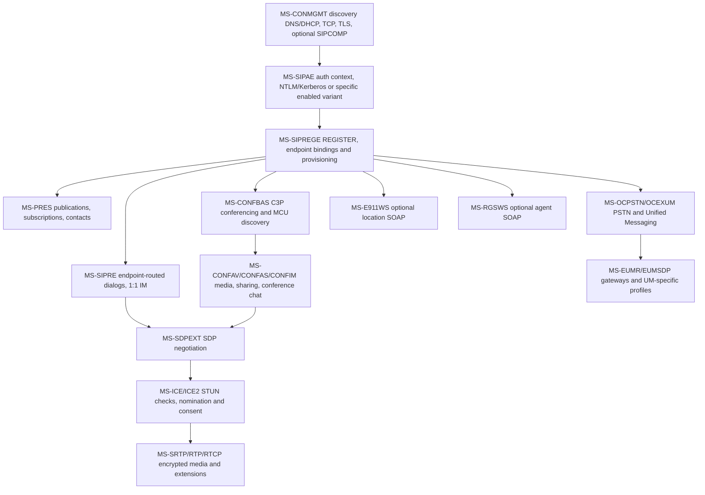
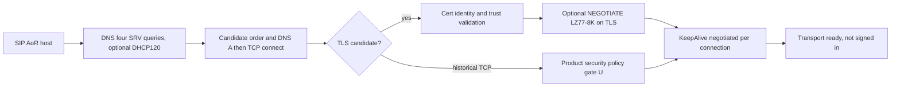
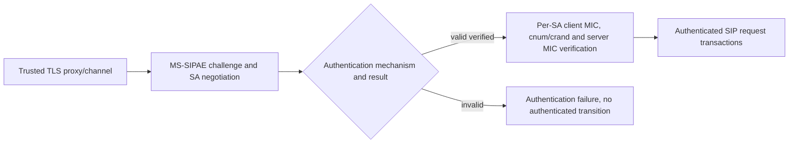
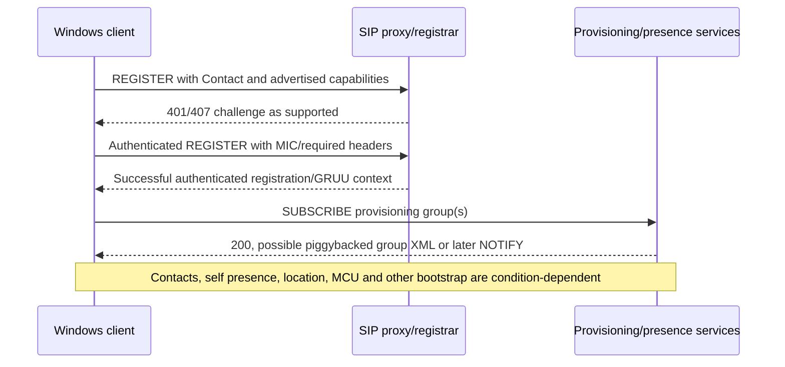
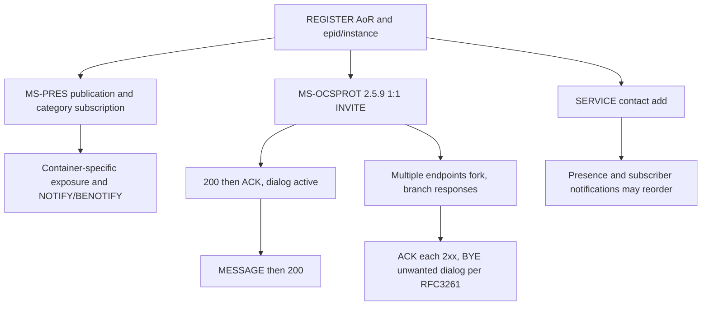
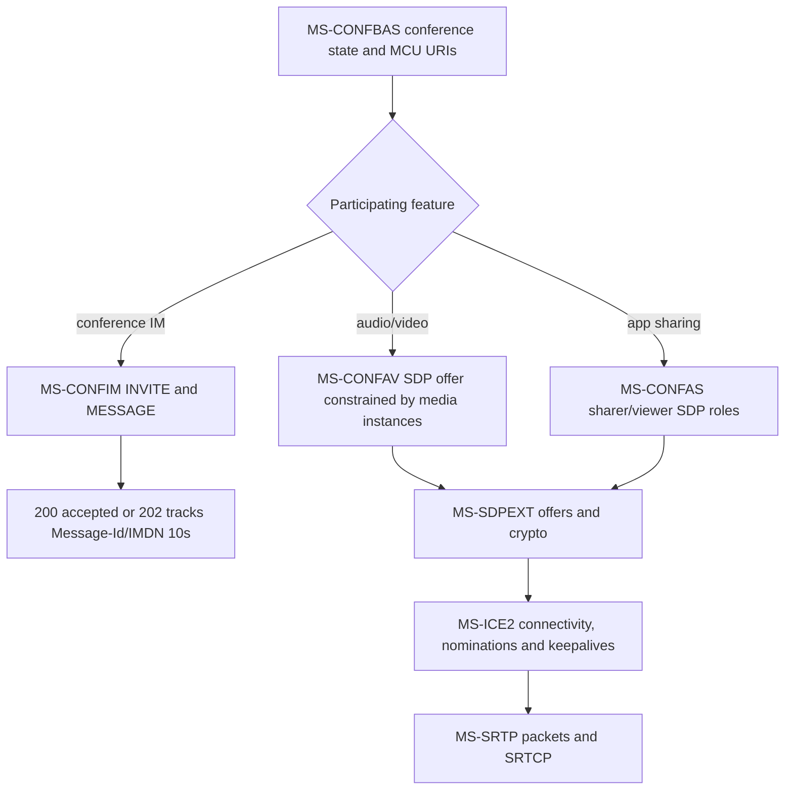
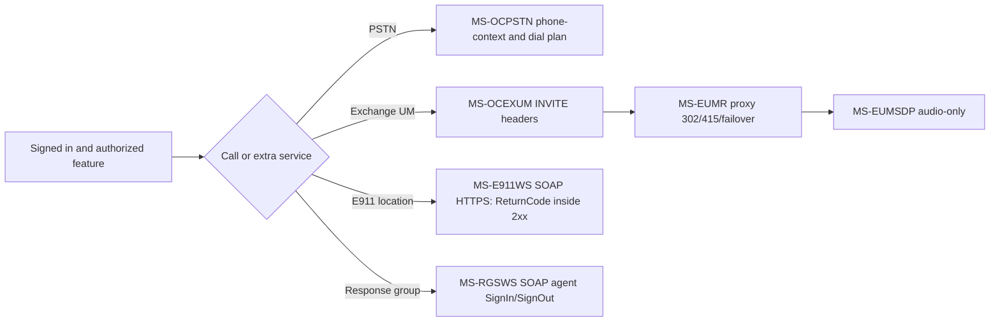
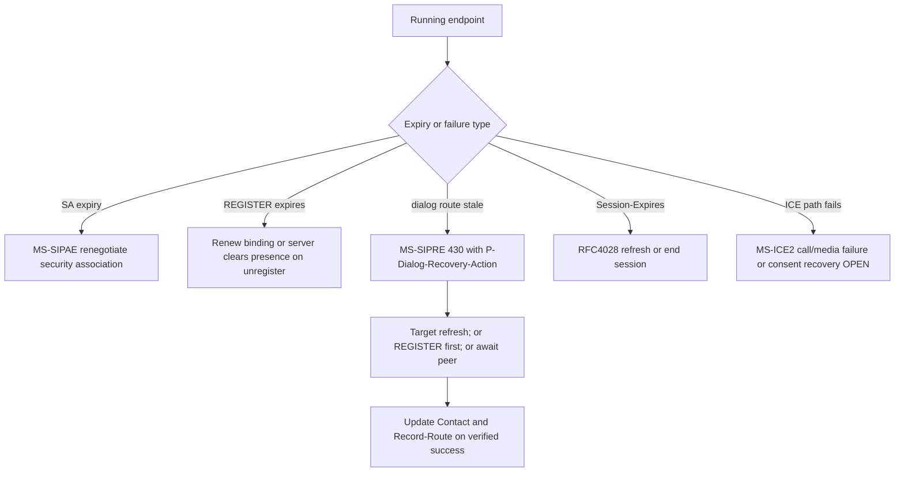

# CommSCraft / classic Skype for Business Windows Full Client — research evidence master index

**Last evidence update: 2026-10-22. Status: INCOMPLETE, implementation gate CLOSED.**
This is a durable entry point for research under draft PR #51, **not** an assertion of complete normative/functional compliance. Its tables explicitly distinguish examined original clauses, reconstructed cross-protocol behavior and unresolved normative gaps. Nothing here authorizes new protocol code, real-server traffic, merges or releases.

## I. Evidence, roles and provenance

**Evidence codes:** `P` = primary Microsoft Open Specification or RFC text directly verified at cited edition/section; `S` = cross-spec synthesis inferred from multiple `P` rules, needing full sequence proof; `U` = unverified or unavailable behavior; `H` = historical/feature-conditional deployment rule. Each rule must be independently assigned a *role* (UAC, UAS, registrar, proxy, MCU, web-service client, web-service server, media peer) and an applicability guard (client version, topology, auth scheme and negotiated extensions). Server MUST ≠ client MUST.

**Corpus boundary:** provided original archive has **150 Microsoft MS-prefixed PDFs** plus one extra FIPS 197 PDF; **54 indexed primaries**, **96 additional PDF editions**, 95 of 96 additional dates extracted, one `MS-SIPRE-2015` historical-edition verification outstanding. The 54-document metadata links **145 different RFC identifiers**, whose updating/obsoleting/normative applicability is not yet independently verified. **All Microsoft references in 54-record metadata exist locally, but reference closure of all 150 original texts is NOT established.** See [primary manifest/reference audit](manifest-reference-closure-version-and-feature-gates-2026-10-22.md) and [150-PDF inventory](complete-150-microsoft-pdf-archive-version-audit-2026-10-22.md). 112 user-provided Markdown assessments are secondary and not automatically trusted as protocol proof.

**Selected directly checked original editions** (not proof of full reading): MS-OCSPROT 9.0 (2025-05-20), MS-CONMGMT 10.0 (2025-05-20), MS-SIPAE 11.0 (2025-05-20), MS-SIPREGE 17.1 (2025-08-19), MS-SIPRE 13.0 (2025-05-20), MS-PRES 13.0 (2025-05-20), MS-SIP 8.0 (2017-06-01), MS-SIPCOMP 10.0 (2025-05-20), MS-CONFIM 11.0, MS-CONFAV 11.0, MS-CONFAS 12.0, MS-SDPEXT 16.0, MS-ICE2 19.0, MS-SRTP 14.0, MS-AVEDGEA 12.0, MS-OCPSTN 11.0, MS-EUMR 9.0, MS-EUMSDP 9.0, MS-OCEXUM 11.0, MS-E911WS 9.0, MS-RGSWS 9.0 (remaining dates 2025-05-20). For source URL, PDF SHA and section references use the ZIP inventory and linked per-protocol research. A date on original PDF is **not proof** that every target Skype for Business build implements every rule.

## II. Layered architecture and constraints

**Graph is a dependency map, not unconditional packet order.** SIP registration does not itself guarantee presence availability, conferencing, media connectivity, browser/response-group provisioning or successful PSTN dialing; ICE is not a general requirement for every text-message transaction. Both `A` and `R` are protocol states rather than global `connected=true` flags.

## III. Seven complete-client workflow research ledgers

### 1. Client startup, discovery and transport

**P:** MS-OCSPROT 9.0 §§2.5.1–2; MS-CONMGMT 10.0 §§3.1.4–3.1.5, 3.2–3.4; MS-SIPCOMP 10.0 §§2.2.3–4, 3.1.5 and 3.2.5; RFC3261/RFC3263/RFC2782/DHCP references still partly open.

**P**: Four SRV service prefixes; candidate order is Microsoft-defined; optional compression negotiation must occur after successful TLS but before other data on that channel; keepalive only when successfully negotiated. **U**: full RFC2782 weight ties, RFC3361 DHCP byte fields, full TLS/SAN/revocation product policy, decompressed MPPC total frame boundaries. See [startup/TLS](ms-conmgmt10-ocsprot9-startup-discovery-tls-keepalive-2026-10-22.md), [compression negotiation](ms-sipcomp10-conmgmt10-negotiation-inactivity-original-2026-10-22.md), [binary SIPCOMP](ms-sipcomp10-binary-frame-flags-receiver-state-2026-10-22.md).

### 2. TLS identity, authentication and signing

**P:** MS-SIPAE 11.0 §3.2.4.1 client 16-position canonical signing input, counter/crand and signature algorithms (NTLM/Kerberos GSS MIC or TLS-DSK-specific HMAC where applicable); client/server security context and replay trust must be verified before marking authenticated. **S**: combine with TLS name proof and REGISTER admission. **U**: every Kerberos/NTLM TLS-DSK scheme product note, PKI/realm, context rollover on proxy migration, cross-hop response MIC requirements. See [client MIC original](ms-sipae-11-direct-pdf-client-signature-and-digest-2026-10-22.md), [SA trust](ms-sipae-cross-section-authentication-trust-state-2026-10-22.md), [bidirectional integrity](ms-sipae-bidirectional-integrity-and-epid-media-2026-10-22.md).

### 3. REGISTER, provisioning and bootstrap

**P:** MS-SIPREGE 17.1 §§2.2.2.4–5, 3.3.1–2, MS-OCSPROT 9.0 §2.5.3; provisioning request and response group element names differ; 200 may carry XML if first-notify piggyback supported. **S:** higher-level bootstrap composition; original overview order expressly not universal. **U:** entire provisioning XML schema, subscription renewal and failure recovery under historical RFC3265 vs modern RFC6665. See [provisioning](ms-siprege-17-original-pdf-provisioning-lifecycle-2026-10-22.md), [client subscribe](ms-siprege-17-client-provisioning-state-rfc3265-2026-10-22.md), [bootstrap](ms-ocsprot9-bootstrap-and-siprege17-piggyback-fork-2026-10-22.md).

### 4. Presence, contacts, personal IM, multi-device

**P:** MS-PRES 13 §§3.2.5.3–5.1 category container priority and metadata privacy; MS-SIP 8 BENOTIFY negotiation; MS-OCSPROT 9 §§2.5.9–11 explicit IM/contact/multi-device examples; MS-SIPRE 13 §§3.2–3.4 endpoint routing, EPID-derived SIP.INSTANCE and GRUU; RFC3261 §13 fork races. **U:** full contact/group XML, typing, all 1:1 MIME variants, endpoint-capability election, unknown client behavior on dual 2xx. See [presence](ms-pres-privacy-container-resolution-benotify-register-2026-10-22.md), [personal messaging](ms-ocsprot9-direct-im-contacts-multidevice-sequences-2026-10-22.md), [routing/identities](ms-sipre13-epid-instance-gruu-routing-original-2026-10-22.md), [fork races](rfc3261-forked-invite-ack-cancel-bye-state-ledger-2026-10-22.md).

### 5. Conference IM, A/V and sharing

**P:** MS-CONFIM 11 §§3.3; MS-CONFAV 11 §3.1.5.2.1; MS-CONFAS 12 §§3.2.5.1.1–6; MS-SDPEXT 16 §3.1.5.1; MS-ICE2 19 §§3.1.6.2–5; MS-SRTP 14 §§3.1.5.1–2. **S:** media progression across services and conference control. **U:** complete C3P schemas, conference joining failures, exact sharing RDP data channel, codec matrices, ICE1↔ICE2 and older-client media policies. See [conference IM](ms-confim-pres-registration-lifecycle-cross-spec-2026-10-22.md), [media matrix](media-sdpext-ice2-confav-srtp-avedgea-original-pdf-2026-10-22.md), [app sharing](ms-sipre-dlx-confas-original-source-cross-analysis-2026-10-22.md).

### 6. PSTN, voicemail, location services and response-group agents

**P:** Six 2025 original specs each verified at selected clauses (not whole documents); role- and error-qualified ledger in [PSTN/E911/UM original cross-analysis](ms-ocpstn-eumr-eumsdp-ocexum-e911ws-rgsws-cross-spec-2026-10-22.md). **U:** emergency-calling routing itself, full location verification/UI, PSTN codec fallback, agent authorization and product-specific feature presence. **Important:** E911 web lookup success is not proof that an emergency call is correctly placed or routed.

### 7. Signout, transport failure, registration expiration and recovery

**P:** MS-SIPRE 13 §3.7, MS-SIPAE 11 §3.2.6, MS-PRES 13 §§3.2.5.5–5.1, MS-SIPREGE 17.1, RFC4028, MS-ICE2. **S:** concurrent independent timeouts; never collapse to a single reconnect state. **U:** accurate simultaneous expiry order, transport certificate/key changes and media reconnect, correct retry limits across branches and complete signout semantics. See [dialog recovery](ms-sipre13-dialog-recovery-430-flow-failed-2026-10-22.md) and [multiple lifetimes](rfc4028-ms-sipre-siprege-sipae-multilifecycle-recovery-2026-10-22.md).

## IV. Full-client requirement gate matrix (research status only)

| Feature gate | Evidence level | Deep-source proof still required |
|---|---|---|
| Server discovery / DNS / DHCP | P partial | All error/resolver and product policy branches |
| TLS/PKI and proxy name identity | P partial | Names/SAN, trust, revocation, modern TLS vs historical profile |
| SIP compression | P partial | Full MPPC bitstream, frame delimiting, malformed packet recovery |
| Keepalive/transport reconnect | P partial | Expiry, proxy migration, exact SIP keepalive bytes |
| Kerberos/NTLM/TLS-DSK | P partial | All authenticated handshake branches and target profiles |
| Per-request/response MIC and replay | P partial | All schemes, error recovery, concurrent SAs |
| REGISTER, GRUU, EPID, SIP.INSTANCE | P partial | Expiration races and full wire property cases |
| Provisioning and bootstrap | P partial | All service groups, XML, subscriptions, policy matrix |
| Presence/category containers | P partial | All category schemas, privacy and federation |
| Contact lists/search/roaming | P partial | MS-ABS/MS-DLX all WSDL/errors and MS-PRES contact XML |
| 1:1 text / forked dialogs | P high-level | Detailed SDP, MIME, receipts, SIP dialog errors |
| Conference IM | P partial | IMDN XML, lifecycle, conference role errors |
| Peer audio/video | P partial | Codec, hold/reinvite, full SDP/ICE/MS-SRTP packet profile |
| App/desktop sharing | P partial | MS-RDPBCGR/MS-RDPEMC streaming and ASMCU state |
| PSTN/voicemail/UM | P partial | More MS-OCPSTN/OCEXUM/EUMR and dialplan security |
| E911/emergency calling | P for SOAP only | Emergency call placement/routing, geolocation rules |
| Response group agent controls | P SOAP operations | Client deployment and agent status behavior |
| Graceful signout/unregister | P partial | Full teardown ordering across presence/media/service |
| Network loss, dialog/SA recovery | P partial | All timers/races, product-specific fallback and security |
| Client telemetry/QoE/error reporting | U or references only | MS-QoE, MS-OCER original end-to-end data flow |

**Research completion conditions:** (1) every relevant original document's edition, URL, hash, RFC/MS references and client applicability; (2) section-level normative verification including negative/error and timers, security and conformance examples; (3) each wire format and state diagram independently proof-linked; (4) conflict/obsolescence and product behavior matrix resolved or explicitly stated as blocking; (5) owner reviews proof completeness. **A detailed implementation plan is not produced until this research gate is closed.**

## V. Source conflicts and high-risk assumptions to avoid

1. `MS-SIP` supplied edition **2017** while many other PDF editions are **2025/2026**. Do not assume same feature matrix or full update compatibility.
2. RFC3265 references in Microsoft 2025 PDF vs obsoleting RFC6665: deployment/edition applicability open.
3. RFC5246/TLS 1.2, RFC4346/TLS 1.1 and historically 'SSL' wording in service specs: not an authorization for obsolete crypto.
4. Historic ICE RFC5245 vs RFC8445 and Microsoft ICE/ICE2: don't force modern candidate and consent semantics onto a legacy negotiated variant.
5. RFC3428 direct MESSAGE has no *intrinsic* dialog but Microsoft's MS-OCSPROT §2.5.9 IM example uses separately established INVITE dialog. Both true.
6. Microsoft conference-specific 202/IMDN/Message-Id/timer ≠ automatic personal-IM requirement.
7. REGISTER binding vs authenticated SA vs session refresh vs routable dialog vs ICE consent all have separate timers and fail conditions.
8. SIP gateway/proxy/UM-server-only MUSTs should not become Windows UAC MUSTs.
9. Historical PDF is present ≠ required Windows feature ≠ analyzed ≠ current recommended security behavior.
10. An error in SOAP `ReturnCode` or SIP route negotiation may occur despite HTTP 2xx / SIP 200 on a different layer; never flatten status meanings.

## VI. Repo source traceability and research-only delivery

Additional published research under `docs/` includes:
- [Corpus intake / SHA validation](uploaded-specification-corpus-intake-2026-10-22.md)
- [MS-OCSPROT SIP reference list](ms-ocsprot-sip-protocol-reference-catalog-2026-10-22.md)
- [RFC3261 REGISTER / transaction ledger](rfc3261-uac-registration-transaction-clause-ledger-2026-10-22.md)
- [MS-SIPAE challenge flow](ms-sipae-challenge-state-machine-research-2026-10-22.md)
- [Unregistration](ms-siprege-unregistration-wire-and-security-analysis-2026-10-22.md)
- [MS-CONMGMT presence linkage](ms-conmgmt-presence-cross-spec-research-2026-10-22.md)
- [MS-SIP BENOTIFY](ms-pres-privacy-container-resolution-benotify-register-2026-10-22.md)
- [RFC3428/RFC8591 boundaries](direct-and-conference-im-rfc3428-8591-profile-boundaries-2026-10-22.md)

## VII. 2026-10-22 contacts/directory evidence expansion (new primary-clause audit)

This subsection **supersedes the earlier generic 'contacts partially checked' description with concrete proof**, but does NOT close the Windows Full Client contact requirement gate.

- [MS-ABS 10.1 original binary address-book audit](ms-abs10-original-binary-book-delta-compression-and-rnl-2026-10-22.md): `v20250819`, §§1.3, 2.1.1, 2.2.1–16, 5.1–5.3 and product notes; 13 role/data-qualified findings. HTTP GET from provisioned ABS URL, little-endian full/delta/compact formats, block CRC32, 12-byte headers, two-byte base/full file hash, local normalization, compact-delta missing-vs-deleted attribute behavior, device-only .dabs distinction. **One original PDF page was visually rendered and checked** for endian/product notes.
- [MS-PRES 13.0 / MS-DLX 13.0 original presence-and-directory audit](ms-pres13-dlx13-batch-presence-directory-contacts-2026-10-22.md): `v20250520` sections MS-PRES §§2.2.2.4.1–3, 3.4.5.1.1–3.4.5.2, 3.6.5.1 and MS-DLX §§2.1, 2.2.5.1, 3.1.4.1.3–4. **23 source- and role-qualified rules**: batch vs single SUBSCRIBE, poll vs persistent, accepted/rejected resources in 200 multipart RLMI, re-subscribe/pool GRUU, private category exclusion, BENOTIFY, SOAP response group status, Users/NestedGroups, nested results and independent authorization failures. Linked MS-OCSPROT 9.0 §§2.5.7,2.5.10.
- **Evidence distinction:** local Microsoft Address Book AD `objectGUID` ≠ user-contact-roster membership ≠ MS-SIPRE `epid`/SIP.INSTANCE/GRUU. Cached offline address-book `HTTP GET` ≠ SOAP distribution-list expansion ≠ persistent SIP category subscription. This is crucial to avoid sharing authorization and expiry state improperly.
- **Blocking new questions:** full MS-PRES roster-creation SERVICE XML, 200 response with partial RLMI rejection and real-client handling, DLX WSDL authentication and nested-group traversal, historical vs current TLS for HTTPS, exact MS-ABS .dabs and compact delta product notes, all remaining original-source RFC and schema references.

**Research gate remains OPEN.** These links document the source sections actually checked; not proof of complete specifications or sufficient implementation planning.

### RFC event-notification editions: dedicated primary-series analysis

- [RFC 3265 → RFC 6665 → RFC 7621 normative edition reconciliation](rfc3265-6665-7621-event-subscription-edition-reconciliation-2026-10-22.md): 12 direct RFC Editor checks: RFC6665 obsoletes 3265, modifies event-dialog creation and Timer N (`64*T1`), no 202 for SUBSCRIBE/NOTIFY, RFC7621 clarifies GRUU for notifier/dialogs. The Microsoft's 2017/2025/2025 documents still refer to RFC3265; exact behavior per Windows-client edition and `ms-piggyback-first-notify` / `ms-benotify` remains an **explicit blocking compatibility gate**.

## VIII. 2026-10-22 conference control foundation: provisioning, focus dialogs, roster and media events

**Edition-and-section qualified original research** (not complete conferencing):

- [Focus Factory provisioning MS-CONFPRO 13.0, May 2025](ms-confpro13-focus-factory-c3p-provisioning-version-key-2026-10-22.md): **17** original requirements across §§2.1–2.2.3,3.1–3.2: SERVICE with UTF-8 `application/cccp+xml`, requestId correlation, organizer/delegate identities, 32-second ORQ Request Timer, addConference/static/modify version and conflict, deletion, capability probe, `getConference` encrypted conference key and role-qualified server authorization.
- [Conference Focus MS-CONFBAS 15.0 and XML media control MS-XMLMC 10.0, May 2025](ms-confbas15-xmlmc10-focus-lobby-roster-video-control-2026-10-22.md): separate Focus INVITE/C3P `addUser` and endorsements, BYE/UPDATE, multiple endpoints, optional MCU bootstrap failure (conference remains activated), admission/lobby privacy, first-full roster 32s and RFC4575 partial version state, MCU URI discovery and distinct XML picture_freeze over INFO. Additional **asynchronous C3P INFO** state machine: 202 Accepted is provisional *command processing*, later C3P success/failure arrives in INFO or direct 200; requestId/pending timer initially 32 seconds, extended 180 seconds on pending, Focus timer 28 seconds. **Do not confuse** with provisioning SERVICE or MS-CONFIM MESSAGE 202/IMDN.
- Original RFC Editor source: [RFC4575](https://www.rfc-editor.org/rfc/rfc4575) §4.6 (full/partial/deleted and version gap refresh), [RFC4353](https://www.rfc-editor.org/rfc/rfc4353) architecture, [RFC6086](https://www.rfc-editor.org/rfc/rfc6086) (2011 obsoletes RFC2976 but explicitly preserves legacy INFO). Microsoft 2025 references RFC2976/3265, so the **correct Windows-client edition profile and supported INFO/event extensions remain open**.

**Additional feature gate:** `conference reservation` ≠ `focus signaling dialog` ≠ `focus conference subscription` ≠ `MCU media dialog`. Model organizer/delegate/presenter/attendee/lobby, per endpoint roster state and per-MCU availability separately, and do not expose conference keys/web URLs through ordinary conference-info notifications. The master feature 'conference IM/A/V/sharing' remains **P partial** rather than complete: full C3P command schemas, independent MCU protocol, event package versions, legacy auth, all errors and end-to-end media failure states still block planning.

## IX. 2026-10-22 original media transport, consent and crypto contradiction review

**New original clause-level studies** expand media coverage (not complete RFC conformance):

- [MS-ICE2 19.0 ICE/consent ledger](ms-ice2-19-original-checks-nomination-consent-rfc-profile-2026-10-22.md): original May 2025 §§3.1.2,3.1.4,3.1.5.2–3,3.1.6.1–5; **17** scoped requirements for UDP/TCP modes, candidates, ICE provisional fork handling, 20-provisional/80-pair resource bounds, timeout/reset, integrity, regular nomination, 19s keepalive, STUN consent freshness at 5s/30s and strict response validation. Modern RFC8445/8839/7675/8489 explicitly **not equivalent** to Microsoft legacy draft profile.
- [MS-SDPEXT 16.0 + MS-SRTP 14.0 + MS-AVEDGEA 12.0 security ledger](ms-sdpext16-srtp14-avedgea12-security-negotiation-conflict-2026-10-22.md): original May 2025 crypto field constraints, AVP/SAVP optional security, early media and non-reINVITE renegotiation, SRTP contexts and replay windows, Edge SIP SERVICE token issue and per-credential errors.
- [MS-TURN 21.0 relay allocation challenge ledger](ms-turn21-original-allocation-401-relay-legacy-rfc-2026-10-22.md): original May 2025 allocation challenge/retry, MS-Version/IPv4/IPv6/multiplex, authenticated responses, fixed 650ms nine-attempt recommendation, distinction from SIP REGISTER and ICE consent; modern RFC8656 cannot replace legacy TURN draft-specific packets.

**BLOCKING SECURITY DISAGREEMENT CRYPTO-01 (two independently verified original primary clauses, also confirmed in Microsoft Learn's May 2025 pages):** MS-SDPEXT §3.1.5.1 requires suite `AES_CM_128_HMAC_SHA1_80`, whereas MS-SRTP §3.1.3.3.2 requires **HMAC-SHA-256** with 80-bit tag. These names do **not** unambiguously designate one hash. Do not implement or resolve by assumption: check Microsoft errata and product notes, MS-SSRTP and RFC3711/4568 precise contexts. Profile/edition trust gate stays **OPEN**.

**Media state plane boundaries:** SIP registration + per-hop TLS + SIPAE MIC, A/V Edge credential token, TURN relay allocation, ICE candidate/check state, ICE consent, SDP SRTP security agreement and per-direction/SSRC SRTP replay contexts are **independent**. Successful SIP 200, TURN Allocate, or ICE connectivity does **not** alone prove secure RTP can begin. Microsoft may allow optional unencrypted media in a historical profile; this is **not** a present-day safety recommendation.

**Next blockers:** obtain IETFDRAFT-ICENAT-19/STUN-02/TURN-08/ICETCP-07 originals; validate MS-ICE vs MS-ICE2 / RTCP mux / full ICE-state matrix; MS-TURN byte serialization and nonce/auth; MS-SSRTP; RFC4568/3711 suite contradiction errata; MS-CONFAV full MCU media SDP; product-specific time/version gates and network-loss recovery. **No code until full research.**

Research lives on `security/offline-register-mic-bridge-20261021` in draft PR #51. **No protocol implementation or owner live-server interoperability tests by assistant; no merge/release. Global research status: NOT COMPLETE.**
